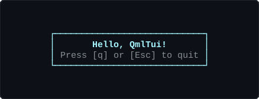

<p align="center">
  <picture>
    <source media="(prefers-color-scheme: dark)" srcset="docs/assets/branding/qmltui_lockup_dark.svg">
    
  </picture>
</p>

**QmlTui** is a retained-mode terminal UI framework for C++17 and Qt 6.8+. Applications declare layouts, borders, focus chains, and states in QML and bind them to C++ `QObject`s and `QAbstractItemModel`s. `QmlTui` renders the scene into a double-buffered character-cell grid (`TextGridBuffer`), diffs against the previous frame, and writes only the changed cells and SGR attributes to the terminal—without depending on `QtQuick` or a display server.


## Overview

- **Retained cell scene graph**: Items (`Rectangle`, `Row`, `Column`, `GridLayout`, `Text`, `ListView`, `TableView`, `TreeView`) live in a persistent C++ item tree. Property bindings mark only the affected subtrees dirty.
- **Qt models and C++ integration**: Expose C++ types with `QML_ELEMENT` and drive virtualized views (`ListView`, `TableView`, `TreeView`, `GridView`) from `QAbstractItemModel` or `QSortFilterProxyModel`. Only visible rows are instantiated.
- **Modular QML imports**: `import QmlTui` (`qmltui::core`) provides the terminal window, layout engine, text inputs, data views, `Canvas`, and animations using only `Qt6::Core` and `Qt6::Qml`. Companion modules add controls (`QmlTui.Controls`), terminal images (`QmlTui.Image`), and embedded Unix PTYs (`QmlTui.PtyView`).
- **Alternate-screen and inline modes**: Run full-screen applications (`Terminal.AltScreen`) or inline CLI sessions (`Terminal.Inline`) that append completed output to native terminal history through `Scrollback`.
- **Terminal protocol support**: Automatic detection for DEC mode 2026 synchronized output, Kitty keyboard protocol, SGR mouse reporting, bracketed paste, Kitty and Sixel graphics (with Unicode half-block fallback), and OSC 8 hyperlinks.
- **Headless testing and recording**: Drive applications deterministically with `qmltui::Runner`, assert committed text and style snapshots in CTest, or record Asciinema v2 `.cast` files without a live TTY.

## Hello, World!

A minimal application using `import QtQml` and `import QmlTui`:

```qml
import QtQml
import QmlTui

Terminal {
    Keys.onPressed: event => {
        if (event.key === Qt.Key_Q || event.key === Qt.Key_Escape) {
            Qt.quit();
            event.accepted = true;
        }
    }

    Rectangle {
        anchors.centerIn: parent
        width: 30
        height: 4
        border {
            style: Border.Rounded
            color: "cyan"
        }

        Column {
            anchors.centerIn: parent

            Text {
                anchors.horizontalCenter: parent.horizontalCenter
                text: "Hello, QmlTui!"
                color: "cyan"
                bold: true
            }
            Text {
                text: "Press [q] or [Esc] to quit"
                dim: true
            }
        }
    }
}
```

Rendered in the terminal:



## Quickstart

### Build and Run the Gallery

Requires CMake 3.21+ and Qt 6.8+ (`Core` and `Qml`, plus `Gui` and `Network` when `QMLTUI_ENABLE_IMAGE=ON`):

```sh
cmake -S . -B build -DQMLTUI_BUILD_EXAMPLES=ON
cmake --build build --target qmltui_gallery
./build/examples/gallery/qmltui_gallery
```

You can also open the [WebAssembly Playground](docs/playground.md) in a browser (see the [WebAssembly build guide](docs/guides/webassembly.md)).

### Standalone Application

See [Getting Started](docs/getting-started.md) or copy [`examples/quickstart/`](examples/quickstart/) for a 3-file (`CMakeLists.txt`, `main.cpp`, `Main.qml`) project using CMake `FetchContent` or `find_package(QmlTui)`.

## Documentation

- **[Getting started](docs/getting-started.md)**: Requirements, standalone setup (`FetchContent` and `find_package(QmlTui)`), CMake options, and environment variables.
- **[Interactive playground](docs/playground.md)**: Inspect, edit, and run the gallery components in the browser.
- **[Guides](docs/guides/index.md)**: Architecture, layouts, input and focus, models and views, styling, animations and states, inline mode, `PtyView`, custom C++ items, testing with `Runner`, and Qt Quick differences.
- **[Examples and recipes](docs/examples.md)**: Gallery demos and copyable QML/C++ recipes (see [`examples/README.md`](examples/README.md) and standalone applications in [qmltui-dev/qmltui-apps](https://github.com/qmltui-dev/qmltui-apps)).
- **[QML types reference](docs/qml-types/index.md)**: API reference for `QmlTui`, `QmlTui.Controls`, `QmlTui.Image`, and `QmlTui.PtyView`.
- **[C++ classes reference](docs/cpp-classes/index.md)**: Public C++ APIs for `Item`, `Terminal`, `TextGridBuffer`, `Cell`, `Color`, `PtyView`, and `Runner`.
- **[Changelog](docs/changes/changelog.md)**: Release history and migration notes.

## License

QmlTui is available under **LGPL-3.0-only OR GPL-3.0-only**. Examples and the
starter template are **BSD-3-Clause**; documentation is **CC-BY-4.0**. See
[LICENSE.md](LICENSE.md).

Separate commercial terms are available upon inquiry for organizations unable
to meet those obligations. Contact through the project repository at
<https://github.com/qmltui-dev/qmltui>.

QmlTui is an independent project and not a product of The Qt Company. Qt and
third-party dependencies remain subject to their own licenses.
