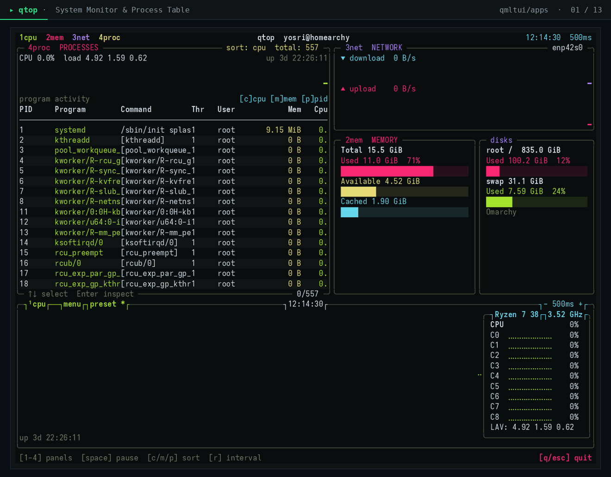

<p align="center">
  <picture>
    <source media="(prefers-color-scheme: dark)" srcset="docs/assets/branding/qmltui_lockup_dark.svg">
    
  </picture>
</p>

<p align="center">
  <a href="https://github.com/qmltui/qmltui/actions/workflows/ci.yml"></a>
  <a href="https://github.com/qmltui/qmltui/blob/badges/summary.md"></a>
</p>

<h3 align="center">Retained-Mode QML for the Terminal</h3>

<p align="center">
  Build reactive terminal UIs with QML property bindings and C++17 models on <code>QCoreApplication</code>.<br>
  <strong>Depends only on <code>Qt6::Core</code> and <code>Qt6::Qml</code></strong> — no <code>QtGui</code>, no <code>QtQuick</code>, and no display server.
</p>

<p align="center">
  <a href="https://qmltui.github.io/"><strong>Documentation</strong></a> ·
  <a href="https://qmltui.github.io/playground.html"><strong>Live Playground (Wasm)</strong></a> ·
  <a href="https://qmltui.github.io/playground.html?mode=gallery"><strong>Component Gallery</strong></a> ·
  <a href="https://qmltui.github.io/showcase.html"><strong>App Showcase</strong></a>
</p>



<p align="center">
  <sub>Featured in <a href="https://github.com/qmltui/apps"><strong>qmltui/apps</strong></a>:
  <a href="https://github.com/qmltui/apps/tree/main/apps/agent_stream">agent_stream</a> ·
  <a href="https://github.com/qmltui/apps/tree/main/apps/qtop">qtop</a> ·
  <a href="https://github.com/qmltui/apps/tree/main/apps/container_fleet">container_fleet</a> ·
  <a href="https://github.com/qmltui/apps/tree/main/apps/file_manager">file_manager</a> ·
  <a href="https://github.com/qmltui/apps/tree/main/apps/industrial_plc_hmi">industrial_plc_hmi</a> ·
  <a href="https://github.com/qmltui/apps/tree/main/apps/turbo_hex">turbo_hex</a> ·
  <a href="https://github.com/qmltui/apps/tree/main/apps/audio_player">audio_player</a> ·
  <a href="docs/examples.md#showcase-applications-qmltuiapps">all 13 apps →</a></sub>
</p>

## Why QmlTui?

- **Headless Qt (`Qt6::Core` + `Qt6::Qml` only)**: Runs Qt's QML engine (`QQmlApplicationEngine`, property bindings, signals/slots, `QML_ELEMENT`) directly on `QCoreApplication` with zero `QtGui` or window-system dependencies—ideal for SSH sessions, containers, Linux, macOS, Windows, and WebAssembly (`xterm.js`).
- **Retained-Mode Cell Scene Graph**: Declare layouts, box-drawing borders, focus chains, `State`s, `Transition`s, and `Behavior` animations in QML. Property changes mark only affected subtrees dirty, paint into a double-buffered 24-byte [`Cell`](docs/cpp-classes/cell.md) grid, and emit minimal synchronized ANSI/SGR diffs.
- **Full-Screen (`AltScreen`) & Scrollback (`Inline`) Modes**: Build full-viewport applications (`Terminal.AltScreen`) or interactive CLI and coding-agent sessions (`Terminal.Inline` + [`Scrollback`](docs/qml-types/scrollback.md)) that commit output directly to native terminal scrollback.
- **Shared C++ & Python Models**: Drive virtualized `ListView`, `TableView`, `TreeView`, and `GridView` components from `QAbstractItemModel` and `QSortFilterProxyModel` in C++, or host QmlTui from Python via [`PySide6`](examples/recipes/pyside6/) without custom C++ bindings.
- **Controls, Sub-Cell Plotting & Embedded PTYs**: Includes [`QmlTui.Controls`](docs/qml-types/index.md) (`Button`, `Panel`, `Dialog`, `TabBar`, `Slider`, `Sparkline`, and more), sub-cell Braille/block [`Canvas`](docs/qml-types/canvas.md) drawing, plus opt-in Kitty/Sixel/half-block [`Image`](docs/qml-types/image.md) rendering and Unix [`PtyView`](docs/guides/pty-view.md) shells.
- **Headless Testing & Agentic Loop**: Link [`QmlTui::Runner`](docs/cpp-classes/runner.md) under `BUILD_TESTING` to drive input deterministically on a virtual clock, assert UTF-8 frames and SGR styles in CTest, audit idle repaint budgets, and record `.cast` demos without a PTY.

## Hello, World!

A QmlTui application is an ordinary headless `QCoreApplication` loading a root [`Terminal`](docs/qml-types/terminal.md) item (from [`examples/helloworld/`](examples/helloworld/)):

```cpp
// main.cpp — links only Qt6::Core, Qt6::Qml, and QmlTui::Core
#include <QCoreApplication>
#include <QQmlApplicationEngine>

int main(int argc, char* argv[]) {
    QCoreApplication app(argc, argv);
    QQmlApplicationEngine engine;
    engine.loadFromModule("HelloQmlTui", "Main");
    if (engine.rootObjects().isEmpty()) {
        return -1;
    }
    return app.exec();
}
```

```qml
// Main.qml
pragma ComponentBehavior: Bound
import QtQml
import QmlTui

Terminal {
    id: root
    property int count: 0

    title: count === 0 ? "Hello QmlTui!" : "Interactions: " + root.count
    color: "#0d1117"

    Keys.onPressed: event => {
        if (event.key === Qt.Key_Escape || event.key === Qt.Key_Q) {
            event.accepted = true;
            console.log("Goodbye!");
            Qt.quit();
        } else if (event.key === Qt.Key_Enter || event.key === Qt.Key_Return) {
            event.accepted = true;
            root.count++;
        } else if (event.key === Qt.Key_R) {
            event.accepted = true;
            root.count = 0;
        }
    }

    Rectangle {
        anchors.centerIn: parent
        width: 52
        height: 11
        border {
            style: Border.Single
            color: "#2cde85"
        }

        Column {
            anchors.centerIn: parent
            spacing: 1

            Text {
                text: "Hello, QmlTui!"
                color: "#00ff66"
                bold: true
            }

            Text {
                text: "QML Declarative terminal UIs"
                color: "#2cde85"
                dim: true
            }

            Text {
                text: "Interactions: " + root.count
                color: "#c9d1d9"
            }

            Text {
                text: "[Enter] Count  •  [R] Reset  •  [Q] Quit"
                color: "#8b949e"
                dim: true
            }
        }
    }
}
```

## Quickstart

To build locally, install **CMake 3.21+**, a **C++17** compiler, and **Qt 6.8+** with **`Core` and `Qml`** (tested across Qt 6.8 through 6.12):

```sh
cmake -S . -B build -G Ninja -DQMLTUI_BUILD_EXAMPLES=ON
cmake --build build --target qmltui_gallery
./build/examples/gallery/qmltui_gallery
```


### Start Your Own Project

- **Standalone C++ / CMake (`FetchContent` or `find_package(QmlTui)`)**: Follow the 3-file [Getting Started tutorial](docs/getting-started.md) or copy [`examples/helloworld/`](examples/helloworld/).
- **Python (`PySide6`)**: Host `QmlTui` and `QmlTui.Controls` directly on `QCoreApplication` without custom C++ bindings—see [`examples/recipes/pyside6/`](examples/recipes/pyside6/).
- **WebAssembly (`xterm.js`)**: Cross-compile with Qt for WebAssembly (`wasm_singlethread`) and `qmltui_wasm_app()`—see the [WebAssembly guide](docs/guides/webassembly.md) or try QmlTui in your browser in the [Live Playground](https://qmltui.github.io/playground.html).

## QML Modules and CMake Targets

`QmlTui::Core` and `QmlTui::Controls` require only **`Qt6::Core`** and **`Qt6::Qml`** (pinned `utf8proc` is fetched automatically via `FetchContent`, or linked from the system with `-DQMLTUI_USE_SYSTEM_UTF8PROC=ON`). **`Qt6::Gui` is never linked** unless you explicitly opt into `QmlTui::Image`:

| QML Import | CMake Target | Default | Dependencies | Summary |
| :--- | :--- | :--- | :--- | :--- |
| `import QmlTui` | `QmlTui::Core` | `ON` | `Qt6::Core`, `Qt6::Qml`, `utf8proc` | `Terminal` (`AltScreen`/`Inline`), `Scrollback`, `Item`, `Popup`, `Rectangle`, `Text`, `TextInput`, `TextArea`, layouts, virtualized views, `Canvas`, input, states, animations |
| `import QmlTui.Controls` | `QmlTui::Controls` | `ON` | `QmlTui::Core` | `Button`, `CheckBox`, `RadioButton`, `ComboBox`, `SpinBox`, `Slider`, `ProgressBar`, `BusyIndicator`, `Sparkline`, `TabBar`, `StackView`, `Panel`, `Dialog`, `ToolTip` |
| `import QmlTui.Image` | `QmlTui::Image` | `OFF` | `QmlTui::Core`, `Qt6::Gui`, `Qt6::Network` | `Image` and `AnimatedSprite` via Kitty, Sixel, or Unicode half-blocks (`-DQMLTUI_ENABLE_IMAGE=ON`) |
| `import QmlTui.PtyView` | `QmlTui::PtyView` | `OFF` | `QmlTui::Core`, `libvterm` | Embedded Unix pseudo-terminal (`PtyView`) on Linux and macOS (`-DQMLTUI_ENABLE_PTYVIEW=ON`) |
| *(C++ / CLI)* | `QmlTui::Runner` | `BUILD_TESTING` | `QmlTui::Core` | Headless scenario driver ([`qmltui::Runner`](docs/cpp-classes/runner.md) and `qmltui-runner`) with virtual clock, snapshots, style/paint audits, and `.cast` recording |

See [Build Configuration and Installation](docs/build-configuration.md) for `FetchContent`, `find_package(QmlTui)`, CMake options, and environment variables.

### Official Add-on Modules

| QML Import | Repository & Target | License | Summary |
| :--- | :--- | :--- | :--- |
| `import QmlTui.TVision` | [`qmltui/tvision`](https://github.com/qmltui/tvision) (`QmlTui::TVision`) | `BSD-3-Clause` | Borland Turbo Vision-inspired Multi-Document Interface (MDI) windowing (`TvDesktop`, `TvWindow`, `TvMenuBar`, `TvDialog`, `TvButton`, `TvStatusLine`), per-file `TvPalette` themes, and `TvDropShadow` (showcased in [`turbo_hex`](https://github.com/qmltui/apps/tree/main/apps/turbo_hex)) |

## Headless Testing

Link `QmlTui::Runner` under `BUILD_TESTING` to drive your unmodified executable headlessly on `QCoreApplication`—sweeping viewports with 0-based `(x, y)` rulers, inspecting `#RRGGBBAA` / SGR styles, stepping animations on a virtual clock, checking idle repaint budgets, and recording deterministic `.cast` replays:

```sh
./build/tools/qmltui-runner/qmltui-runner --clock virtual --sweep --idle-ms 300 --ruler --styled \
  -- ./build/examples/helloworld/hello_qmltui
```

See [Testing with Runner](docs/guides/testing.md) and [Agentic Development Loop](docs/guides/agentic-development.md).

## Performance and Memory

- **24-byte value-type `Cell`**: [`Cell`](docs/cpp-classes/cell.md) stores UTF-8 grapheme clusters up to 11 bytes inline without per-cell heap allocation. Consecutive `TextGridBuffer` frames are diffed cell by cell and emitted inside DEC mode 2026 synchronized output blocks.
- **Sub-millisecond view updates**: On an 80×24 viewport backed by a 100,000-row C++ `QAbstractListModel` (Release `-O3`, `pragma ComponentBehavior: Bound`), idle layout/paint completes in **< 30 µs** (**0 diff bytes**), single-row `dataChanged` repaints take **6.2–22.2 µs**, and 1-row virtualized scroll steps take **8.7–34.3 µs** across `ListView`, `TreeView`, `TableView`, and `GridView`. See [View Benchmark Comparison](docs/contributing/benchmarks/2026-10-27-view-comparison.md) and [0.4 Acceptance Benchmarks](docs/contributing/benchmarks/0.4-acceptance/README.md).

## Platform Support and Design Notes

- **Supported platforms**: Linux, macOS, Windows (Windows Terminal and modern ConPTY sessions; legacy `conhost.exe` is not targeted), and WebAssembly (`xterm.js`). `QmlTui.PtyView` uses `forkpty` and `libvterm` and is supported on Linux and macOS only.
- **Integer character-cell geometry**: Coordinates and dimensions (`x`, `y`, `width`, `height`, margins, padding, spacing) are integer character cells; `Canvas` and `Image` draw sub-cell patterns inside those cell bounds.
- **Explicit keyboard quit path**: Raw-mode terminals have no window close button, and `TextInput`/`TextArea` bind `Ctrl+C` to copy. Applications must provide an explicit exit handler (such as `Q` or contextual `Escape` on the root `Terminal`).
- **Runtime capability probing**: [`TerminalCapabilities`](docs/qml-types/terminalcapabilities.md) probes DEC mode 2026, Kitty keyboard, SGR mouse, Kitty/Sixel graphics, and OSC 52 clipboard at startup and degrades cleanly when unsupported.
- **Flat views vs. trees**: `ListView`, `TableView`, `GridView`, and `Repeater` display one model level (`rootIndex` selects a subtree); multi-level hierarchies use `TreeView`.
- **Optional `Qt6::QmlPrivate` ABI**: `QMLTUI_ENABLE_PRIVATE_QT=ON` (default when private headers are installed) links `Qt6::QmlPrivate` to enable `Behavior` and direct-assignment `PropertyChanges`, coupling shared binaries to that `Qt 6.x` minor release. Pass `-DQMLTUI_ENABLE_PRIVATE_QT=OFF` for public-Qt-only builds (`Qt6::Core` + `Qt6::Qml` only) with binary compatibility across Qt 6 minor versions.

## Documentation

- **[Getting Started](docs/getting-started.md)** · **[Build & CMake](docs/build-configuration.md)** · **[Architecture](docs/guides/architecture.md)** · **[Editor Setup](docs/guides/editor-setup.md)**
- **[Guides](docs/guides/index.md)** · **[Inline Mode](docs/guides/inline-mode.md)** · **[Testing with Runner](docs/guides/testing.md)** · **[Agentic Loop](docs/guides/agentic-development.md)**
- **[Examples & Recipes](docs/examples.md)** ([qmltui/apps](https://github.com/qmltui/apps)) · **[QML Types Reference](docs/qml-types/index.md)** · **[C++ Classes Reference](docs/cpp-classes/index.md)**
- **[Changelog](docs/changes/changelog.md)** · **[Contributing](CONTRIBUTING.md)**

## License

QmlTui is available under the **GNU Lesser General Public License v3.0 (`LGPL-3.0-only`)**. Examples and the starter template are **BSD-3-Clause**; documentation is **CC-BY-4.0**. See [LICENSE.md](LICENSE.md).

QmlTui is an independent open-source project and not a product of The Qt Company.
