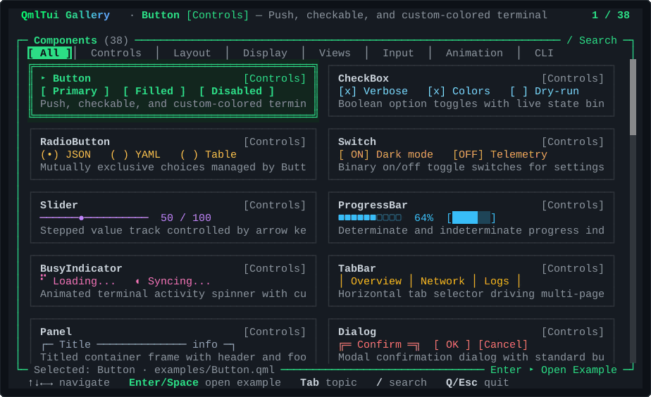

  <picture>
    <source media="(prefers-color-scheme: dark)" srcset="docs/assets/branding/qmltui_lockup_dark.svg">
    
  </picture>

QmlTui is a retained-mode terminal UI framework for Qt 6. It exposes terminal
items, layouts, controls, views, animation, and widgets as QML modules while
using the Qt event loop and model/view APIs.

QmlTui targets Linux and macOS terminals and Windows Terminal, all with UTF-8 and
ANSI/VT escape support. Terminal I/O goes through one platform backend per OS
(`termios` and `SIGWINCH` on POSIX, virtual-terminal console modes on Windows);
everything above it is shared. The optional PTY-backed `TerminalView` module is
Unix only.

## Documentation

Start with [Getting started](docs/getting-started.md), then follow the
[six-part tutorial](docs/tutorials/index.md). The [documentation index](docs/README.md)
links to topics, [QML types](docs/qml-types/index.md), [C++ classes](docs/cpp-classes/index.md),
and [release notes](docs/changes/changelog.md).

## Examples

Browse the [example catalog](examples/README.md) for component and topic demos.
Run `./build/examples/gallery/qmltui_gallery` for the interactive gallery, or build
the [WebAssembly playground](docs/topics/webassembly.md).
Full application showcases live in [qmltui-apps](https://github.com/qmltui-dev/qmltui-apps).

## License

QmlTui is available under **LGPL-3.0-only OR GPL-3.0-only**. Examples and the
starter template are **BSD-3-Clause**; documentation is **CC-BY-4.0**. See
[LICENSE.md](LICENSE.md).

Separate commercial terms are available upon inquiry for organizations unable
to meet those obligations. Contact through the project repository at
<https://github.com/qmltui-dev/qmltui>.

QmlTui is an independent project and not a product of The Qt Company. Qt and
third-party dependencies remain subject to their own licenses.
