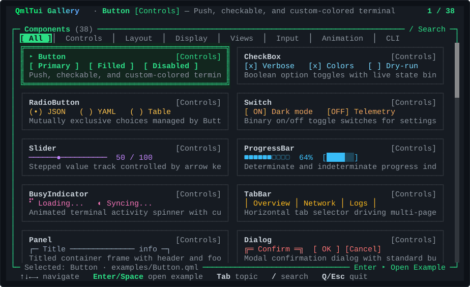
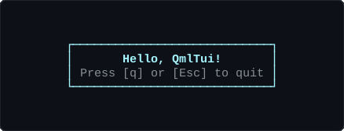

## Hello, World!

With `import QtQml` and `import QmlTui`, declare a bordered card and a keyboard quit handler:

```qml
import QtQml
import QmlTui

Terminal {
    Keys.onPressed: event => {
        if (event.key === Qt.Key_Q || event.key === Qt.Key_Escape) {
            Qt.quit();
            event.accepted = true;
        }
    }

    Rectangle {
        anchors.centerIn: parent
        width: 30
        height: 4
        border {
            style: Border.Rounded
            color: "cyan"
        }

        Column {
            anchors.centerIn: parent

            Text {
                anchors.horizontalCenter: parent.horizontalCenter
                text: "Hello, QmlTui!"
                color: "cyan"
                bold: true
            }
            Text {
                text: "Press [q] or [Esc] to quit"
                dim: true
            }
        }
    }
}
```

Rendered in the terminal:



Build and run the component gallery locally, or open the [WebAssembly Playground](playground.md):

```sh
cmake -S . -B build -DQMLTUI_BUILD_EXAMPLES=ON
cmake --build build --target qmltui_gallery
./build/examples/gallery/qmltui_gallery
```

## Start Here

- **[Getting Started](getting-started.md)**: System requirements, running `qmltui_gallery`, creating a standalone 3-file application (`FetchContent` or `find_package(QmlTui)`), CMake options, and environment variables.
- **[Interactive Playground](playground.md)**: Edit and run gallery components in the browser with QmlTui autocomplete.
- **[Examples and Recipes](examples.md)**: Browse the built-in component gallery and standalone QML/C++ recipes.
- **[Qt Creator Setup](guides/qt-creator.md)**: Configure project wizards (`qmltui-qtc`), offline `F1` help (`qmltui.qch`), `qmlls`, `qmllint`, and `Runner` build actions.
- **[QmlTui for Qt Quick Developers](guides/qt-quick-to-qmltui.md)**: Differences between `QtQuick` and QmlTui's character-cell coordinate system, borders, terminal modes, and imports.

## Guides

See the [Guides index](guides/index.md) for the full reading order:

- **[Architecture](guides/architecture.md)**: Retained item tree, double-buffered `TextGridBuffer` diffing, platform backends, and QML module boundaries.
- **[Layouts & Cell Geometry](guides/layouts.md)**: Integer cell coordinates, `anchors`, `Row`/`Column` positioners, and `RowLayout`/`ColumnLayout`/`GridLayout`/`StackLayout`.
- **[Input & Focus](guides/input-and-focus.md)**: Focus chains, `FocusScope`, `Keys.onPressed` propagation, `Shortcut`, SGR mouse events, and bracketed paste.
- **[Styling & Colors](guides/styling-and-colors.md)**: Terminal-default colors, ANSI 16/256/TrueColor quantization, `Gradient`, `Border` styles, and reusable QML component styling.
- **[Models in QmlTui Views](guides/models.md)**: Connecting `ListModel` and C++ `QAbstractItemModel` subclasses to `ListView`, `TableView`, `TreeView`, and `GridView`.
- **[Animation & States](guides/animation-and-states.md)**: `NumberAnimation`, `ColorAnimation`, `PropertyAnimation`, `State`, `Transition`, and optional `Behavior` / `StateGroup`.
- **[Inline Mode & Scrollback](guides/inline-mode.md)**: Building streaming CLIs and REPLs with `Terminal.Inline` and `Scrollback`.
- **[Embedded PTY Shells (`QmlTui.PtyView`)](guides/pty-view.md)**: Hosting interactive Unix child processes inside `PtyView` on Linux and macOS.
- **[Custom C++ Items](guides/custom-items.md)**: Subclassing `qmltui::Item`, painting into `TextGridBuffer`, registering QML types with `QML_ELEMENT`, and C++-only scenes.
- **[Testing & Recording with Runner](guides/testing.md)**: Headless testing with a virtual clock, text and style snapshots, and Asciinema `.cast` recording.
- **[WebAssembly Playground](guides/webassembly.md)**: Building and hosting QmlTui applications in the browser with Qt for WebAssembly.

## API Reference

- **[QML Types Reference](qml-types/index.md)**: Properties, methods, and signals for `QmlTui`, `QmlTui.Controls`, `QmlTui.Image`, and `QmlTui.PtyView`.
- **[C++ Classes Reference](cpp-classes/index.md)**: Public C++ headers for `Item`, `Terminal`, `TerminalEngine`, `TextGridBuffer`, `Cell`, `Color`, `TerminalCapabilities`, `PtyView`, and `Runner`.
- **[Release Notes & Changelog](changes/changelog.md)**: Version history and migration notes.

## Contributing

- **[CI Runners](contributing/ci-runners.md)**: Continuous integration setup and headless test execution.
- **[Recording Demos](contributing/recording.md)**: Capturing `.cast` recordings and GIF assets with `Runner`.
- **[Development Plans](contributing/plans/README.md)**: Design notes and milestone records.
