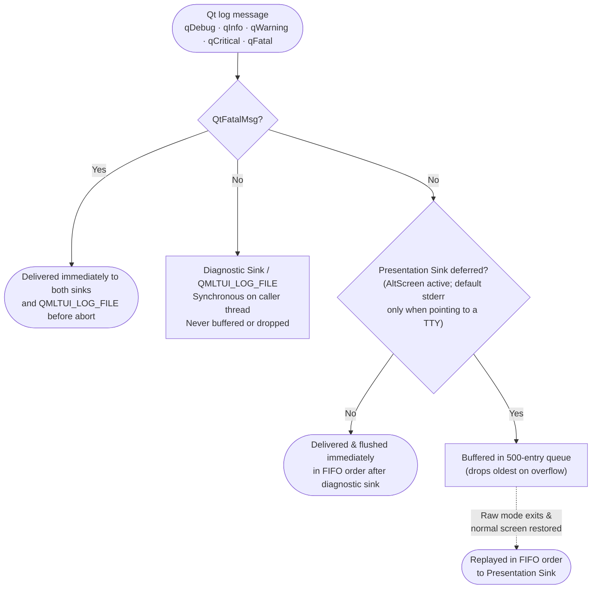

# QtMessageRouting

`QtMessageRouting` routes Qt diagnostics (`qDebug`, `qInfo`, `qWarning`, `qCritical`, `qFatal`) in QmlTui applications. It separates immediate diagnostic logging (such as writing to a log file) from terminal screen presentation so `stderr` output does not overwrite an active alternate-screen session.

- **Header**: `<QmlTui/Core/Engine/QtMessageRouting.h>`
- **Target**: `QmlTui::Core` (`Qt6::Core` only; no QML dependency)

Scope:
- Intercepts messages sent through Qt's global message handler (`qInstallMessageHandler`).
- Does not intercept libc `printf`, `std::cout`, or raw file descriptor writes.

## Routing Pipeline



### Default Behavior

The router installs its `qInstallMessageHandler` hook while at least one `TerminalEngine` instance exists or an explicit `QtMessageRouting::install()` registration is active, and restores the previous Qt message handler once the last engine and registration are torn down.

When an application does not call `QtMessageRouting::install()` (while a `TerminalEngine` is active):
- Setting `QMLTUI_LOG_FILE=<path>` opens `<path>` in append mode and registers an automatic diagnostic sink that writes and flushes every `console.log()`, `qDebug()`, and `qWarning()` line immediately during `AltScreen` sessions.
- Otherwise, no diagnostic sink is registered and presentation defaults to `stderrPresentationSink()`.
- Outside alternate-screen sessions, or when `stderr` is redirected to a file or pipe (`./my_app 2> debug.log`) while running on an interactive terminal, messages are delivered and flushed immediately through `stderrPresentationSink()`.
- During an interactive alternate-screen session where `stderr` points to the terminal TTY (and `QMLTUI_LOG_FILE` is unset), non-fatal messages are buffered (up to 500 entries, dropping the oldest on overflow) and replayed through `stderrPresentationSink()` after the terminal exits raw mode and restores the normal screen.

### Custom Configuration

Calling `QtMessageRouting::install(diagnosticSink, presentationSink)` registers:
- **Diagnostic sink** (required): receives every message synchronously on the emitting thread without buffering.
- **Presentation sink** (optional): when omitted, terminal presentation is disabled; when provided (such as `stderrPresentationSink()`), messages outside alternate-screen sessions are delivered immediately and alternate-screen messages are buffered until session teardown.

## `QtMessage`

Value snapshot captured when a message reaches the router:

| Field | Type | Description |
| :--- | :--- | :--- |
| `type` | `QtMsgType` | Severity (`QtDebugMsg`, `QtInfoMsg`, `QtWarningMsg`, `QtCriticalMsg`, `QtFatalMsg`). |
| `message` | `QString` | Unformatted message text. |
| `timestampUtc` | `QDateTime` | UTC timestamp recorded at receipt. |
| `category` | `QByteArray` | Qt logging category name. |
| `file` | `QByteArray` | Source file name. |
| `function` | `QByteArray` | Function name. |
| `line` | `int` | Source line number. |
| `formattedText` | `QString` | Message pre-formatted at receipt with `qFormatLogMessage`. |

`const QString &formattedMessage() const noexcept` returns `formattedText`.

## `QtMessageRouting` Methods

#### `[[nodiscard]] static std::unique_ptr<QtMessageRouting> install(QtMessageSink diagnosticSink, QtMessageSink presentationSink = {})`
Installs an explicit routing configuration and returns an RAII registration token. Only one explicit registration may be active per process; duplicate attempts return `nullptr`. May be called before or after constructing `QCoreApplication`.

#### `static QtMessageSink stderrPresentationSink()`
Returns the default presentation sink. If another `QtMessageHandler` was installed before QmlTui's router hooked `qInstallMessageHandler`, this sink chains the message (`type`, reconstructed `QMessageLogContext`, and `message`) to that prior handler; otherwise it writes `msg.formattedMessage()` to `stderr` and flushes it. Redirecting `stderr` (`./app 2> errors.log`) redirects the fallback `stderr` output as expected.

#### `void reset()`
Unregisters the configuration, discards any buffered presentation records owned by this registration, waits for in-flight sink callbacks on worker threads to finish, and restores default routing.

## Threading and Ordering Guarantees

- Records receive monotonic 64-bit sequence numbers and are drained to the presentation sink in FIFO order after their diagnostic callback completes.
- Sink callbacks run outside the router mutex and must be thread-safe.
- Terminal restoration and raw-mode exit always complete before buffered presentation records are replayed.
- Recursive Qt logging from inside a sink callback is diverted to `stderr` to prevent deadlocks.
- `QtFatalMsg` bypasses buffering and is delivered synchronously to both sinks before Qt aborts.

## Example

```cpp
#include <QCoreApplication>
#include <QFile>
#include <QTextStream>
#include <QmlTui/Core/Engine/QtMessageRouting.h>
#include <QmlTui/Core/Items/Terminal.h>

int main(int argc, char *argv[])
{
    QCoreApplication app(argc, argv);

    QFile logFile("application.log");
    logFile.open(QIODevice::WriteOnly | QIODevice::Append | QIODevice::Text);
    QTextStream logStream(&logFile);

    auto routing = qmltui::QtMessageRouting::install(
        [&](const qmltui::QtMessage &msg) {
            logStream << "[" << msg.timestampUtc.toString(Qt::ISODate) << "] "
                      << msg.formattedMessage() << "\n";
            logStream.flush();
        },
        qmltui::QtMessageRouting::stderrPresentationSink()
    );

    qmltui::Terminal terminal;
    terminal.componentComplete();
    return app.exec();
}
```
