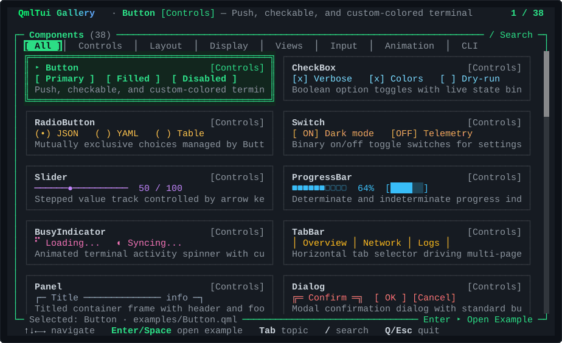
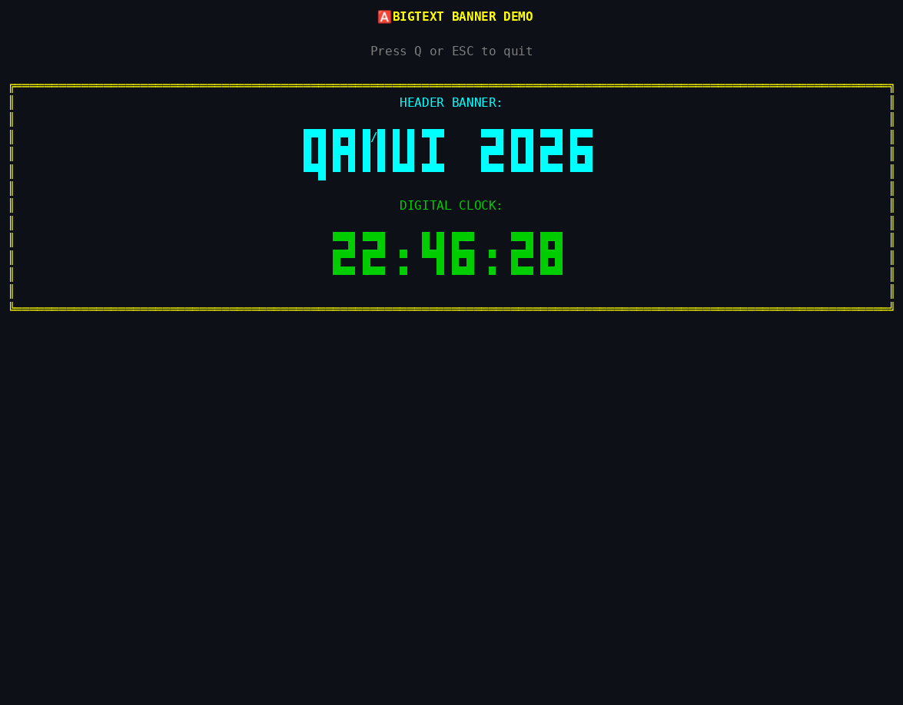
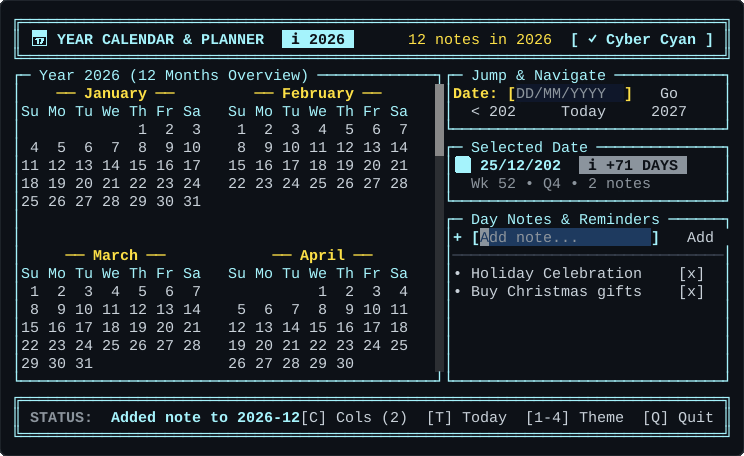
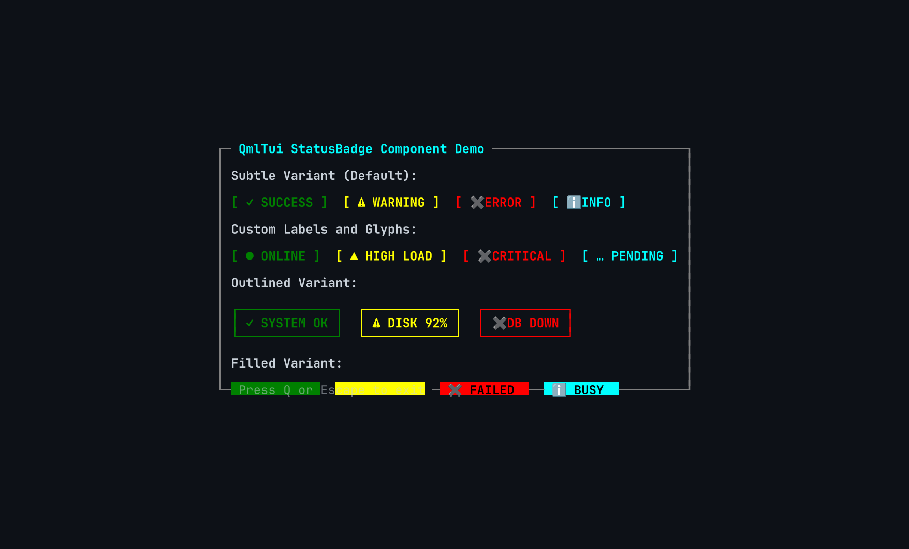

# Examples & Component Cookbook

Build and run the interactive gallery—or any standalone component demo—by configuring QmlTui with `-DQMLTUI_BUILD_EXAMPLES=ON`:

```sh
cmake -S . -B build -DQMLTUI_BUILD_EXAMPLES=ON
cmake --build build -j8 --target qmltui_gallery

# Browse all 39 interactive tiles in the gallery shell:
./build/examples/gallery/qmltui_gallery

# Open the gallery directly on a specific tile:
./build/examples/gallery/qmltui_gallery --page Button.qml

# Run any of the 39 gallery examples as a standalone terminal app:
./build/examples/gallery/qmltui_gallery --example Button

# List all available gallery example names:
./build/examples/gallery/qmltui_gallery --list-examples
```



You can also edit and run the gallery examples directly in your browser using the [WebAssembly Playground](playground.md).

---

## How `examples/` Is Articulated (Four-Tier Taxonomy)

QmlTui organizes [`examples/`](../examples/) into four non-overlapping tiers so every example has a single source of truth:

1. **Tier 1 — Built-in Type Gallery (`examples/gallery/examples/*.qml`)**:
   All **39** single-file QML demos for `QmlTui`, `QmlTui.Controls`, `QmlTui.Image`, and `QmlTui.TerminalHost` live once in [`examples/gallery/examples/`](../examples/gallery/examples/). They power the interactive `qmltui_gallery` browser, standalone `--example <Name>` execution, automated `.cast`/`.gif` documentation recordings, and the [WebAssembly Playground](playground.md).
2. **Tier 2 — Reusable Recipes & C++ Models (`examples/components/`)**:
   [`examples/components/`](../examples/components/) contains only the **6** multi-file component recipes and C++ `QAbstractItemModel` / `QSortFilterProxyModel` integrations that go beyond a single self-contained `.qml` file.
3. **Tier 3 — Architectural Guide Examples (`examples/guides/`)**:
   [`examples/guides/`](../examples/guides/) contains the **6** C++ and inline-mode companion projects for `docs/guides/` (`cpp_only`, `custom_cpp_item`, `independent_states`, `inline_repl`, `lazy_model`, `live_image`).
4. **Tier 4 — Quickstart & WebAssembly (`examples/quickstart/`, `examples/wasm/`)**:
   The minimal 3-file `FetchContent` starter template and the browser WebAssembly host.

### Controls vs. Recipes Boundary

- **`QmlTui.Controls` (Framework Primitives)**: Admits a type only when it requires engine knowledge that an application cannot cleanly reproduce in user QML (cell-grid geometry, Unicode grapheme width measurement, viewport virtualization, or overlay z-stacking) or when it is universal across terminal toolkits.
- **Copyable Recipes (`examples/components/` & `examples/guides/`)**: Domain-specific or higher-level widgets (`Calendar`, `StatusBadge`, `BigText`, and custom syntax highlighters) live as copyable BSD-3-Clause recipes under `examples/`.
- **Application-Owned Styling**: Core items and `QmlTui.Controls` default to the terminal's native foreground and background (`"default"`), while the gallery and docs share a unified phosphor-green dark/light theme (`#0d1117` canvas, `#161b22` surface, `#2cde85` / `#00ff66` accent—toggleable live with `T` in `qmltui_gallery`).

---

## 1. Built-in Component Gallery (`examples/gallery/examples/`)

Every tile in [`examples/gallery/examples/`](../examples/gallery/examples/) can be run standalone via `./build/examples/gallery/qmltui_gallery --example <Name>` or opened interactively in the [WebAssembly Playground](playground.md):

| Example | Source File | CLI Command | QML Reference | Playground | Recorded Demo |
| :--- | :--- | :--- | :--- | :--- | :--- |
| **Button** | [`Button.qml`](../examples/gallery/examples/Button.qml) | `--example Button` | [Button](qml-types/button.md) | [▶ Open](playground.md?example=Button.qml) | [GIF](assets/casts/components/button.gif) |
| **CheckBox** | [`CheckBox.qml`](../examples/gallery/examples/CheckBox.qml) | `--example CheckBox` | [CheckBox](qml-types/checkbox.md) | [▶ Open](playground.md?example=CheckBox.qml) | [GIF](assets/casts/components/check_box.gif) |
| **RadioButton** | [`RadioButton.qml`](../examples/gallery/examples/RadioButton.qml) | `--example RadioButton` | [RadioButton](qml-types/radiobutton.md) | [▶ Open](playground.md?example=RadioButton.qml) | [GIF](assets/casts/components/radio_button.gif) |
| **Switch** | [`Switch.qml`](../examples/gallery/examples/Switch.qml) | `--example Switch` | [Switch](qml-types/switch.md) | [▶ Open](playground.md?example=Switch.qml) | [GIF](assets/casts/components/switch.gif) |
| **Slider** | [`Slider.qml`](../examples/gallery/examples/Slider.qml) | `--example Slider` | [Slider](qml-types/slider.md) | [▶ Open](playground.md?example=Slider.qml) | [GIF](assets/casts/components/slider.gif) |
| **ProgressBar** | [`ProgressBar.qml`](../examples/gallery/examples/ProgressBar.qml) | `--example ProgressBar` | [ProgressBar](qml-types/progressbar.md) | [▶ Open](playground.md?example=ProgressBar.qml) | [GIF](assets/casts/components/progress_bar.gif) |
| **BusyIndicator** | [`BusyIndicator.qml`](../examples/gallery/examples/BusyIndicator.qml) | `--example BusyIndicator` | [BusyIndicator](qml-types/busyindicator.md) | [▶ Open](playground.md?example=BusyIndicator.qml) | [GIF](assets/casts/components/busy_indicator.gif) |
| **TabBar** | [`TabBar.qml`](../examples/gallery/examples/TabBar.qml) | `--example TabBar` | [TabBar](qml-types/tabbar.md) | [▶ Open](playground.md?example=TabBar.qml) | [GIF](assets/casts/components/tab_bar.gif) |
| **Panel** | [`Panel.qml`](../examples/gallery/examples/Panel.qml) | `--example Panel` | [Panel](qml-types/panel.md) | [▶ Open](playground.md?example=Panel.qml) | [GIF](assets/casts/components/panel.gif) |
| **Dialog** | [`Dialog.qml`](../examples/gallery/examples/Dialog.qml) | `--example Dialog` | [Dialog](qml-types/dialog.md) | [▶ Open](playground.md?example=Dialog.qml) | [GIF](assets/casts/components/dialog.gif) |
| **Popup** | [`Popup.qml`](../examples/gallery/examples/Popup.qml) | `--example Popup` | [Popup](qml-types/popup.md) | [▶ Open](playground.md?example=Popup.qml) | [GIF](assets/casts/components/popup.gif) |
| **Toast** | [`Toast.qml`](../examples/gallery/examples/Toast.qml) | `--example Toast` | [Toast](qml-types/toast.md) | [▶ Open](playground.md?example=Toast.qml) | [GIF](assets/casts/components/toast.gif) |
| **ToolTip** | [`ToolTip.qml`](../examples/gallery/examples/ToolTip.qml) | `--example ToolTip` | [ToolTip](qml-types/tooltip.md) | [▶ Open](playground.md?example=ToolTip.qml) | [GIF](assets/casts/components/tool_tip.gif) |
| **StackView** | [`StackView.qml`](../examples/gallery/examples/StackView.qml) | `--example StackView` | [StackView](qml-types/stackview.md) | [▶ Open](playground.md?example=StackView.qml) | [GIF](assets/casts/components/stack_view.gif) |
| **Sparkline** | [`Sparkline.qml`](../examples/gallery/examples/Sparkline.qml) | `--example Sparkline` | [Sparkline](qml-types/sparkline.md) | [▶ Open](playground.md?example=Sparkline.qml) | [GIF](assets/casts/components/sparkline.gif) |
| **TextInput** | [`TextInput.qml`](../examples/gallery/examples/TextInput.qml) | `--example TextInput` | [TextInput](qml-types/textinput.md) | [▶ Open](playground.md?example=TextInput.qml) | [GIF](assets/casts/components/text_input.gif) |
| **TextArea** | [`TextArea.qml`](../examples/gallery/examples/TextArea.qml) | `--example TextArea` | [TextArea](qml-types/textarea.md) | [▶ Open](playground.md?example=TextArea.qml) | [GIF](assets/casts/components/text_area.gif) |
| **ListView** | [`ListView.qml`](../examples/gallery/examples/ListView.qml) | `--example ListView` | [ListView](qml-types/listview.md) | [▶ Open](playground.md?example=ListView.qml) | [GIF](assets/casts/components/list_view.gif) |
| **TableView** | [`TableView.qml`](../examples/gallery/examples/TableView.qml) | `--example TableView` | [TableView](qml-types/tableview.md) | [▶ Open](playground.md?example=TableView.qml) | [GIF](assets/casts/components/table_view.gif) |
| **TreeView** | [`TreeView.qml`](../examples/gallery/examples/TreeView.qml) | `--example TreeView` | [TreeView](qml-types/treeview.md) | [▶ Open](playground.md?example=TreeView.qml) | [GIF](assets/casts/components/tree_view.gif) |
| **GridView** | [`GridView.qml`](../examples/gallery/examples/GridView.qml) | `--example GridView` | [GridView](qml-types/gridview.md) | [▶ Open](playground.md?example=GridView.qml) | [GIF](assets/casts/components/grid_view.gif) |
| **ScrollView** | [`ScrollView.qml`](../examples/gallery/examples/ScrollView.qml) | `--example ScrollView` | [ScrollView](qml-types/scrollview.md) | [▶ Open](playground.md?example=ScrollView.qml) | [GIF](assets/casts/components/scroll_view.gif) |
| **Text** | [`Text.qml`](../examples/gallery/examples/Text.qml) | `--example Text` | [Text](qml-types/text.md) | [▶ Open](playground.md?example=Text.qml) | [GIF](assets/casts/components/text.gif) |
| **RichText** | [`RichText.qml`](../examples/gallery/examples/RichText.qml) | `--example RichText` | [Text](qml-types/text.md) | [▶ Open](playground.md?example=RichText.qml) | [GIF](assets/casts/components/rich_text.gif) |
| **Rectangle** | [`Rectangle.qml`](../examples/gallery/examples/Rectangle.qml) | `--example Rectangle` | [Rectangle](qml-types/rectangle.md) | [▶ Open](playground.md?example=Rectangle.qml) | [GIF](assets/casts/components/rectangle.gif) |
| **Canvas** | [`Canvas.qml`](../examples/gallery/examples/Canvas.qml) | `--example Canvas` | [Canvas](qml-types/canvas.md) | [▶ Open](playground.md?example=Canvas.qml) | [GIF](assets/casts/components/canvas.gif) |
| **Image** | [`Image.qml`](../examples/gallery/examples/Image.qml) | `--example Image` | [Image](qml-types/image.md) | [▶ Open](playground.md?example=Image.qml) | [GIF](assets/casts/components/image.gif) |
| **AnimatedSprite** | [`AnimatedSprite.qml`](../examples/gallery/examples/AnimatedSprite.qml) | `--example AnimatedSprite` | [AnimatedSprite](qml-types/animatedsprite.md) | [▶ Open](playground.md?example=AnimatedSprite.qml) | [GIF](assets/casts/components/animated_sprite.gif) |
| **Layouts** | [`Layouts.qml`](../examples/gallery/examples/Layouts.qml) | `--example Layouts` | [RowLayout](qml-types/rowlayout.md) / [GridLayout](qml-types/gridlayout.md) | [▶ Open](playground.md?example=Layouts.qml) | [GIF](assets/casts/components/layouts.gif) |
| **Repeater** | [`Repeater.qml`](../examples/gallery/examples/Repeater.qml) | `--example Repeater` | [Repeater](qml-types/repeater.md) | [▶ Open](playground.md?example=Repeater.qml) | [GIF](assets/casts/components/repeater.gif) |
| **Loader** | [`Loader.qml`](../examples/gallery/examples/Loader.qml) | `--example Loader` | [Loader](qml-types/loader.md) | [▶ Open](playground.md?example=Loader.qml) | [GIF](assets/casts/components/loader.gif) |
| **MouseArea** | [`MouseArea.qml`](../examples/gallery/examples/MouseArea.qml) | `--example MouseArea` | [MouseArea](qml-types/mousearea.md) | [▶ Open](playground.md?example=MouseArea.qml) | [GIF](assets/casts/components/mouse_area.gif) |
| **Shortcut** | [`Shortcut.qml`](../examples/gallery/examples/Shortcut.qml) | `--example Shortcut` | [Shortcut](qml-types/shortcut.md) | [▶ Open](playground.md?example=Shortcut.qml) | [GIF](assets/casts/components/shortcut.gif) |
| **TerminalCapabilities** | [`TerminalCapabilities.qml`](../examples/gallery/examples/TerminalCapabilities.qml) | `--example TerminalCapabilities` | [TerminalCapabilities](qml-types/terminalcapabilities.md) | [▶ Open](playground.md?example=TerminalCapabilities.qml) | [GIF](assets/casts/components/terminal_capabilities.gif) |
| **TerminalView** | [`TerminalView.qml`](../examples/gallery/examples/TerminalView.qml) | `--example TerminalView` | [TerminalView](qml-types/terminalview.md) | [▶ Open](playground.md?example=TerminalView.qml) | [GIF](assets/casts/components/terminal_view.gif) |
| **States** | [`States.qml`](../examples/gallery/examples/States.qml) | `--example States` | [State](qml-types/state.md) / [Transition](qml-types/transition.md) | [▶ Open](playground.md?example=States.qml) | [GIF](assets/casts/components/states.gif) |
| **Animation** | [`Animation.qml`](../examples/gallery/examples/Animation.qml) | `--example Animation` | [NumberAnimation](qml-types/numberanimation.md) | [▶ Open](playground.md?example=Animation.qml) | [GIF](assets/casts/components/animation.gif) |
| **Behavior** | [`Behavior.qml`](../examples/gallery/examples/Behavior.qml) | `--example Behavior` | [Behavior](qml-types/behavior.md) | [▶ Open](playground.md?example=Behavior.qml) | [GIF](assets/casts/components/behavior.gif) |
| **InlineMode** | [`InlineMode.qml`](../examples/gallery/examples/InlineMode.qml) | `--example InlineMode` | [Scrollback](qml-types/scrollback.md) | [▶ Open](playground.md?example=InlineMode.qml) | [GIF](assets/casts/components/inline_mode.gif) |

---

## 2. Reusable Recipes & C++ Models (`examples/components/`)

[`examples/components/`](../examples/components/) houses only the **6** multi-file QML/C++ recipes and C++ `QAbstractItemModel` / `QSortFilterProxyModel` showcases:

| Recipe / Demo | Source Directory | CMake Target | Recorded Demo | What It Provides |
| :--- | :--- | :--- | :--- | :--- |
| **BigText** | [`examples/components/big_text/`](../examples/components/big_text/) | `qmltui_big_text_demo` |  | Custom C++ `qmltui::Item` (`BigText.h`, `BigText.cpp`) rendering multi-row block-pixel banner typography. |
| **Calendar** | [`examples/components/calendar/`](../examples/components/calendar/) | `qmltui_calendar_demo` |  | Reusable `Calendar.qml` month-grid date picker built with `Column`, `Row`, `Repeater`, keyboard navigation, and `StatusBadge.qml`. |
| **StatusBadge** | [`examples/components/status_badge/`](../examples/components/status_badge/) | `qmltui_status_badge_demo` |  | Copyable `StatusBadge.qml` pill component (`[OK]`, `[WARN]`, `[ERR]`) with configurable icon, label, border, and color presets. |
| **TextArea Highlighting** | [`examples/components/text_area_highlighting/`](../examples/components/text_area_highlighting/) | `qmltui_text_area_highlighting_demo` |  | Both a QML highlighter (`QmlHighlighter.qml`) and a C++ JSON highlighter (`JsonHighlighter`) attached to `TextArea`. |
| **StandardItemDelegate Showcase** | [`examples/components/standard_item_delegate/`](../examples/components/standard_item_delegate/) | `qmltui_standard_item_delegate_demo` / `qmltui_standard_item_delegate_widgets` | [GIF](assets/casts/components/standard_item_delegate.gif) | Multi-executable showcase rendering `StandardItemDelegate` in `ListView` alongside `TableView` and `TreeView` sharing a C++ `ReleaseChecklistModel` (`QStandardItemModel`). |
| **C++ TableView Model** | [`examples/components/table_view/`](../examples/components/table_view/) | `qmltui_table_view_demo` | [GIF](assets/casts/components/table_view.gif) | `TableView` backed by C++ `ProcessModel` (`QAbstractTableModel`) and `ProcessProxy` (`QSortFilterProxyModel`) with column sorting and live filtering. |

---

## 3. Architectural Guide Examples (`examples/guides/`)

Each directory under [`examples/guides/`](../examples/guides/) is a companion executable for an architectural guide in `docs/guides/`:

| Guide Example | Directory | CMake Target | Related Guide | What It Demonstrates |
| :--- | :--- | :--- | :--- | :--- |
| **C++-Only Application** | [`cpp_only/`](../examples/guides/cpp_only/) | `qmltui_cpp_only_demo` | [Custom C++ Items](guides/custom-items.md) | Constructing and updating a `qmltui::Terminal` and item tree purely from C++ without `.qml` files. |
| **Custom C++ Item** | [`custom_cpp_item/`](../examples/guides/custom_cpp_item/) | `qmltui_custom_cpp_item_demo` | [Custom C++ Items](guides/custom-items.md) | Subclassing `qmltui::Item`, overriding `paint(TextGridBuffer &, int, int, const ClipRect &)`, and registering with `QML_ELEMENT`. |
| **Independent States** | [`independent_states/`](../examples/guides/independent_states/) | `qmltui_independent_states_demo` | [Animation & States](guides/animation-and-states.md) | Orthogonal state machines using `StateGroup`, `State`, and `Transition` (`QMLTUI_ENABLE_PRIVATE_QT=ON`). |
| **Inline REPL** | [`inline_repl/`](../examples/guides/inline_repl/) | `qmltui_inline_repl_demo` | [Inline Mode](guides/inline-mode.md) | Minimal command-line REPL using `Terminal.Inline` and `Scrollback.print()`. |
| **Lazy Model** | [`lazy_model/`](../examples/guides/lazy_model/) | `qmltui_lazy_model_demo` | [Models & Views](guides/models.md) | C++ `LazyDirectoryModel` (`QAbstractItemModel`) populating a lazy 4-level directory tree on demand inside `TreeView`. |
| **Live Image** | [`live_image/`](../examples/guides/live_image/) | `qmltui_live_image_demo` | [Architecture](guides/architecture.md) | Streaming procedural `QImage` frames from `qmltui::AsyncImageProvider` into a terminal `Image` item (`QMLTUI_ENABLE_IMAGE=ON`). |

---

## 4. Quickstart & WebAssembly (`examples/quickstart/`, `examples/wasm/`)

| Project | Source Directory | CMake Target | Description |
| :--- | :--- | :--- | :--- |
| **Standalone Quickstart** | [`examples/quickstart/`](../examples/quickstart/) | `hello_qmltui` (`qmltui_quickstart_test` in-tree) | Minimal 3-file (`CMakeLists.txt`, `main.cpp`, `Main.qml`) standalone project using `FetchContent`. |
| **WebAssembly Playground** | [`examples/wasm/`](../examples/wasm/) | [Live Playground](playground.md) / [Guide](guides/webassembly.md) | Browser-hosted interactive QmlTui playground sharing the gallery examples. |
