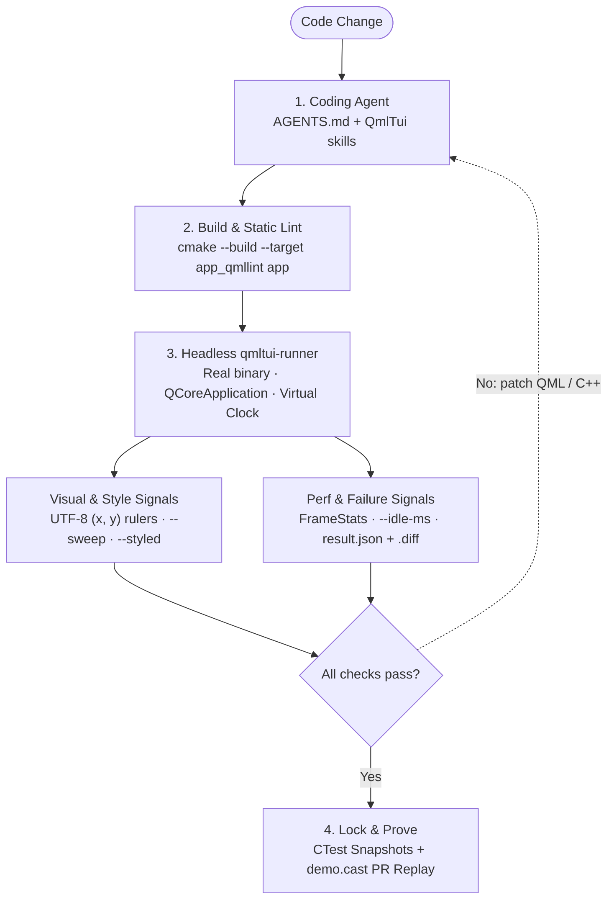
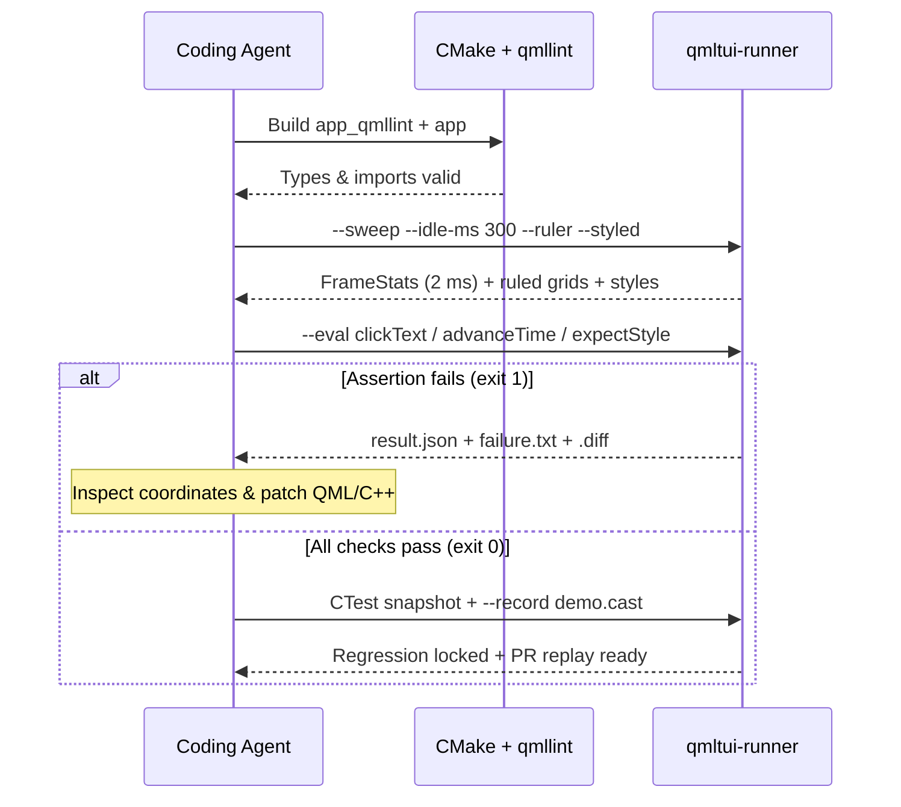

# Agentic Development Loop with Runner

AI coding agents struggle to verify graphical and terminal interfaces directly. Browser and desktop workflows require a display server and multimodal screenshots that still miss off-by-one clipping, color regressions, and focus states. Raw-mode terminal binaries either block waiting for a TTY or emit cursor-positioning ANSI streams that force fragile PTY scrapers and wall-clock sleeps.

[`qmltui::Runner`](../cpp-classes/runner.md) and [`qmltui-runner`](testing.md#run-scenarios-with-the-qmltui-runner-cli) give coding agents (Claude Code, Codex, Gemini CLI, Antigravity, Cursor, Zed) a text-native closed loop on `QCoreApplication` with an in-memory terminal backend. Without a TTY, display server, or separate test binary, an agent builds your real executable, sweeps multiple viewports with 0-based `(x, y)` coordinate rulers, inspects exact `#RRGGBBAA` colors and SGR attributes, steps animations instantaneously on a [virtual clock](testing.md#step-animations-and-timers-with-the-virtual-clock), checks retained-mode paint telemetry and idle repaint budgets, and records deterministic `.cast` replays for human review.



| Capability | Browser / Desktop Screenshot Agent | PTY / ANSI Scraper | QmlTui + [`qmltui-runner`](../cpp-classes/runner.md#qmltui-runner-command-line-launcher) |
| :--- | :--- | :--- | :--- |
| **Runtime environment** | Display server + headless browser | Interactive PTY (`tmux` / `script`) | `QCoreApplication` only (headless CI, containers, SSH, cloud sandboxes) |
| **Visual perception** | PNG screenshots (vision tokens, pixel guessing) | Raw escape-sequence text | Exact 2D UTF-8 cell grid, 0-based `(x, y)` rulers, `#RRGGBBAA` / SGR style runs |
| **Animations & timers** | Wall-clock waits | Wall-clock `sleep` | Deterministic virtual clock ([`app.advanceTime(ms)`](../cpp-classes/runner.md#clock-timing-and-frame-synchronization)) in milliseconds |
| **Targeting & assertions** | DOM or pixel coordinates | Substring regexes | [`clickText()`](../cpp-classes/runner.md#mouse-input), [`app.item("objectName")`](../cpp-classes/runner.md#frame-inspection-and-scoped-locators-region-and-item), [`app.itemTree()`](../cpp-classes/runner.md#frame-inspection-and-scoped-locators-region-and-item) (`session tree`), [`app.region()`](../cpp-classes/runner.md#frame-inspection-and-scoped-locators-region-and-item), [`expectStyle()`](../cpp-classes/runner.md#frame-text-regex-and-style-assertions), [`Inline`](inline-mode.md) scrollback |
| **Performance & paint audit** | External profiler | None | Built-in [`FrameStats`](../cpp-classes/runner.md#clock-timing-and-frame-synchronization) (`paintAvg`, `diffBytes`, `dirtyDuringPaint=0`) and [`--idle-ms`](testing.md#qmltui-runner-options-reference) |
| **Visual proof for PR review** | Static screenshots | None | Deterministic asciicast v2 `.cast` recordings ([`--record`](../cpp-classes/runner.md#asciicast-recording-cast)) |

For the full 61-method [`app.*` facade](../cpp-classes/runner.md#javascript-app-runner-facade-reference), interactive sessions, CLI flags, CMake macros, and C++ API, see [Testing and Recording with Runner](testing.md) and the [Runner Reference](../cpp-classes/runner.md).

## Set Up Your Agent in 60 Seconds

### Install the Bundled Agent Skills

Install QmlTui's portable skills into your repository from [`qmltui/qmltui`](https://github.com/qmltui/qmltui):

```bash
npx skills add qmltui/qmltui
```

This adds two domain skills that teach coding agents QmlTui's rules and verification loop out of the box:

- **[`qmltui-qml`](../../.agents/skills/qmltui-qml/SKILL.md)**: Enforces allowed imports (no `QtQuick`), `pragma ComponentBehavior: Bound`, required-property delegates, `AltScreen` vs. `Inline` mode, integer cell geometry, border insets, and contextual quit paths.
- **[`qmltui-dev-loop`](../../.agents/skills/qmltui-dev-loop/SKILL.md)**: Bundles the build/lint/probe workflow plus on-demand references for the complete [`app.*` Runner facade](../cpp-classes/runner.md#javascript-app-runner-facade-reference), visual and performance audit checklists, and CMake/subsystem configuration.

### Link `QmlTui::Runner` into Your Application Target

Link [`QmlTui::Runner`](../cpp-classes/runner.md) conditionally under `BUILD_TESTING` in `CMakeLists.txt` (see [CMake and CTest Integration](testing.md#cmake-and-ctest-integration) and [Editor Setup](editor-setup.md)). Normal interactive startup is unaffected unless launched via [`qmltui-runner`](testing.md#run-scenarios-with-the-qmltui-runner-cli) or `QMLTUI_RUNNER_*` environment variables (see the [Runner Reference](../cpp-classes/runner.md)), and production builds (`-DBUILD_TESTING=OFF`) omit `QmlTui::Runner` entirely:

```cmake
set(QT_QML_GENERATE_QMLLS_INI ON)

if(BUILD_TESTING AND TARGET QmlTui::Runner)
    target_link_libraries(ops_console PRIVATE QmlTui::Runner)
    qmltui_scenario_editor_support()
endif()
```

### Add a Concise `AGENTS.md`

Pair the installed skills with a short root `AGENTS.md` pointing agents to your targets and build directory (see QmlTui's [`AGENTS.md`](../../AGENTS.md)):

```markdown
# Project Agent Instructions

- Build terminal UIs with `QtQml`, `QmlTui`, and `QmlTui.Controls`. Never import `QtQuick` or link `Qt6::Quick`.
- All item geometry (`x`, `y`, `width`, `height`, margins, padding, spacing) uses integer character cells.
- Provide a reachable keyboard quit path (`Q` or contextual `Escape` at the root `Terminal` after closing modals or clearing input focus).
- Build and lint before probing: `cmake --build build --target ops_console_qmllint ops_console`
- Audit every visible change with `qmltui-runner --clock virtual --sweep --idle-ms 300 --ruler --styled` and verify `dirtyDuringPaint=0` and zero idle repaints.
- Lock verified flows into CTest scenarios and run `ctest --test-dir build -LE Demo --output-on-failure` plus `git diff --check` before handoff.
```

## What the Agent Actually Sees

One [`qmltui-runner`](../cpp-classes/runner.md#qmltui-runner-command-line-launcher) command gives an agent layout geometry, exact colors and text attributes, paint performance, and idle-budget verification in milliseconds:



Running that probe against `hello_qmltui` (substitute `./build/tools/qmltui-runner/qmltui-runner` when `qmltui-runner` is not installed on `PATH`; see [Reference: Locating `qmltui-runner`](#reference-locating-qmltui-runner)):

```bash
qmltui-runner --clock virtual --sizes 60x13 --idle-ms 300 --ruler --styled \
  -- ./build/examples/helloworld/hello_qmltui
```

prints structured telemetry, a 0-based `(x, y)` coordinate-ruled UTF-8 frame, and exact `#RRGGBBAA` / SGR style runs directly to `stdout`:

```text
[Test] PASSED in 2 ms; artifacts: /tmp/qmltui-runner-cTESlC
FrameStats: frames=4 paintAvg=42us paintMax=156us diffBytes=0 bytesTotal=1141 dirtyDuringPaint=0 skippedBackpressure=0

=== Viewport 60x13 ===
    0         1         2         3         4         5
    012345678901234567890123456789012345678901234567890123456789
   ┌────────────────────────────────────────────────────────────
00 │
01 │    ┌──────────────────────────────────────────────────┐
02 │    │                                                  │
03 │    │     Hello, QmlTui!                               │
04 │    │                                                  │
05 │    │     QML Declarative terminal UIs                 │
06 │    │                                                  │
07 │    │     Interactions: 0                              │
08 │    │                                                  │
09 │    │     [Enter] Count  •  [R] Reset  •  [Q] Quit     │
10 │    │                                                  │
11 │    └──────────────────────────────────────────────────┘
12 │
--- Styles (60x13) ---
y=1 x=4-55 fg=#2CDE85FF bg=#0D1117FF
y=3 x=10-23 fg=#00FF66FF bg=#0D1117FF bold
y=5 x=10-37 fg=#2CDE85FF bg=#0D1117FF dim
y=7 x=10-24 fg=#C9D1D9FF bg=#0D1117FF
y=9 x=10-49 fg=#8B949EFF bg=#0D1117FF dim
...
```

From that single output, the agent checks four bug classes without needing a screenshot:

1. **Cell alignment and clipping**: The `(x, y)` ruler shows exact column indices for every border corner, label, and 2-cell wide grapheme (CJK/emoji). With [`--sweep`](testing.md#qmltui-runner-options-reference), Runner checks `60x18`, `80x24`, and `120x36` in one run to catch cramped-pane overflow and wide-screen layout gaps.
2. **Colors, attributes, and focus cues**: [`--- Styles`](../cpp-classes/runner.md#frame-inspection-and-scoped-locators-region-and-item) lists exact `#RRGGBBAA` foreground/background colors and SGR attributes (`bold`, `dim`, `italic`, `underline`, `reverse`), confirming focus borders and text hierarchy stay legible. Set `NO_COLOR=1` or `QMLTUI_COLOR_DEPTH=16` in the environment on non-recording probes or `--live` runs when checking monochrome or 16-color resilience (`--record` pins 24-bit color so `.cast` replays stay deterministic across shells).
3. **Idle repaint leaks**: [`--idle-ms 300`](testing.md#qmltui-runner-options-reference) advances time while idle and fails if [`frameCount()`](../cpp-classes/runner.md#clock-timing-and-frame-synchronization) changes, catching unguarded timers or running animations on hidden tabs.
4. **Retained-mode paint hygiene**: [`FrameStats`](../cpp-classes/runner.md#clock-timing-and-frame-synchronization) reports `dirtyDuringPaint=0` (catching illegal `markDirty()` calls inside `Item::paint()`), `paintAvg`, and `diffBytes` (spotting unintended full-screen redraws).

### Machine-Readable Self-Correction on Failure

When an assertion fails, [`qmltui-runner`](../cpp-classes/runner.md#exit-codes-and-handshake-protocol) exits with code `1` (exit code `2` indicates CLI errors, handshake timeouts, or process crashes), prints the failing ruler frame, and writes atomic schema-v1 [`result.json`](testing.md#inspecting-artifacts), `failure.txt`, and (for snapshot mismatches) `snapshots/<name>.diff`:

```bash
qmltui-runner --clock virtual --columns 60 --rows 13 --ruler \
  --eval 'app.press("Enter"); app.expectText("Interactions: 2");' \
  -- ./build/examples/helloworld/hello_qmltui
```

```json
{
  "schemaVersion": 1,
  "status": "failed",
  "exitCode": 1,
  "mode": "eval",
  "clock": "virtual",
  "message": "Expected frame to contain \"Interactions: 2\"",
  "operation": { "index": 2, "name": "expectText", "status": "failed" },
  "artifacts": { "finalFrame": "failure.txt", "result": "result.json" }
}
```

The agent reads `result.json` (`message` and `operation`) alongside the ruler frame printed to `stdout` (and the plain committed frame saved in `failure.txt`, showing `Interactions: 1` at row `07`), fixes the root cause, and re-runs without guessing.

## The Five-Step Closed Verification Loop

Run the tightest check that proves each edit before running the full CTest suite:

### 1. Build and Static-Lint QML (`<target>_qmllint`)

```bash
cmake --build build --target ops_console_qmllint ops_console
```

Catches forbidden `import QtQuick` statements, unknown properties, type mismatches, and unqualified lookups before execution.

### 2. Sweep Viewports, Styles, and Idle Budget (`--sweep --ruler --styled --idle-ms`)

```bash
qmltui-runner --clock virtual --sweep --idle-ms 300 --ruler --styled \
  --clean-artifacts --artifacts ./tmp/probe \
  -- ./build/ops_console
```

Sweeps `60x18`, `80x24`, and `120x36`, prints `FrameStats` and ruled frames, checks `dirtyDuringPaint=0`, and enforces zero idle repaints across 300 ms. `--ruler` implies `--print` without altering saved artifact files, `--styled` requires `--print` or `--ruler` to print `--- Styles ---` to `stdout`, and `--clean-artifacts` safely reuses a prior Runner artifact directory (containing `result.json`); see [How Probe and Output Flags Compose](../cpp-classes/runner.md#how-probe-and-output-flags-compose) and the [`qmltui-runner` options reference](testing.md#qmltui-runner-options-reference) for full flag composition rules.

### 3. Probe Interactions, Virtual-Clock Animations, and Scrollback (`--eval`)

Drive keyboard shortcuts, mouse clicks, semantic locators, style checks, and animations inline without creating temporary script files (see the [JavaScript `app` facade reference](../cpp-classes/runner.md#javascript-app-runner-facade-reference)):

```bash
qmltui-runner --clock virtual --columns 80 --rows 24 --ruler \
  --eval '
    app.item("sidebar").clickText("Workers");
    app.advanceTime(300);
    app.expectText("RUNNING");
    app.expectStyle(2, 1, { foreground: "cyan", bold: true });
    app.injectKey("Down");
    app.expectRepaint();
  ' \
  -- ./build/ops_console
```

- **[`--clock virtual`](testing.md#step-animations-and-timers-with-the-virtual-clock) + [`app.advanceTime(ms)`](../cpp-classes/runner.md#clock-timing-and-frame-synchronization)**: Steps QmlTui animations (`NumberAnimation`, `ColorAnimation`, `Behavior`), `ToolTip` delays, `AnimatedSprite`, and QML `Timer` items instantaneously without wall-clock waiting. Use `--clock real` only for C++ `QTimer`, worker threads, or `PtyView`.
- **Semantic targeting**: [`app.item("objectName")`](../cpp-classes/runner.md#frame-inspection-and-scoped-locators-region-and-item) and [`app.region(x, y, w, h)`](../cpp-classes/runner.md#frame-inspection-and-scoped-locators-region-and-item) scope clicks and assertions to a component's committed bounds instead of brittle full-screen coordinates.
- **Self-scheduled invalidation**: [`app.injectKey()`](../cpp-classes/runner.md#keyboard-and-clipboard-input) paired with [`app.expectRepaint()`](../cpp-classes/runner.md#clock-timing-and-frame-synchronization) proves the application scheduled its own redraw rather than relying on the harness to force a render.
- **[`Terminal.Inline`](inline-mode.md) scrollback**: Add `--scrollback` to inspect committed history alongside the live bottom prompt, or checkpoint rows in JS with `const mark = app.scrollbackRowCount()` and `app.expectScrollbackText("...")` (see [Testing and Recording with Runner](testing.md)):

```bash
qmltui-runner --clock virtual --columns 80 --rows 12 --ruler --scrollback \
  --eval 'app.typeText("help"); app.press("Enter"); app.expectScrollbackText("help");' \
  -- ./build/examples/recipes/inline_repl/qmltui_inline_repl_demo
```

### 3b. Drive a Live App Interactively (`qmltui-runner session`)

When exploring an unfamiliar UI, debugging focus issues, or driving stateful / real-clock flows without restarting the binary on every turn, keep the application alive with [`qmltui-runner session`](../cpp-classes/runner.md#interactive-sessions-qmltui-runner-session):

```bash
# 1. Start a live background session (prints initial ruled frame + FrameStats)
qmltui-runner session start --clock virtual --columns 80 --rows 24 -- ./build/ops_console

# 2. Inspect the live QML Item tree, objectNames, bounds, and activeFocus
qmltui-runner session tree

# 3. Send events turn-by-turn (or pipe a multi-step burst with `session batch` / `s` shorthand)
qmltui-runner session click-item sidebar
qmltui-runner session press Down --diff
qmltui-runner session advance 300 --styled
qmltui-runner session expect-text "RUNNING"
qmltui-runner session eval 'app.expectStyle(2, 1, { foreground: "cyan", bold: true })'

# 4. Export the verified steps straight into a CTest .js scenario and stop
qmltui-runner session export -o tests/test_workers.js
qmltui-runner session stop
```

- **Interactive console & batching**: Humans driving a `--live` terminal can attach an interactive prompt with `qmltui-runner s connect [id] --no-frame` (`press`, `click-item`, `tree`, `mode on|off|diff|ruler|plain`, `export`, `detach`, `stop`); agents can send multi-step bursts in one command with `qmltui-runner s batch [id] --diff <<'EOF' ... EOF`.
- **Recoverable errors**: A bad `click-text`, failed `expect-text`, or runaway `eval` exits with code `1`, prints the error alongside the current frame (even under `--diff`), and **keeps the session alive** so the agent can inspect and retry.
- **Self-quit & orphan cleanup**: Triggering the app's keyboard quit path (`qmltui-runner session press q`) writes `result.json`/`final.txt`, reports a clean normal exit, and tears down the daemon automatically; idle headless sessions auto-reap after 5 minutes (`--idle-timeout-ms`, or `0` to disable).
- **Multiple sessions, live viewing & recording**: Run parallel sessions with `--name <id>` / `--session <id>` (`session list`, `session stop --all`), pass `--live` to `session start` in one terminal to watch an agent drive the app live from another (or attach to any headless session with `qmltui-runner session watch`), and record deterministic asciicasts with `--record demo.cast` at `session start` or mid-session via `session record start <file.cast>` / `session marker` / `session record stop`.

### 4. Lock Behavior into CTest Snapshots (`qmltui_add_scenario`)

Promote ad-hoc probes into permanent [CTest scenarios](testing.md#cmake-and-ctest-integration) using [`expectSnapshot()` and `expectStyled()`](../cpp-classes/runner.md#frame-snapshots-and-captures) (UTF-8 text plus `#RRGGBBAA` / SGR runs), then update baselines intentionally and inspect the diff (see [Run and Update Scenarios with CTest](testing.md#run-and-update-scenarios-with-ctest)):

```bash
QMLTUI_RUNNER_UPDATE_SNAPSHOTS=1 ctest --test-dir build -R "^ops_console_smoke$" --output-on-failure
git diff -- '*snapshots*'
ctest --test-dir build -LE Demo --output-on-failure
```

### 5. Produce Deterministic Visual Proof for Human Review (`--record`)

When an agent finishes a feature or bug fix, it can record an [asciicast v2 `.cast` replay](../cpp-classes/runner.md#asciicast-recording-cast) on the virtual clock so reviewers can watch the interactive flow (`asciinema play` or rendered GIF) without compiling the branch:

```bash
qmltui-runner --clock virtual --columns 80 --rows 24 \
  --script tests/tour_ops_console.js --record ops_console.cast \
  --clean-artifacts --artifacts ./tmp/demo \
  -- ./build/ops_console
```

Pace holds with [`app.advanceTime(ms)`](../cpp-classes/runner.md#clock-timing-and-frame-synchronization) and tag steps with [`app.marker("Filter services")`](../cpp-classes/runner.md#asciicast-recording-cast) to produce byte-identical chaptered demos across runs.

## Walkthrough: Catching a Cell-Clipping Bug with `--ruler`

Compilers and `qmllint` validate QML types, not character-cell budgets. Consider a 27-column `Panel` holding two 11-column `Button` items:

```qml
pragma ComponentBehavior: Bound
import QtQml
import QmlTui
import QmlTui.Controls

Terminal {
    id: root

    Keys.onPressed: event => {
        if (event.key === Qt.Key_Escape || event.key === Qt.Key_Q) {
            event.accepted = true;
            Qt.quit();
        }
    }

    Panel {
        x: 1
        y: 1
        width: 27
        height: 5
        title: Text {
            text: "CONTROLS"
            bold: true
        }

        Row {
            x: 2
            y: 1
            spacing: 1

            Button {
                width: 11
                height: 3
                text: "[S] START"
            }

            Button {
                width: 11
                height: 3
                text: "[X] STOP"
            }
        }
    }
}
```

This builds and passes `qmllint` cleanly, but `qmltui-runner --clock virtual --sizes 30x7 --ruler` immediately exposes clipped labels and exact column bounds:

```text
=== Viewport 30x7 ===
    0         1         2
    012345678901234567890123456789
   ┌──────────────────────────────
00 │
01 │ ┌─ CONTROLS ──────────────┐
02 │ │ ┌─────────┐ ┌─────────┐ │
03 │ │ │ S] STAR │ │ [X] STO │ │
04 │ │ └─────────┘ └─────────┘ │
05 │ └─────────────────────────┘
06 │
```

Reading row `03` against the ruler shows each button spans 11 columns (`03..13` and `15..25`), leaving only 7 label cells because `Button` defaults to `leftPadding: 2` and `rightPadding: 2` (1 border cell plus 1 inner space per side: `11 - 4 = 7`). Setting `leftPadding: 1` and `rightPadding: 1` with width-aware labels resolves the budget:

<!-- check-docs: ignore -->
```qml no-playground
Button {
    id: startBtn
    width: 11
    height: 3
    leftPadding: 1
    rightPadding: 1
    text: startBtn.width >= 13 ? "[S] START" : "S START"
}

Button {
    id: stopBtn
    width: 11
    height: 3
    leftPadding: 1
    rightPadding: 1
    text: stopBtn.width >= 12 ? "[X] STOP" : "X STOP"
}
```

Re-running `--sizes 30x7 --ruler --idle-ms 300` confirms clean borders, full labels, and zero idle repaints:

```text
=== Viewport 30x7 ===
    0         1         2
    012345678901234567890123456789
   ┌──────────────────────────────
00 │
01 │ ┌─ CONTROLS ──────────────┐
02 │ │ ┌─────────┐ ┌─────────┐ │
03 │ │ │ S START │ │ X STOP  │ │
04 │ │ └─────────┘ └─────────┘ │
05 │ └─────────────────────────┘
06 │
```

## Reference: Locating `qmltui-runner`

| Project Layout | `qmltui-runner` Path |
| :--- | :--- |
| Installed package (`find_package(QmlTui)`) | `<install-prefix>/bin/qmltui-runner` (or `qmltui-runner` on `PATH`) |
| `FetchContent` with `CMAKE_RUNTIME_OUTPUT_DIRECTORY "${CMAKE_BINARY_DIR}/bin"` | `./build/bin/qmltui-runner` |
| `FetchContent` default layout (`-B build`) | `./build/_deps/qmltui-build/tools/qmltui-runner/qmltui-runner` |
| QmlTui repository build (`-B build`) | `./build/tools/qmltui-runner/qmltui-runner` |

See [Testing and Recording with Runner](testing.md) for CTest scenario setup, [Runner Reference](../cpp-classes/runner.md) for all `app.*` methods and `QMLTUI_RUNNER_*` environment variables, and [Editor and IDE Setup](editor-setup.md) for `qmlls` and `qmltui-runner.d.ts` autocomplete.
