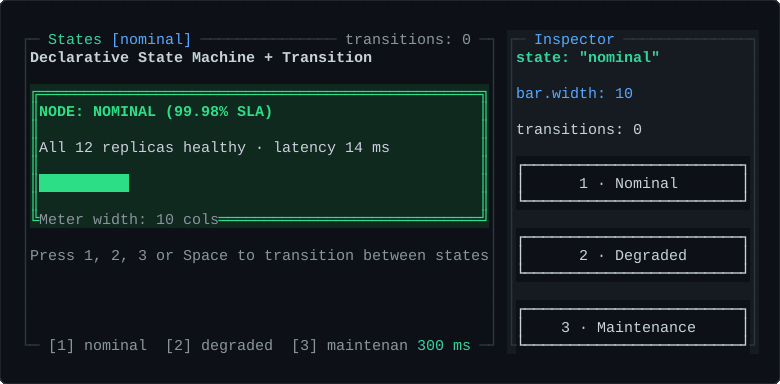
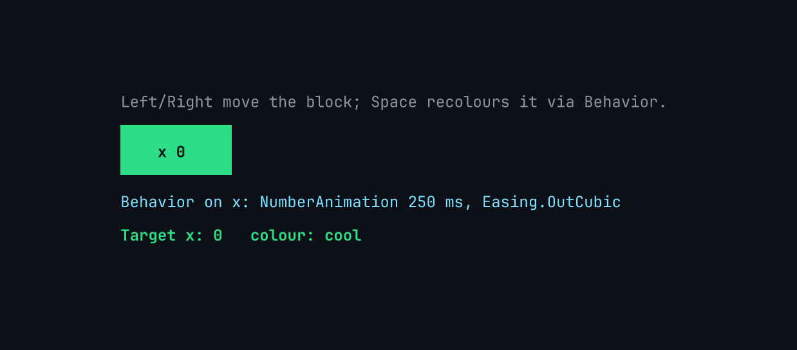

# Animation and States

QmlTui supports declarative states, property changes, transitions, and property animations on the character-cell grid.

## Public Qt vs. Private Qt Builds

QmlTui supports **Qt 6.8 through 6.12** in both public-Qt and private-Qt configurations. By default (`QMLTUI_ENABLE_PRIVATE_QT=ON`), CMake links `Qt6::QmlPrivate` when available to provide `Behavior` and binding-aware `PropertyChanges`.

Because `Qt6::QmlPrivate` does not guarantee binary compatibility across Qt minor releases, shared `QmlTuiCore` binaries built with `QMLTUI_ENABLE_PRIVATE_QT=ON` are coupled to the exact `Qt 6.x` minor version they were compiled against (rebuild QmlTui when upgrading Qt minor versions). If `Qt6::QmlPrivate` is not installed, CMake emits a warning and builds the public-Qt subset; pass `-DQMLTUI_ENABLE_PRIVATE_QT=OFF` explicitly to build strictly against public `Qt6::Core` and `Qt6::Qml` APIs with forward binary compatibility across Qt 6 minor releases.

| Feature | Public Qt Only (`PRIVATE_QT=OFF`) | Private Qt (`PRIVATE_QT=ON`) |
| :--- | :--- | :--- |
| `Item.states` and `state` | Supported | Supported (shared controller) |
| `StateGroup` | Supported | Supported |
| Map-based `PropertyChanges { properties: ({ ... }) }` | Supported | Supported |
| Direct assignment syntax `PropertyChanges { target.prop: val }` | Not available | Supported |
| `PropertyChanges.explicit` | Ignored | Supported (`false` default reactive) |
| Value restoration | Snapshot-based | Binding-aware & snapshot-based |
| Binding preservation across states (A → B → base) | Restores value | Restores original bindings |
| `restoreEntryValues: false` | Supported | Supported |
| Independent groups & atomic collision preflight | Supported | Supported |
| Zero-duration (`duration: 0`) synchronous execution | Supported | Supported |
| Endpoint equality write suppression | Supported | Supported |
| Interrupted transition starts from displayed value | Supported | Supported |
| `Behavior on property` | Not available | Supported |

## States, Transitions, and `Behavior`

Use [`State`](../qml-types/state.md) and [`Transition`](../qml-types/transition.md) to coordinate multi-property changes, or attach [`Behavior`](../qml-types/behavior.md) (when `QMLTUI_ENABLE_PRIVATE_QT=ON`) to animate individual property writes:

```qml
pragma ComponentBehavior: Bound
import QtQml
import QmlTui

Terminal {
    id: root
    property bool expanded: false

    Keys.onPressed: event => {
        if (event.key === Qt.Key_Space) {
            root.expanded = !root.expanded;
            event.accepted = true;
        } else if (event.key === Qt.Key_Q || event.key === Qt.Key_Escape) {
            Qt.quit();
            event.accepted = true;
        }
    }

    Rectangle {
        id: card
        anchors {
            centerIn: parent
        }
        width: 28
        height: 5
        border {
            style: Border.Rounded
            color: "cyan"
        }

        Behavior on width {
            NumberAnimation {
                duration: 150
            }
        }

        Text {
            anchors {
                centerIn: parent
            }
            text: root.expanded ? "Expanded (Press Space)" : "Compact (Press Space)"
        }

        states: [
            State {
                name: "expanded"
                when: root.expanded
                PropertyChanges {
                    target: card
                    properties: ({
                        "width": 48
                    })
                }
            }
        ]

        transitions: [
            Transition {
                NumberAnimation {
                    property: "width"
                    duration: 200
                    easing: Easing.OutQuad
                }
            }
        ]
    }
}
```

## `PropertyChanges` Syntax Forms

### Direct Assignment (`QMLTUI_ENABLE_PRIVATE_QT=ON`)

When built with `QMLTUI_ENABLE_PRIVATE_QT=ON`, assign properties directly on a `target` or qualify them by item `id`:

```qml
PropertyChanges {
    target: label
    text: root.status
    color: "cyan"
}

PropertyChanges {
    label.text: root.status
    card.border.color: "green"
}
```

By default (`explicit: false`), expressions remain reactive while the state is active: if `root.status` changes, `label.text` updates. When `explicit: true`, QmlTui evaluates the expression once on state entry. Mixing direct assignments and map-based `properties: { ... }` in a single `PropertyChanges` object fails at compile time.

### Map-Based Declarations (All Builds)

The map form works in both public-Qt and private-Qt builds. Wrap the object literal in parentheses (`properties: ({ ... })`) so QML parses dynamic binding expressions rather than a statement block:

```qml
PropertyChanges {
    target: label
    properties: ({
        "text": root.status,
        "color": "cyan"
    })
}
```

Inside an `Item`, omitting `target` defaults to the enclosing item. Inside a `StateGroup`, specify an explicit `target` or `id`-qualified property.

## Binding and Restoration Lifecycle

When built with `QMLTUI_ENABLE_PRIVATE_QT=ON`, entering a state suspends preexisting bindings on modified properties rather than overwriting them, and exiting to the base state (or transitioning through chained states `A -> B -> base`) with `restoreEntryValues: true` (the default) restores the original base binding or value. When built with `QMLTUI_ENABLE_PRIVATE_QT=OFF`, state exit restores the snapshotted entry value via `setProperty()`, which replaces prior QML bindings on that property with a static value. Setting `restoreEntryValues: false` on a `State` leaves modified properties at their state values upon exit.

## Independent State Controllers

Combine `Item.states` with one or more [`StateGroup`](../qml-types/stategroup.md) instances for orthogonal state machines. Each `Item` and `StateGroup` tracks the properties it currently owns (resolving QML property aliases to their underlying target property). Before applying a state change, the controller checks whether another active controller already owns any target property; on a collision, it logs a warning and rejects the activation atomically without partially mutating the scene.

## Transition Semantics on the Cell Grid

- Geometry animations (`NumberAnimation` on `x`, `y`, `width`, `height`) step through integer character cells.
- `easing` is a direct enum property on animations (for example, `easing: Easing.OutQuad`, rather than Qt Quick's grouped `easing.type`), and `loops: Animation.Infinite` repeats indefinitely.
- QmlTui suppresses redundant writes when an animated property's destination equals its current displayed value.
- Setting `duration: 0` applies the destination value synchronously without scheduling timer ticks.
- Interrupting a running transition starts the new transition from the currently displayed value.
- When both an active `Transition` and a `Behavior` cover the same property, the `Transition` takes precedence.

See [`examples/recipes/independent_states/`](../../examples/recipes/independent_states/), the gallery examples [`States.qml`](../../examples/gallery/examples/States.qml), [`Animation.qml`](../../examples/gallery/examples/Animation.qml), and [`Behavior.qml`](../../examples/gallery/examples/Behavior.qml), and the [`State`](../qml-types/state.md), [`StateGroup`](../qml-types/stategroup.md), and [`PropertyChanges`](../qml-types/propertychanges.md) references.




