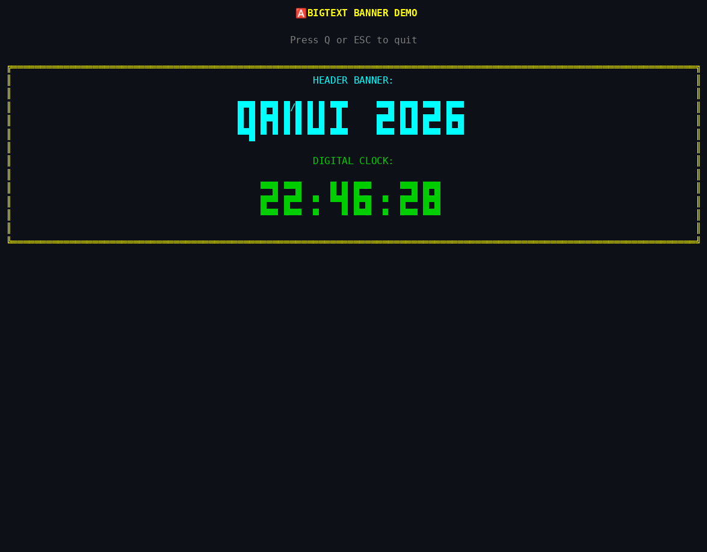

# Creating Custom Items

Extend QmlTui in C++ by subclassing `qmltui::Item` (or `qmltui::Rectangle`) and registering the class with `QML_ELEMENT`.

> [!TIP]
> **Sub-cell drawing without C++**: If you only need custom 2×4 Braille or 1×2 half-block pixel graphics from QML, use [`Canvas`](../qml-types/canvas.md) with `autoClear: false` (for imperative `setPixel()` calls) or declarative `CanvasShape` children instead of writing a C++ subclass.

## 1. Header (`CustomBlock.h`)

Subclass `qmltui::Item` in your own namespace (or global scope), add `Q_OBJECT` and `QML_ELEMENT`, and call `markDirty()` whenever a property change alters the rendered cells. Do not mark `QML_ELEMENT` classes `final` (Qt's QML registration template subclasses your type).

```cpp
#pragma once

#include <QString>
#include <QtQml/qqmlregistration.h>
#include <QmlTui/Core/Engine/KeyEvent.h>
#include <QmlTui/Core/Items/Item.h>
#include <QmlTui/Core/Primitives/Color.h>
#include <QmlTui/Core/Primitives/TextGridBuffer.h>
#include <QmlTui/Core/Primitives/UnicodeText.h>

class CustomBlock : public qmltui::Item {
    Q_OBJECT
    QML_ELEMENT
    Q_PROPERTY(QString label READ label WRITE setLabel NOTIFY labelChanged)
    Q_PROPERTY(qmltui::Color color READ color WRITE setColor NOTIFY colorChanged)

public:
    explicit CustomBlock(QObject* parent = nullptr) : qmltui::Item(parent) {
        setFocusPolicy(Qt::StrongFocus);
        setImplicitHeight(1);
    }

    QString label() const { return m_label; }
    void setLabel(const QString& label) {
        if (m_label == label) return;
        m_label = label;
        setImplicitWidth(qmltui::UnicodeText::displayWidth(m_label) + leftPadding() + rightPadding());
        setImplicitHeight(1 + topPadding() + bottomPadding());
        emit labelChanged();
        markDirty();
    }

    qmltui::Color color() const { return m_color; }
    void setColor(qmltui::Color color) {
        if (m_color == color) return;
        m_color = color;
        emit colorChanged();
        markDirty();
    }

signals:
    void labelChanged();
    void colorChanged();

protected:
    void paint(qmltui::TextGridBuffer& buffer, int absX, int absY,
               const qmltui::ClipRect& clipRect) const override;
    void keyPressEvent(qmltui::KeyEvent* event) override;

private:
    QString m_label;
    qmltui::Color m_color = qmltui::Color::fromString(QStringLiteral("cyan"));
};
```

## 2. Painting and Input (`CustomBlock.cpp`)

Override `paint(qmltui::TextGridBuffer& buffer, int absX, int absY, const qmltui::ClipRect& clipRect) const`. During each frame, the engine calls `paint()`, traverses visible children in stacking order with content offsets and clipping applied, and finally calls `paintOverlay()`. Child traversal is owned by the engine; custom items must not iterate or paint their children directly.

Respect `clipRect` so clipped containers (`ScrollView`, `Popup`, `clip: true`) never bleed outside their bounds. Use [`GraphemeIterator`](../cpp-classes/unicodetext.md) with [`TextGridBuffer::setGrapheme()`](../cpp-classes/textgridbuffer.md) for clipped grapheme-aware writes:

```cpp
#include "CustomBlock.h"

void CustomBlock::paint(qmltui::TextGridBuffer& buffer, int absX, int absY,
                        const qmltui::ClipRect& clipRect) const {
    if (clipRect.isEmpty()) return;
    const int clipRight = clipRect.x + clipRect.width;
    const int clipBottom = clipRect.y + clipRect.height;
    const int row = absY + topPadding();
    if (row < clipRect.y || row >= clipBottom) return;

    int col = absX + leftPadding();
    const qmltui::TextAttribute attrs =
        activeFocus() ? qmltui::TextAttribute::Bold : qmltui::TextAttribute::None;

    qmltui::GraphemeIterator it(m_label);
    qmltui::GraphemeRef g;
    while (it.next(g)) {
        if (g.width > 0 && col + g.width > clipRight) break;
        if (col >= clipRect.x) {
            buffer.setGrapheme(col, row, g.utf16, g.width, m_color, qmltui::Color::Default, attrs,
                               clipRect.x);
        }
        col += g.width;
    }
}

void CustomBlock::keyPressEvent(qmltui::KeyEvent* event) {
    if (event->key() == Qt::Key_Return || event->key() == Qt::Key_Enter) {
        setColor(qmltui::Color::fromString(QStringLiteral("green")));
        event->setAccepted(true);
    }
}
```

### Layout and Paint Rules

- Override `updateLayout()` for work that positions or creates children. Each frame runs a layout pass over the tree before painting, so geometry updated in `updateLayout()` is painted in the same frame. A size change on the item itself marks it `LayoutDirty` automatically.
- `paint()` and `paintOverlay()` are `const`: they must only write cells to `buffer`. Store lazily computed caches in `mutable` members. Invalidations during painting are deferred to the next frame; set `QMLTUI_DEBUG_PAINT_DIRTY=1` to log a warning if an item calls `markDirty()` inside `paint()`.
- Override `paintOverlay()` only for chrome that must appear above the item's children, such as a scrollbar or focus frame.

## 3. CMake Registration and QML Usage

List the header and source under `SOURCES` in `qt_add_qml_module()` and link `QmlTui::Core` (guard `DEPENDENCIES TARGET` on `NOT IMPORTED` so the same `CMakeLists.txt` works with both `FetchContent` and `find_package(QmlTui)`; see [In-Tree vs. Installed Builds](../build-configuration.md#in-tree-vs-installed-builds)):

```cmake
set(app_qml_dependencies)
get_target_property(qmltui_imported QmlTui::Core IMPORTED)
if(NOT qmltui_imported)
    list(APPEND app_qml_dependencies DEPENDENCIES TARGET QmlTui::Core)
endif()

qt_add_executable(my_app main.cpp)
qt_add_qml_module(my_app
    URI MyApp
    SOURCES CustomBlock.h CustomBlock.cpp
    QML_FILES Main.qml
    ${app_qml_dependencies}
)
target_link_libraries(my_app PRIVATE Qt6::Core Qt6::Qml QmlTui::Core)
```

Instantiate `CustomBlock` directly in `Main.qml`:

```qml no-playground
pragma ComponentBehavior: Bound
import QtQml
import QmlTui
import MyApp

Terminal {
    Keys.onPressed: event => {
        if (event.key === Qt.Key_Q || event.key === Qt.Key_Escape) {
            event.accepted = true;
            Qt.quit();
        }
    }

    CustomBlock {
        anchors.centerIn: parent
        padding: 1
        focus: true
        label: "Press Enter to turn green"
    }
}
```

## Complete Examples



- [`examples/recipes/custom_cpp_item/`](../../examples/recipes/custom_cpp_item/): Subclassing `qmltui::Rectangle` (`ProgressBar`), overriding `paint()`, registering with `QML_ELEMENT`, and instantiating from QML.
- [`examples/recipes/big_text/`](../../examples/recipes/big_text/): Custom C++ item painting 3×3 block-pixel banner text into `TextGridBuffer`.
- [`examples/recipes/cpp_only/`](../../examples/recipes/cpp_only/): Constructing and driving a `qmltui::Terminal` and `qmltui::Item` hierarchy directly in C++ without `.qml` files.
