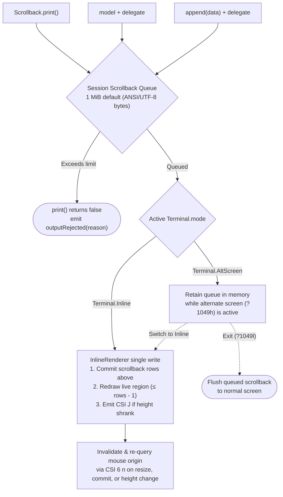
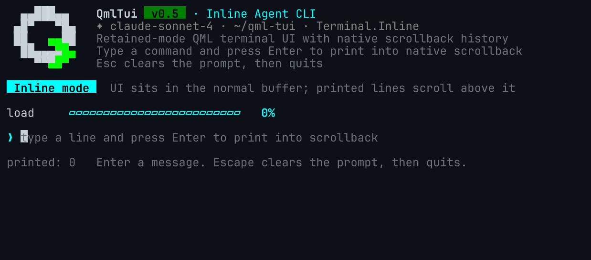

# Inline Mode and Scrollback

By default, `Terminal.mode` is `Terminal.AltScreen`, which switches to the terminal's alternate screen buffer (`\033[?1049h`) and fills the viewport. Setting `mode: Terminal.Inline` keeps the session in the normal screen buffer: it renders a live interactive region at the bottom of the terminal while writing completed output into the terminal's native scrollback above it through [`Scrollback`](../qml-types/scrollback.md).

## Minimal Inline Prompt

In `Terminal.Inline` mode, the root `Terminal` sizes its height from its visible children (capped at `terminalHeight - 1`). Give the root layout a finite implicit or explicit height and use `Scrollback` to commit completed lines above the live prompt:

```qml
pragma ComponentBehavior: Bound
import QtQml
import QmlTui

Terminal {
    id: root
    mode: Terminal.Inline

    Scrollback {
        id: history
    }

    Keys.onPressed: event => {
        if (event.key === Qt.Key_Escape) {
            if (promptInput.text.length > 0) {
                promptInput.text = "";
            } else {
                Qt.quit();
            }
            event.accepted = true;
        }
    }

    Column {
        width: parent.width

        Rectangle {
            width: parent.width
            height: 3
            border {
                style: Border.Rounded
                color: "cyan"
            }

            TextInput {
                id: promptInput
                anchors.fill: parent
                focus: true
                placeholderText: "Type a message (Enter commits to scrollback, Esc quits)..."
                Keys.onReturnPressed: event => {
                    if (promptInput.text.length > 0) {
                        history.print([
                            { text: "> ", color: "cyan", bold: true },
                            { text: promptInput.text }
                        ]);
                        promptInput.text = "";
                    }
                    event.accepted = true;
                }
            }
        }
    }
}
```

## Committing Output with `Scrollback`

`Scrollback` is a non-visual object with three ways to emit rows above the live viewport:

### Direct Output with `print()`

`print()` bypasses delegates, spacing, and separators to write plain text or styled span literals directly into scrollback:

```qml
scrollback.print("Simple log line");

scrollback.print({ text: "Build succeeded", color: "green", bold: true });

scrollback.print([
    { text: "> ", color: "cyan", bold: true },
    { text: "deploy --prod\n" },
    { text: "  done in 0.4s", color: "green" }
]);
```

### Model-Driven Output (`model` + `delegate`)

When bound to a `ListModel` or C++ `QAbstractItemModel`, `Scrollback` renders each newly appended model row through `delegate` once and commits the resulting cells into terminal history:

```qml no-playground
pragma ComponentBehavior: Bound
import QtQml
import QtQml.Models
import QmlTui

Terminal {
    id: root
    mode: Terminal.Inline

    Keys.onPressed: event => {
        if (event.key === Qt.Key_Escape) {
            Qt.quit();
            event.accepted = true;
        }
    }

    ListModel {
        id: messageLog
    }

    Scrollback {
        id: history
        model: messageLog
        spacing: 0

        delegate: Row {
            id: rowRoot
            required property string sender
            required property string message
            required property string time
            spacing: 1

            Text {
                text: "[" + rowRoot.time + "]"
                dim: true
            }
            Text {
                text: rowRoot.sender + ":"
                bold: true
                color: rowRoot.sender === "User" ? "cyan" : "green"
            }
            Text {
                text: rowRoot.message
            }
        }
    }

    function addMessage(sender, message) {
        messageLog.append({
            sender: sender,
            message: message,
            time: new Date().toLocaleTimeString()
        });
    }
}
```

### Template Output (`delegate` + `append(data)`)

When a persistent model is unnecessary, set `delegate` on `Scrollback` and pass JS objects to `append(data)`:

```qml
Scrollback {
    id: buildLog
    spacing: 1

    delegate: Column {
        id: entryDelegate
        required property string title
        required property string detail
        required property bool success

        Text {
            text: (entryDelegate.success ? "[OK] " : "[FAIL] ") + entryDelegate.title
            color: entryDelegate.success ? "green" : "red"
            bold: true
        }
        Text {
            text: "  " + entryDelegate.detail
            dim: true
        }
    }
}

// In a signal handler:
buildLog.append({
    title: "Compilation",
    detail: "Finished in 1.4s (42 targets)",
    success: true
});
```

### Delegate Rules

- Declare `required property <Type> <roleName>` on the delegate root for each role read under `pragma ComponentBehavior: Bound`.
- `Scrollback` is append-only: each entry is painted once and written to the terminal's scrollback buffer. Later modifications to already-emitted model rows are not redrawn.
- `reuseItems` defaults to `true`, pooling the delegate instance across entries.
- `spacing` inserts blank rows between entries, and `separator: Component { ... }` renders an optional divider item between consecutive entries.

## Inline Geometry, Dynamic Resizing, Mode Switching, and Queue Limits



- **Content-driven height and shrinking**: Do not set `anchors.fill: parent` or `height: parent.height` on the top-level child of an inline `Terminal`. Size the live region from its content (`Column`, explicit `height`, etc.). Hidden children (`visible: false`) do not contribute to inline height. When the live region grows and later shrinks (for example, after dismissing an inline completion list or confirmation box), `InlineRenderer` moves the cursor to the previous top row, redraws the shorter live region, and emits `CSI J` (`\033[J`) to erase leftover rows below it.
- **Cursor origin (`CSI 6 n`) and terminal resize**: Because inline output begins at whatever row the shell cursor occupied when the process started, `InlineRenderer` queries the cursor row with `CSI 6 n` (`\033[6n`) to map terminal mouse coordinates to the live region's screen origin. Whenever the prompt height changes, scrollback rows are committed, or the terminal is resized, the cached mouse origin is invalidated and re-queried automatically.
- **Switching between `Terminal.Inline` and `Terminal.AltScreen`**: You can toggle `root.mode` at runtime (for example, switching to `Terminal.AltScreen` to open a full-screen diff or pager and returning to `Terminal.Inline` afterward). Leaving `Terminal.Inline` erases the live inline region cleanly with `\033[J`.
- **Mouse reporting defaults to `false`**: Unlike `Terminal.AltScreen` (which defaults `mouseReporting` to `true`), `Terminal.Inline` disables mouse tracking by default so the host terminal's native text selection and scrollback wheel remain usable. Set `mouseReporting: true` on `Terminal` if your inline prompt contains clickable controls (users can still hold `Shift` in most terminals to select text).
- **Scrollback queue limit**: Pending scrollback output (plain UTF-8 text from `print(string)` and ANSI/SGR-encoded rows from delegates or styled spans) is buffered in a session ANSI/UTF-8 byte queue (`1 MiB` by default, configurable via `QMLTUI_SCROLLBACK_QUEUE_LIMIT` or `TerminalEngine::setScrollbackQueueLimit`) and held while temporarily in `Terminal.AltScreen` mode, then flushed when `Terminal.Inline` resumes or the session exits. If a producer exceeds the queue limit, `print()` returns `false` and `Scrollback` emits `outputRejected(reason)`.

## Logging & `stderr` in Inline Mode

`QtMessageRouting` defers interactive TTY `stderr` diagnostics only while an `AltScreen` session is active. In `Terminal.Inline` mode, `stderr` writes are emitted immediately while raw mode has output post-processing (`OPOST`) disabled, which can cause staircase line breaks or interleave with the live prompt. For clean diagnostics in inline applications, either redirect `stderr` (`./my_cli 2> debug.log`), install a no-op presentation sink from C++ alongside `QMLTUI_LOG_FILE=/tmp/my_cli.log` (`qmltui::QtMessageRouting::install([](const qmltui::QtMessage&) {});` so `QMLTUI_LOG_FILE` captures every log without writing to `stderr`), or write directly to a file sink (see [QtMessageRouting](../cpp-classes/qtmessagerouting.md)).

## Inline Edge Cases

- **Live-region height cap**: `InlineRenderer` caps the live region at `terminalHeight - 1` rows. If your visible root children exceed that height, bottom rows clip silently—keep inline prompts compact or scroll inner content inside a bounded `ScrollView` / `ListView`.
- **`Ctrl+C` in focused text inputs**: When `TextInput` or `TextArea` has active focus and a text selection, `Ctrl+C` copies the selection and accepts the event. When nothing is selected, `Ctrl+C` bubbles up to ancestor `Keys.onPressed` handlers so inline REPLs can clear input or exit on `Ctrl+C`. (Note: a global `Shortcut { sequence: "Ctrl+C" }` runs before focused-item dispatch and intercepts `Ctrl+C` even when text is selected.)
- **Commit-time width and terminal resize**: Rows written through `Scrollback` are rendered at the terminal width active when they are committed and become native terminal scrollback. Subsequent terminal resizes re-layout the live bottom region (and update pooled `Scrollback` delegates that do not set an explicit `width`), while already-committed rows follow the host terminal emulator's own reflow behavior.
- **`print()` wrapping vs. delegates**: `Scrollback.print()` writes strings and span arrays verbatim without word wrapping. Pre-wrap long text before calling `print()`, or use a `Scrollback.delegate` containing a `Text` item with `wrapMode: Text.WordWrap` (leaving `width` unset or binding `width: root.width` so `Scrollback` sizes it to the active terminal width).
- **`append()` dispatch and `DelegateChooser`**: When `Scrollback.delegate` is unset, `append({ text, color, ... })` routes through `append(spans)` (honoring `spacing` and `separator`, unlike `print()`). When `delegate` is set, `append(data)` instantiates the delegate with `data` bound to its properties (use `print()` or `QmlTui.span(...)` for span literals). `Scrollback.delegate` also supports `DelegateChooser` to pick different row layouts per entry type.

See [`examples/recipes/inline_repl/`](../../examples/recipes/inline_repl/), the full-scale [`agent_stream`](https://github.com/qmltui/apps/tree/main/apps/agent_stream) and [`package_manager`](https://github.com/qmltui/apps/tree/main/apps/package_manager) showcase applications in `qmltui/apps`, and the [`Terminal`](../qml-types/terminal.md) and [`Scrollback`](../qml-types/scrollback.md) references.


