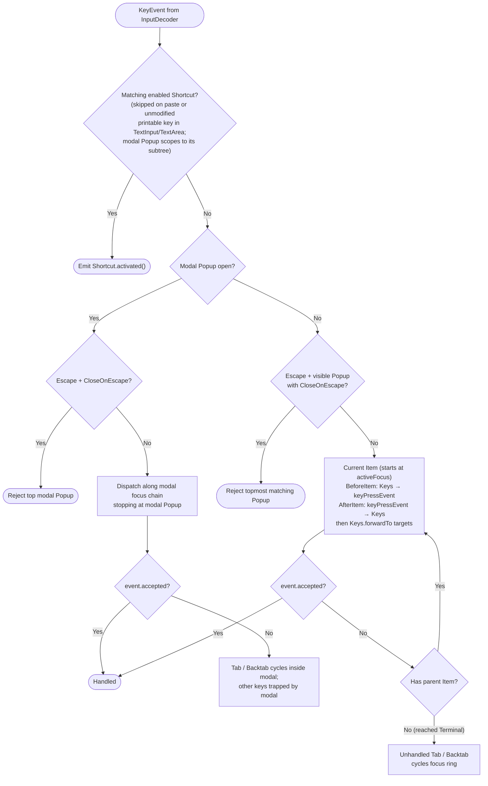
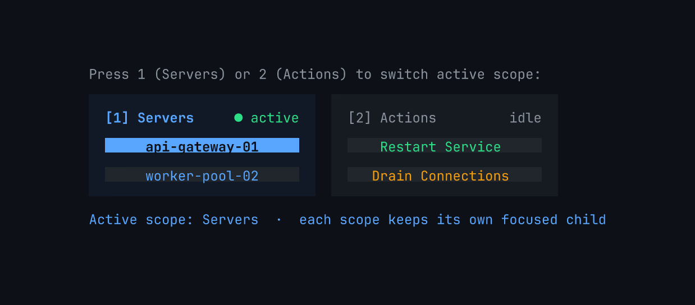
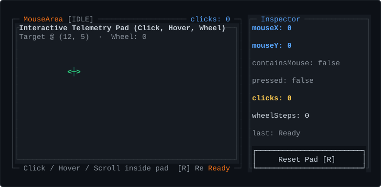

# Input and Focus

QmlTui maintains an explicit focus chain, routes decoded key events from the active item up to the root `Terminal`, and translates SGR mouse sequences and bracketed paste blocks into QML events.

## Active Focus, Tab Chains, and `FocusScope`

Set `focus: true` on the initial interactive item. Items with `focusPolicy: Qt.StrongFocus` or `Qt.TabFocus` (the default on interactive controls, `TextInput`, and `TextArea`) participate in the **Tab** / **Shift+Tab** ring in tree order. Plain `Item` and `Rectangle` default to `Qt.NoFocus`, so custom focusable items must set `focusPolicy: Qt.StrongFocus` explicitly in addition to `focus: true`.

Use [`FocusScope`](../qml-types/focusscope.md) when building a composite component that needs to remember which internal child is focused and gain `activeFocus` as a unit when focused from outside:

```qml
FocusScope {
    id: searchBox
    width: 30
    height: 3

    Rectangle {
        anchors.fill: parent
        border {
            style: searchBox.activeFocus ? Border.Double : Border.Single
            color: searchBox.activeFocus ? "cyan" : "gray"
        }

        TextInput {
            anchors {
                fill: parent
                margins: 1
            }
            focus: true
        }
    }
}
```

## Key Event Propagation

Attached [`Keys`](../qml-types/keys.md) handlers (`Keys.onPressed: event => { ... }`, `Keys.onReturnPressed`, `Keys.onEscapePressed`, `Keys.onUpPressed`) run on the item with `activeFocus`. Unlike Qt Quick, specific-key handlers (`Keys.onEscapePressed`, `Keys.onReturnPressed`, etc.) start with `event.accepted = false`. Set `event.accepted = true;` whenever a handler consumes the key; when `event.accepted` remains `false`, the event bubbles up through ancestor items to the root `Terminal`.

Set `Keys.priority: Keys.BeforeItem` to intercept keys before an item's built-in C++ handler runs (for example, to catch a shortcut before `TextInput` or `PtyView` consumes the keystroke). Set `Keys.forwardTo: [targetItem]` to forward unhandled keys from a search field or container directly to another item such as a `ListView` or `TableView`.



## Shortcuts and the Application Quit Path

In terminal raw mode, `Ctrl+C` does not generate `SIGINT` (`TextInput` and `TextArea` use `Ctrl+C` for copying to the clipboard), and a root `Terminal` does not exit automatically on `Q` or `Escape`. Every application must provide an explicit keyboard quit path:

- [`Shortcut`](../qml-types/shortcut.md) accepts either a portable chord string (`sequence: "Ctrl+Q"`) or a Qt key combination bitmask (`sequence: Qt.ControlModifier | Qt.Key_Q`). Unmodified printable shortcuts are suppressed automatically while an editable `TextInput` or `TextArea` holds focus, whereas modified chords (`"Ctrl+Q"`) fire regardless of focus; prefer `"Ctrl+Q"` for global shortcuts or handle `Qt.Key_Q` on the root `Terminal` after focused items have had a chance to accept the key.
- Handle `Escape` contextually: close open [`Dialog`](../qml-types/dialog.md) or [`Popup`](../qml-types/popup.md) overlays first, clear active filter text or cancel an in-progress action second, and call `Qt.quit()` only when nothing else consumed `Escape`.

```qml
pragma ComponentBehavior: Bound
import QtQml
import QmlTui
import QmlTui.Controls

Terminal {
    id: root

    Shortcut {
        sequence: "Ctrl+Q"
        onActivated: Qt.quit()
    }

    Keys.onPressed: event => {
        if (event.key === Qt.Key_Escape) {
            if (filterInput.text.length > 0) {
                filterInput.text = "";
            } else {
                Qt.quit();
            }
            event.accepted = true;
        }
    }

    Column {
        anchors.centerIn: parent
        spacing: 1

        TextInput {
            id: filterInput
            width: 28
            placeholderText: "Filter (Esc clears, then quits)..."
            focus: true
        }

        Button {
            text: "Open Modal Dialog"
            onClicked: confirmDialog.open()
        }
    }

    Dialog {
        id: confirmDialog
        title: "Confirm Action"
        message: "Press Esc to close this modal without quitting."
    }
}
```

## Mouse Input (`MouseArea`)

[`MouseArea`](../qml-types/mousearea.md) converts SGR 1006 terminal mouse events into cell-coordinate `onClicked`, `onPressed`, `onReleased`, `onMouseXChanged` / `onMouseYChanged` (drag or hover), `onWheel`, and `containsMouse` (when `hoverEnabled: true`). Always pair mouse handlers with keyboard navigation so the interface remains usable without a mouse.

See [`Shortcut.qml`](../../examples/gallery/examples/Shortcut.qml), [`MouseArea.qml`](../../examples/gallery/examples/MouseArea.qml), and [`Dialog.qml`](../../examples/gallery/examples/Dialog.qml), and the [`FocusScope`](../qml-types/focusscope.md), [`Keys`](../qml-types/keys.md), [`Shortcut`](../qml-types/shortcut.md), and [`MouseArea`](../qml-types/mousearea.md) references.




