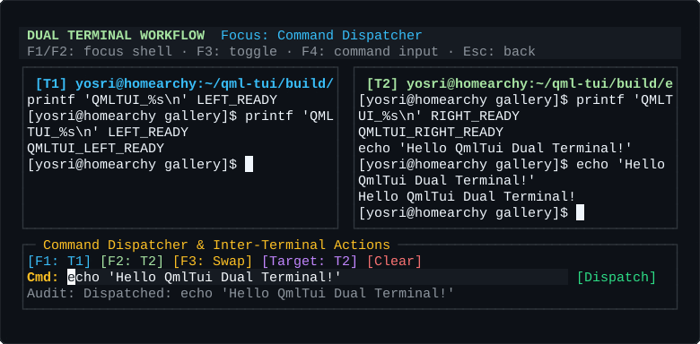

# Embedded PTY Shells (`QmlTui.PtyView`)

`QmlTui.PtyView` provides [`PtyView`](../qml-types/ptyview.md), an embedded terminal emulator backed by a Unix pseudo-terminal (PTY) and `libvterm`. Use it when a QmlTui application needs to host an interactive shell, SSH session, or external CLI process inside a layout pane.

If your application only needs to stream its own output into the parent terminal's scrollback while keeping a live prompt at the bottom, use [`Terminal.Inline` and `Scrollback`](inline-mode.md) instead; inline mode works on all platforms and does not require a PTY.

## Enabling `QmlTui.PtyView` in CMake

`QmlTui.PtyView` is supported on Linux and macOS and is enabled with `-DQMLTUI_ENABLE_PTYVIEW=ON`. By default, CMake fetches a pinned copy of `libvterm`; pass `-DQMLTUI_USE_SYSTEM_LIBVTERM=ON` to link a system-installed `libvterm`:

```bash
cmake -S . -B build \
  -DQMLTUI_ENABLE_PTYVIEW=ON \
  -DQMLTUI_USE_SYSTEM_LIBVTERM=OFF
```

Link `QmlTui::PtyView` in CMake and import `QmlTui.PtyView` in QML:

```cmake
qt_add_qml_module(my_app
    URI MyApp
    QML_FILES Main.qml
    DEPENDENCIES
        TARGET QmlTui::Core
        TARGET QmlTui::PtyView
)
target_link_libraries(my_app PRIVATE Qt6::Core Qt6::Qml QmlTui::Core QmlTui::PtyView)
```

## Process Configuration

`PtyView` executes `program` and `arguments` directly via `execvp` without invoking an intermediate shell or expanding shell metacharacters:

- `program` and `arguments`: executable path/name and argument list. Call `pty.defaultUserShell()` to query the current user's login shell.
- `workingDirectory`: initial working directory for the child process.
- `environment` and `inheritEnvironment`: map of extra environment variables (`{ "MY_VAR": "1" }`), merged with the parent process environment when `inheritEnvironment: true` (default).
- `terminalType`: sets `TERM` inside the PTY (defaults to `"xterm-256color"`, along with `COLORTERM=truecolor` and `TERM_PROGRAM=qmltui`).
- `autoStart`: starts the child process automatically when the QML component completes, or call `start()`, `terminate()` (`SIGTERM`), and `kill()` (`SIGKILL`) explicitly.

## Key Interception, Focus Escape, `sendText()`, and Scrollback

While running and focused, `PtyView` forwards `Tab`, printable keys (`Q`), `Escape`, arrow keys, and `Ctrl+C` directly to the child PTY so interactive programs inside the shell work naturally. Always provide a host `Shortcut` (such as `Shortcut { sequence: "Ctrl+Q"; ... }` or a focus-switching chord) or attach `Keys.priority: Keys.BeforeItem` so keyboard users can move focus out of `PtyView` or exit the host application:

```qml
pragma ComponentBehavior: Bound
import QtQml
import QmlTui
import QmlTui.PtyView

Terminal {
    id: root

    ColumnLayout {
        anchors.fill: parent
        spacing: 1

        Text {
            text: "PID: " + pty.processId + " | State: " + (pty.running ? "Running" : "Stopped (" + pty.exitCode + ")")
                  + " | Title: " + (pty.title || "shell")
            color: "cyan"
            bold: true
        }

        Rectangle {
            Layout.fillWidth: true
            Layout.fillHeight: true
            border {
                style: pty.activeFocus ? Border.Double : Border.Single
                color: pty.activeFocus ? "cyan" : "gray"
            }

            PtyView {
                id: pty
                anchors {
                    fill: parent
                    margins: 1
                }
                focus: true
                program: defaultUserShell()
                arguments: ["-l"]
                autoStart: true

                Keys.priority: Keys.BeforeItem
                Keys.onPressed: event => {
                    if ((event.modifiers & Qt.ControlModifier) && event.key === Qt.Key_Q) {
                        pty.terminate();
                        Qt.quit();
                        event.accepted = true;
                    } else if (event.key === Qt.Key_F1) {
                        pty.sendText("echo 'Hello from QmlTui'\n");
                        event.accepted = true;
                    } else if (event.key === Qt.Key_PageUp) {
                        pty.scrollOffset = Math.min(pty.scrollbackSize, pty.scrollOffset + 5);
                        event.accepted = true;
                    } else if (event.key === Qt.Key_Escape && pty.scrollOffset > 0) {
                        pty.scrollToBottom();
                        event.accepted = true;
                    }
                }

                onFinished: exitCode => Qt.quit()
            }
        }
    }
}
```

## Security Defaults and OSC Permissions

Child processes can emit Operating System Command (OSC) sequences. `PtyView` gates side-effecting sequences by default:

| Property | Default | Behavior |
| :--- | :--- | :--- |
| `allowTitleChanges` | `true` | Updates the read-only `title` property when the child emits OSC 0 / OSC 2 window title sequences. |
| `allowClipboardWrite` | `false` | When enabled, OSC 52 clipboard requests emit `clipboardWriteRequested(string text)` rather than writing to the host clipboard directly. |
| `allowNotifications` | `false` | When enabled, OSC 9 / OSC 777 notification requests emit `notificationRequested(string title, string message)`. |

## Testing `PtyView` with `Runner`

`PtyView` renders its internal `libvterm` screen and scrollback rows directly into the host `TextGridBuffer` during paint. In [`qmltui::Runner`](testing.md) scenarios, inspect child process output on the committed terminal frame using `app.waitForText("...", timeoutMs)` (which uses a wall-clock timeout for child OS processes even when `--clock virtual` is active), `app.frameText()`, or `app.item("pty")` scoped assertions.

See the [PtyView QML Reference](../qml-types/ptyview.md), the [PtyView C++ Reference](../cpp-classes/ptyview.md), [`PtyView.qml`](../../examples/gallery/examples/PtyView.qml) (`./build/examples/gallery/qmltui_gallery --example PtyView`), and the integrated shell drawer in [`file_manager`](https://github.com/qmltui/apps/tree/main/apps/file_manager) (`qmltui/apps`).


