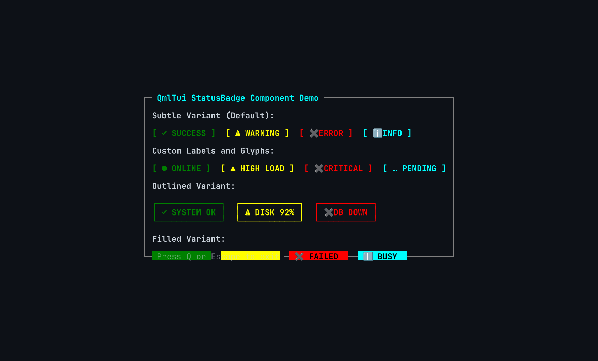
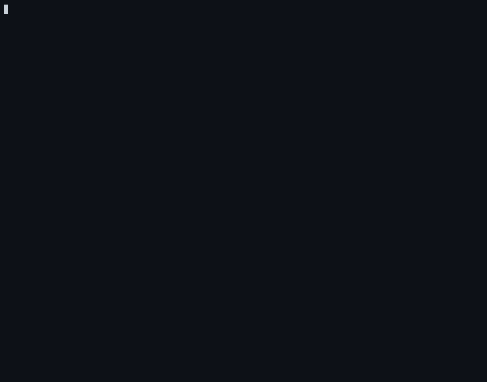

# Styling and colors


QmlTui provides its own QtGui-free `color` value type. Use string literals or the
`QmlTui` singleton to construct a value from normalized red, green, blue, and
alpha channels:

```qml
pragma ComponentBehavior: Bound
import QtQml
import QmlTui

Terminal {
    id: root
    property color accent: QmlTui.rgba(0.2, 0.4, 0.6, 1.0)

    Keys.onPressed: event => {
        if (event.key === Qt.Key_Escape) {
            Qt.quit();
            event.accepted = true;
        }
    }

    Text {
        text: "Custom color"
        color: root.accent
    }
}
```

This property contains a `qmltui::Color`, not a `QColor`. Because `QtQuick` is not
imported in a QtCore/QtQml-only QmlTui application, `property color` resolves
directly to `qmltui::Color`, and `QmlTui.rgba()` / `QmlTui.color()` replace
`Qt.rgba()` / `Qt.color()`. String literals remain supported for any `color`
property.

Two kinds of string are accepted, and they behave differently on screen:

- Hex values such as `"#2cde85"` and bare CSS/SVG color names (`"red"`, `"blue"`,
  `"cyan"`, `"orange"`, `"steelblue"`, ...) are literal 24-bit RGB (`"red"` is
  identical to `"#ff0000"`). On truecolor terminals they render as exact RGB; on
  256- and 16-color terminals they are quantised.
- Explicit `"ansi:..."` strings (`"ansi:red"`, `"ansi:brightred"`, `"ansi:0"`
  through `"ansi:15"`) and `QmlTui.ansi(N)` are 16-color ANSI palette indices,
  not RGB. They are emitted as SGR 30-37 and 90-97 at every color depth, so the
  user's terminal theme decides how they look.
- `QmlTui.defaultColor` (or `"default"`, and the initial value of a default-constructed `color` property) resets to the terminal's default foreground or background via SGR 39/49. When used as a background (for example on a `Dialog`), it paints opaque cells with the terminal's default background color, occluding underlying content.
- `QmlTui.transparent` (or `"transparent"`) leaves item background cells unpainted so the surface underneath remains visible. On a `Canvas`, `setPixelColor(x, y, "transparent")` paints a set pixel in the terminal's default ink, not a hole; erase a pixel with `setPixel(x, y, false)` or the whole surface with `clear()`.

### Inspecting the terminal's actual RGB colors

While `QmlTui.defaultColor` and `QmlTui.ansi(0..15)` are interpreted by the terminal emulator at render time via SGR 39/49 and SGR 30–37/90–97, interactive sessions also query the host terminal's default foreground and background RGB values (`OSC 10` and `OSC 11`) at startup—and the 16-color ANSI palette (`OSC 4;0..15`) when [`Terminal.queryColors()`](../qml-types/terminal.md) is called—and expose them on [`Terminal.capabilities`](../qml-types/terminalcapabilities.md):

- `terminal.capabilities.defaultForegroundColor` (`color`, `.valid === true` once reported)
- `terminal.capabilities.defaultBackgroundColor` (`color`, `.valid === true` once reported)
- `terminal.capabilities.ansiColor(index)` and `terminal.capabilities.ansiPalette` (`0`–`15`)

## Component styling

Core items and Controls default to the terminal's foreground and background.
There is no framework palette, inherited color scheme, or theme singleton.
Set ordinary properties to customize individual components, define an inline
component inside a file, or create a reusable QML component file for
application-wide styling:

```qml
// 1. Inline reusable component using Button's direct color properties:
component AppButton: Button {
    textColor: "#ffffff"
    color: "#202830"
    borderColor: "cyan"
}

// 2. Or file-based RoundedButton.qml overriding background for structural restyling:
Button {
    id: control
    textColor: "#ffffff"
    topPadding: 1
    bottomPadding: 1
    background: Rectangle {
        color: "#202830"
        border {
            color: "cyan"
            style: control.height >= 3
                ? (control.activeFocus ? Border.Double : Border.Rounded)
                : Border.None
        }
    }
}
```

| Component | Color overrides |
| :--- | :--- |
| Text | `color`, `backgroundColor` |
| TextInput, TextArea | `color`, `selectionColor`, `selectedTextColor`, `cursorColor` (`TextInput` also has `placeholderColor`) |
| Canvas, BusyIndicator | `color` (`Canvas` also has `fillColor`) |
| Sparkline | `color`, `backgroundColor` |
| Rectangle and Panel | `color`, `border.color` (`Panel` border slots take `Item`s styled via their own properties) |
| Button | `textColor`, `color`, `borderColor` |
| CheckBox, RadioButton | `textColor` |
| SpinBox, Slider | `color` (background), `textColor`, `border.color` |
| ProgressBar | `color` (filled bar), `trackColor` (unfilled cells; unset `QmlTui.invalidColor` dims `color`) |
| ComboBox | `textColor`, `color`, `border.color`, `popupColor`, `popupBorderColor`, `selectionColor`, `selectedTextColor` |
| Dialog | `textColor`, `titleColor`, `background.color`, `background.border.color` |
| TabBar | `color`, `textColor`, `selectedTextColor`, `selectionColor` |
| TableView | `textColor`, `selectedTextColor`, `selectionColor`, `headerColor`, `headerBackgroundColor`, `rowBackgroundColor`, `alternatingRowBackgroundColor`, `gridColor` |
| TreeView | `textColor`, `selectedTextColor`, `selectionColor`, `branchColor` |
| PtyView | `textColor`, `backgroundColor`, `palette` |
| ToolTip attached properties | `ToolTip.textColor`, `ToolTip.color`, `ToolTip.border.color` (and `ToolTip.border.style`) |

Focus uses borders or bold text. Disabled text is dimmed using SGR 2, preserving
its configured color. `Text.dim` also exposes this attribute directly. TextInput
hints use the configured text color with dimming unless `placeholderColor` is
set. Rich Text links use underline and inline code uses bold.

TabBar, ComboBox, and the built-in TableView/TreeView selection render with reverse video
until selection colors are explicitly supplied. Their optional selection color properties
default to `QmlTui.invalidColor` (`valid === false`, meaning "unset: use reverse video");
setting `"default"` (`valid === true`) explicitly selects the terminal's default color and
disables the reverse-video fallback. TextInput also supports explicit
selection, selected-text, placeholder, and cursor colors. Custom delegates own
their appearance, including selection styling.

## Gradients (`Gradient` and `GradientStop`)

Both [`Rectangle`](../qml-types/rectangle.md) and [`Text`](../qml-types/text.md) accept a [`Gradient`](../qml-types/gradient.md) with [`GradientStop`](../qml-types/gradientstop.md) children (`orientation: Gradient.Horizontal` or `Gradient.Vertical`) to interpolate cell colors across their bounds:

```qml
Rectangle {
    width: 36
    height: 3
    gradient: Gradient {
        orientation: Gradient.Horizontal
        GradientStop { position: 0.0; color: "#0f2027" }
        GradientStop { position: 0.5; color: "#203a43" }
        GradientStop { position: 1.0; color: "#2c5364" }
    }

    Text {
        anchors.centerIn: parent
        text: "Gradient Text & Background"
        bold: true
        gradient: Gradient {
            orientation: Gradient.Horizontal
            GradientStop { position: 0.0; color: "#00f2fe" }
            GradientStop { position: 1.0; color: "#4facfe" }
        }
    }
}
```

See the gallery examples [`Text.qml`](../../examples/gallery/examples/Text.qml) and [`RichText.qml`](../../examples/gallery/examples/RichText.qml), and the [`TextArea` highlighting example](../../examples/recipes/text_area_highlighting/).

### TextArea Highlighting Layers

`TextArea` supports independent named highlight layers through `setHighlightLayer()` and `highlightRange` values. Each layer specifies its own priority and range list. Overlapping layers compose independently per property (foreground color, background color, and text attributes):

```qml
// Priority 0: syntax coloring
textArea.setHighlightLayer("syntax", [
    { start: 0, length: 5, color: "green", bold: true }
], textArea.textRevision, 0)

// Priority 10: search background overlay (preserves syntax green foreground and bold)
textArea.setHighlightLayer("search", [
    { start: 2, length: 3, backgroundColor: "yellow" }
], textArea.textRevision, 10)
```

Highlight changes schedule repaints without modifying document text, layout dimensions, or undo history. Document modifications increment `textRevision` and clear existing layers before `textChanged` is emitted, allowing highlighters to update synchronously or asynchronously.




