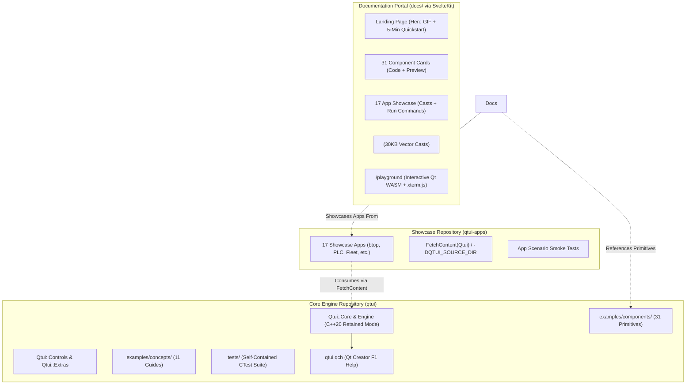

# Qtui Adoption Roadmap & Master Documentation Plan

This directory contains the modular, phased technical plans to establish **Qtui** as the premier terminal UI framework for C++ and Qt, combining the viral adoption ergonomics of Ratatui/Textual with the rigorous standards of the Qt ecosystem.

## Modular Implementation Plans

| Step | Plan Document | Scope & Deliverables | Status |
| :---: | :--- | :--- | :---: |
| **01** | [**01. Showcase Repository Decoupling**](01-repo-split-qtui-apps.md) | Extract `examples/apps` into dedicated `qtui-apps` repo, decouple core CMake and tests, add in-tree `test_behavior.cpp`. | **Ready for Execution** |
| **02** | [**02. Official Qt Documentation Standards**](02-official-qt-docs-standards.md) | Standardize QML/C++ docs (imports, property tables, signals, methods) and generate `.qch` help for Qt Creator F1 support. | **Planned** |
| **03** | [**03. Svelte Documentation Portal**](03-svelte-docs-portal.md) | SvelteKit + mdsvex documentation site, 5-minute `FetchContent` Quickstart, Qt-branded dark terminal theme, and search. | **Planned** |
| **04** | [**04. Visual Showcase & Component Catalog**](04-visual-gallery-catalog.md) | 17-app categorized showcase gallery, 31-component visual catalog, `<TerminalWindow.svelte>`, and automated screenshot pipeline. | **Planned** |
| **05** | [**05. Tiered Live Previews: Casts & WASM**](05-live-preview-wasm-casts.md) | Tier 1 instant Asciinema vector casts + Tier 2 full interactive WebAssembly (WASM) playground piped into `xterm.js`. | **Planned** |

---

## Architectural Vision

---

## Phased Execution Sequence

1. **Phase 1 (Immediate)**: Untangle core tests, extract `examples/apps` into `/home/yosri/qtui-apps`, set up standalone CMake and CI.
2. **Phase 2**: Create the SvelteKit documentation skeleton in `docs/` with the 5-minute Quickstart and Qt-brand styling (`#2CDE85` on `#0d1117`).
3. **Phase 3**: Migrate and format all 31 component documents following the official Qt QML Type layout.
4. **Phase 4**: Capture high-resolution screenshots and Asciinema casts for the showcase apps and components.
5. **Phase 5**: Wire the CMake `.qch` help generation target for Qt Creator F1 help and launch the `/playground` WASM demo.
