# Qtui Launch Roadmap

Nothing is published yet. That is the one advantage this roadmap is built
around: every rough edge can still be fixed before a newcomer ever sees it, and
the first public impression can be made deliberately.

Goal: a Qt developer lands on the site, watches a terminal app run, copies
three files, and has their own Qtui app running in five minutes. Then they find
a component catalog, a showcase, and Qt Creator help that all look and behave
like the rest of Qt. That developer is as likely to be on Windows as on
Linux, so Windows Terminal is a launch platform, not an afterthought.

## Plans, in Execution Order

| Step | Plan | Deliverables | Launch blocker |
| :---: | :--- | :--- | :---: |
| **00** | [Launch Readiness](00-launch-readiness.md) | Qt Quick naming pass (`label` to `text`, versionless imports), compiled `examples/quickstart/`, `TerminalBackend` seam with POSIX and Win32 console backends, Windows Terminal support, CI on Linux, macOS, and Windows, `v0.4.0` tag, README rewrite | Yes |
| **01** | [Documentation Portal](01-docs-portal.md) | SvelteKit site in `website/`, single markdown source next to the code, quickstart above the fold, working Pages deploy | Yes |
| **02** | [Visual Gallery and Casts](02-visual-gallery-and-casts.md) | One recording pipeline for 8 apps and 31 components, SVG stills, hero cast, filterable showcase, generated inventory | Yes |
| **03** | [Repo Split: `qtui-apps`](03-repo-split-qtui-apps.md) | Apps consume Qtui via `FetchContent`, in-tree `test_behavior`, `qtui-starter` template repository | No |
| **04** | [Qt Docs Conventions and Qt Creator](04-qt-docs-standards-qch.md) | Qt-style type pages with compiled examples, `qtui.qch` release asset, `qmlls` completion guide | No |
| **05** | [WebAssembly Playground](05-wasm-playground.md) | `WasmTerminalBackend` on the Plan 00 seam, Emscripten bridge, `xterm.js` playground for `btop`, `snake_game`, `twozero48` | No |

Plans 00 to 02 gate the first announcement. Plans 03 to 05 follow in the weeks
after, each shippable on its own.

## Facts the Plans Are Built On

Verified against the tree on 2026-09-07:

- Version `0.4.0`, Qt 6.8 minimum, no git tags yet, no `.github/workflows/`.
- Exported CMake targets: `Qtui::Core`, `Qtui::Controls`, `Qtui::Extras`,
  `Qtui::Testing`; QML modules `Qtui`, `Qtui.Controls`, `Qtui.Extras`,
  `Qtui.Canvas`, `Qtui.Image`, `Qtui.TerminalHost`. `find_package(Qtui)` is
  supported via installed config files.
- 16 apps in `examples/apps/` today, trimmed to 8 for launch (Plan 02), each
  telling a story no other app tells. 31 components in `examples/components/`,
  11 concepts in `examples/concepts/`. Inventories are generated, not typed.
- `TestRunner` captures text frames with `QTUI_INSPECT`; image capture needs a
  `QGuiApplication`. Stills therefore derive from casts.
- Terminal I/O is POSIX (`termios`, `QSocketNotifier` on stdin, `SIGWINCH`)
  behind about a dozen `#ifdef _WIN32` blocks. Windows output already enables
  VT processing, but input never arrives because `QSocketNotifier` needs a
  socket on Windows, VT input mode is not enabled, and resize is Unix only.
  One backend seam fixes Windows now and WebAssembly later.

## Architecture After All Plans

```mermaid
graph TB
    subgraph "Qtui (core repository)"
        Engine["Qtui::Core, Controls, Extras"]
        Backends["TerminalBackend: Posix, Win32Console, (Wasm)"]
        Backends --> Engine
        Quick["examples/quickstart (compiled in CI)"]
        Comp["examples/components (31)"]
        Conc["examples/concepts (11)"]
        Docs["docs/components, docs/guide, src/Qtui/*/doc (single source)"]
        Tests["tests/ (self-contained, test_behavior)"]
        QCH["qtui.qch (release asset)"]
    end

    subgraph "qtui-apps"
        Apps["8 showcase apps"]
        Starter["qtui-starter (template repo)"]
    end

    subgraph "website/ (SvelteKit, GitHub Pages)"
        Landing["Landing: hero cast + quickstart"]
        Catalog["Component catalog"]
        Showcase["Showcase gallery"]
        Playground["/playground (WASM, later)"]
    end

    Apps -->|FetchContent v0.4.0| Engine
    Starter -->|FetchContent v0.4.0| Engine
    Docs -->|sync-content| Catalog
    Quick -->|verbatim| Landing
    Apps -->|casts| Showcase
    Comp -->|casts + SVG| Catalog
    Docs --> QCH
```

## Working Rules

- Anything a newcomer copies is compiled in CI: the quickstart, every doc
  example, every showcase run command.
- Anything a newcomer counts is generated from the filesystem.
- Any number shown on the site (load time, payload size) is measured in the
  build, never estimated in a plan.
- One showcase app per story. A new app is added only if it demonstrates
  something no existing app does, and it arrives with tests and a cast.
- Every platform claim on the site is backed by a CI row: Linux, macOS, and
  Windows Terminal at launch.
- Naming follows Qt Quick unless there is a terminal-specific reason not to,
  and that reason is written in the type's Detailed Description.
