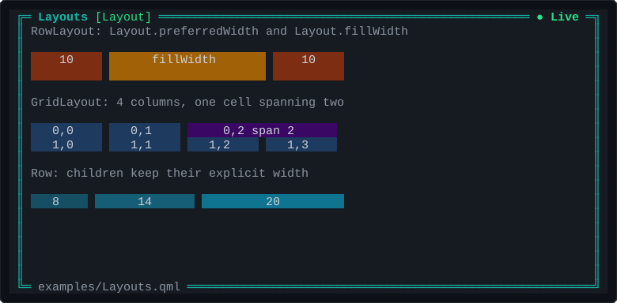

# AnchorLine QML type

Represents an edge or center alignment line used for anchoring items. [More...](#detailed-description)

| | |
| :--- | :--- |
| **Import Statement** | `import QmlTui` |
| **Since** | QmlTui 0.4 |
| **Inherits** | none |
| **Instantiation** | Not directly instantiable |

## Enumeration AnchorLine.Edge

| Value | Description |
| :--- | :--- |
| `AnchorLine.Left` | The left edge alignment line of an item. |
| `AnchorLine.Right` | The right edge alignment line of an item. |
| `AnchorLine.Top` | The top edge alignment line of an item. |
| `AnchorLine.Bottom` | The bottom edge alignment line of an item. |
| `AnchorLine.HorizontalCenter` | The horizontal center line bisecting an item. |
| `AnchorLine.VerticalCenter` | The vertical center line bisecting an item. |

## Detailed Description

AnchorLine represents a specific edge or center boundary on an [Item](item.md).
It is exposed as read-only properties on Item: `left`, `right`, `top`, `bottom`,
`horizontalCenter`, and `verticalCenter`.

AnchorLine instances cannot be instantiated directly in QML; they are passed
as targets to [Anchors](anchors.md) properties (such as `anchors.left: parent.left`).

### Example

<<< ../../examples/gallery/examples/Anchors.qml{qml}

### Gallery Example

See [`examples/gallery/examples/Anchors.qml`](../../examples/gallery/examples/Anchors.qml) (`./build/examples/gallery/qmltui_gallery --example Anchors`, or open in the [WebAssembly Playground](../playground.md?example=Anchors.qml)).
