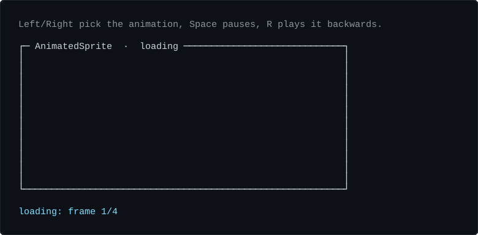

# AnimatedSprite QML type

Plays a frame-grid animation from a single sprite sheet. [More...](#detailed-description)

| | |
| :--- | :--- |
| **Import Statement** | `import QmlTui.Image` |
| **Since** | QmlTui 0.5 |
| **Inherits** | [Image](image.md) |

## Properties

| Property | Type | Default | Description |
| :--- | :--- | :--- | :--- |
| `frameCount` | `int` | `1` | Number of frames in the animation. |
| `frameWidth` | `int` | `0` | Width of one frame in sheet pixels. `0` derives it: the sheet is taken as one row of square frames, so it defaults to the frame height. |
| `frameHeight` | `int` | `0` | Height of one frame in sheet pixels. `0` uses the sheet height. |
| `frameX` | `int` | `0` | X of the first frame's top-left corner in the sheet. |
| `frameY` | `int` | `0` | Y of the first frame's top-left corner in the sheet. |
| `frameRate` | `real` | `0` | Frames per second. When greater than `0` it takes precedence over `frameDuration`. Changing it re-times the clock. |
| `frameDuration` | `int` | `-1` | Milliseconds per frame, used when `frameRate` is not set. With neither set the animation cannot advance and a warning is printed. |
| `currentFrame` | `int` | `0` | The frame being shown. Writable, also while paused or stopped; values wrap into `0 .. frameCount-1`. |
| `running` | `bool` | `true` | Whether the animation plays. Setting it to `true` behaves like `start()` and rewinds to the first frame; `false` behaves like `stop()` and keeps the current frame. |
| `paused` | `bool` | `false` | Freezes the clock without resetting anything; `advance()` still steps by hand. |
| `loops` | `int` | `AnimatedSprite.Infinite` | How many times the animation plays before it finishes. `AnimatedSprite.Infinite` never stops on its own. |
| `reverse` | `bool` | `false` | Play the frames last to first. A run then starts at the last frame. |
| `finishBehavior` | `FinishBehavior` | `AnimatedSprite.FinishAtInitialFrame` | Which frame stays visible when a finite `loops` count completes. |

Every [Image](image.md) property applies to the current frame: `fillMode`,
`renderMode`, `smooth`, `alignment`, `source`, `image`, and so on.

## Enumeration AnimatedSprite.Loops

| Value | Description |
| :--- | :--- |
| `AnimatedSprite.Infinite` | Loop the animation indefinitely (`-1`). |

## Enumeration AnimatedSprite.FinishBehavior

| Value | Description |
| :--- | :--- |
| `AnimatedSprite.FinishAtInitialFrame` | Return to the first frame of a run when the animation finishes. |
| `AnimatedSprite.FinishAtFinalFrame` | Stay on the last frame shown. |

## Signals

| Signal | Description |
| :--- | :--- |
| `finished()` | A finite `loops` count completed. Not emitted for `Infinite`, nor when `running` is set to `false`. |

## Methods

| Method | Description |
| :--- | :--- |
| `void start()` | Rewinds to the first frame of a run and plays. Nothing happens when already running. |
| `void stop()` | Stops playing, keeping the current frame. |
| `void restart()` | `stop()` then `start()`. |
| `void pause()` | Sets `paused`. |
| `void resume()` | Clears `paused`. |
| `void advance()` | Steps one frame by hand, loops and finishing included; works while paused or stopped. |
| `void advance(int frames)` | Steps `frames` frames by hand, loops and finishing included; works while paused or stopped. |

## Detailed Description

AnimatedSprite is [Image](image.md) plus a frame clock. The sheet is decoded
once; each tick moves the inherited `sourceClipRect` to the next frame, so the
glyph modes re-scale one frame per tick and the pixel protocols upload one
frame instead of the sheet. The item owns `sourceClipRect`; a value assigned
from outside is overwritten on the next frame.

Frames run to the right from (`frameX`, `frameY`) in steps of `frameWidth`,
and wrap to the sheet's left edge one `frameHeight` further down when a row
runs out — the same layout Qt Quick's AnimatedSprite reads. The implicit size
is one frame, height halved for the half-block cell grid.

For several named animations in one sheet — a character with idle, walk and
jump rows — give each state its own `frameX`/`frameY`/`frameCount` and switch
them from a state machine or plain bindings.

### Example

<<< ../../examples/gallery/examples/AnimatedSprite.qml{qml}

### Gallery Example

See [`examples/gallery/examples/AnimatedSprite.qml`](../../examples/gallery/examples/AnimatedSprite.qml) (`./build/examples/gallery/qmltui_gallery --example AnimatedSprite`, or open in the [WebAssembly Playground](../playground.md?example=AnimatedSprite.qml)).
