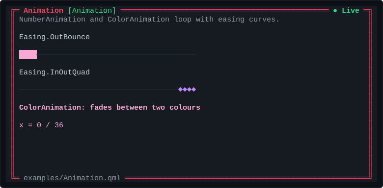

# Animation QML type

Base class for all QmlTui animations. [More...](#detailed-description)

| | |
| :--- | :--- |
| **Import Statement** | `import QmlTui` |
| **Since** | QmlTui 0.4 |
| **Inherits** | none |
| **Instantiation** | Not directly instantiable |

## Properties

| Property | Type | Default | Description |
| :--- | :--- | :--- | :--- |
| `running` | `bool` | `false` | Holds whether the animation is currently running. |
| `loops` | `int` | `1` | Holds the number of times the animation plays before completing. |

## Signals

| Signal | Description |
| :--- | :--- |
| `started()` | Emitted when the animation begins playing. |
| `stopped()` | Emitted when the animation is stopped before completing. |
| `finished()` | Emitted when the animation completes all specified loops. |

## Methods

| Method | Description |
| :--- | :--- |
| `void start()` | Starts or resumes playback of the animation. |
| `void stop()` | Stops the animation and resets playback. |

## Detailed Description

Animation is the uncreatable abstract base class for all animation types in QmlTui,
including [PropertyAnimation](propertyanimation.md), [NumberAnimation](numberanimation.md),
and [ColorAnimation](coloranimation.md).

It provides common playback controls (`start()`, `stop()`), loop management (`loops`),
and lifecycle signals (`started`, `stopped`, `finished`). Under the hood, running
animations are stepped by the QmlTui animation manager driven by the active
system or virtual clock.

### Example

```qml
import QtQml
import QmlTui

Terminal {
    Keys.onPressed: event => {
        if (event.key === Qt.Key_Q || event.key === Qt.Key_Escape) {
            Qt.quit()
            event.accepted = true
        }
    }

    Rectangle {
        id: box
        anchors.centerIn: parent
        width: 10
        height: 3
        border.style: Border.Single

        NumberAnimation {
            target: box
            property: "width"
            from: 10
            to: 30
            duration: 400
            running: true
            loops: 1
        }

        Text {
            anchors.centerIn: parent
            text: "Animated"
        }
    }
}
```

### Gallery Example



See [`examples/gallery/examples/Animation.qml`](../../examples/gallery/examples/Animation.qml) (`./build/examples/gallery/qmltui_gallery --example Animation`, or open in the [WebAssembly Playground](../playground.md?example=Animation.qml)).
