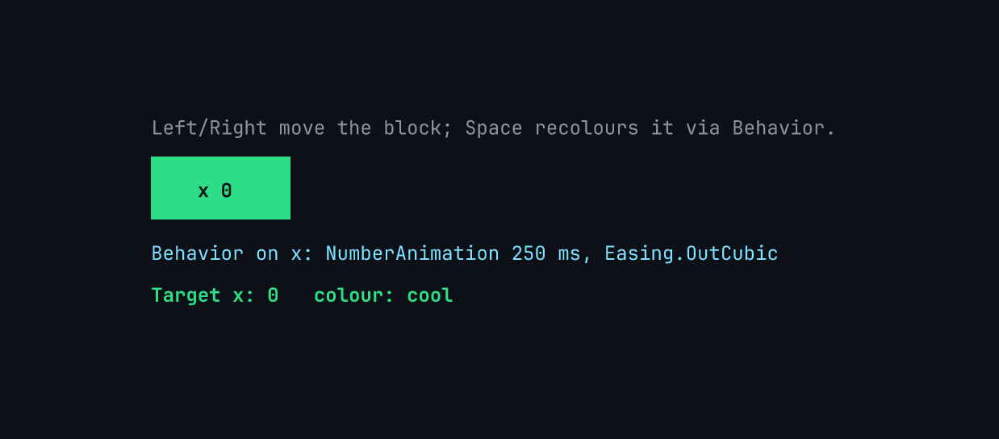

# Behavior QML type

Defines default animations for property changes. [More...](#detailed-description)

| | |
| :--- | :--- |
| **Import Statement** | `import QmlTui` |
| **Since** | QmlTui 0.4 |
| **Inherits** | none |

## Properties

| Property | Type | Default | Description |
| :--- | :--- | :--- | :--- |
| `animation` | `Animation` | `null` | Holds the animation to execute whenever the target property changes value. This is the default property. |

## Detailed Description

Behavior allows an animation to be triggered automatically whenever a property's
value changes, using the `Behavior on <property>` syntax.

Whenever the target property is assigned a new value, the Behavior intercepts
the change and plays its child [Animation](animation.md) to transition the property
smoothly from its old value to the new value.

> [!NOTE]
> Behavior is an optional feature in QmlTui requiring `QMLTUI_ENABLE_PRIVATE_QT=ON`
> and links against `Qt6::QmlPrivate`.

### Example

<<< ../../examples/gallery/examples/Behavior.qml{qml}

### Gallery Example

See [`examples/gallery/examples/Behavior.qml`](../../examples/gallery/examples/Behavior.qml) (`./build/examples/gallery/qmltui_gallery --example Behavior`, or open in the [WebAssembly Playground](../playground.md?example=Behavior.qml)).
