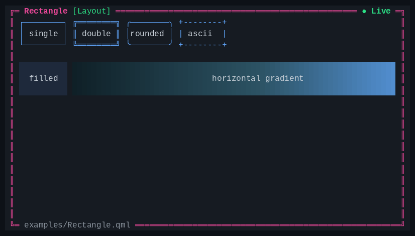

# Border QML type

Grouped property configuring the border style and colour of a Rectangle. [More...](#detailed-description)

| | |
| :--- | :--- |
| **Import Statement** | `import QmlTui` |
| **Since** | QmlTui 0.4 |
| **Inherits** | none |
| **Instantiation** | Not directly instantiable |

## Properties

| Property | Type | Default | Description |
| :--- | :--- | :--- | :--- |
| `style` | `Style` | `Border.None` | Holds the border style: `Border.None`, `Border.Single` (single-line), `Border.Double` (double-line), `Border.Rounded` (single-line with curved corners `╭`, `╮`, `╰`, `╯`), `Border.Heavy` (heavy-line `┏`, `┓`, `┗`, `┛`, `━`, `┃`), or `Border.Ascii` (`+`, `-`, `|`). |
| `color` | `rgba` | `"default"` | Holds the colour of the border glyphs. |

## Enumeration Border.Style

| Value | Description |
| :--- | :--- |
| `Border.None` | No border is rendered. |
| `Border.Single` | Standard single-line box-drawing characters (`┌`, `┐`, `└`, `┘`, `─`, `│`). |
| `Border.Double` | Double-line box-drawing characters (`╔`, `╗`, `╚`, `╝`, `═`, `║`). |
| `Border.Rounded` | Single-line border with curved corner glyphs (`╭`, `╮`, `╰`, `╯`). |
| `Border.Heavy` | Heavy-line box-drawing characters (`┏`, `┓`, `┗`, `┛`, `━`, `┃`). |
| `Border.Ascii` | ASCII fallback characters (`+`, `-`, `|`). |

## Detailed Description

`Border` is a grouped property available on [Rectangle](rectangle.md). It
controls the box-drawing characters used to frame the item.

### Example

```qml
import QtQml
import QmlTui

Terminal {
    Rectangle {
        anchors.centerIn: parent
        width: 20
        height: 6
        border.style: Border.Rounded
        border.color: "cyan"
    }
}
```

### Interactive Demo & Recording



- **Live Playground**: [▶ Open `Rectangle.qml` in the WebAssembly Playground](../playground.md?example=Rectangle.qml)
- **Standalone CLI**: `./build/examples/gallery/qmltui_gallery --example Rectangle`
- **Gallery Source**: [`examples/gallery/examples/Rectangle.qml`](../../examples/gallery/examples/Rectangle.qml)
