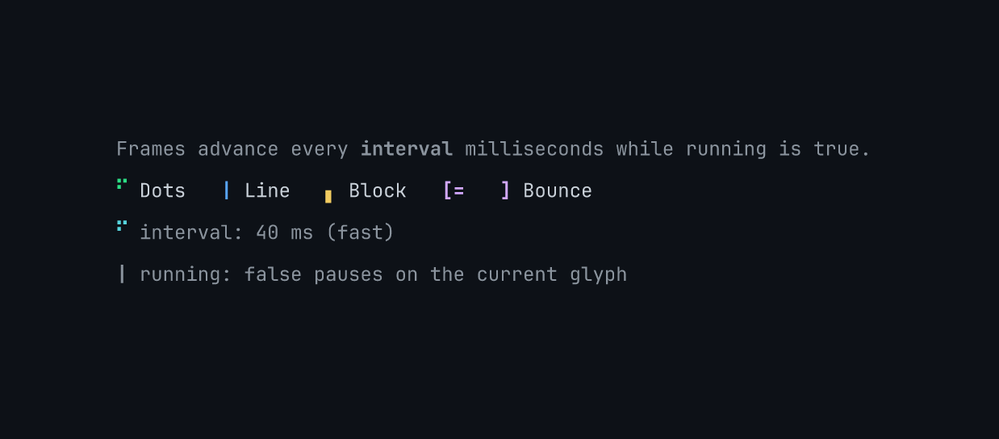

# BusyIndicator QML type

A one-cell animated spinner that cycles through a sequence of glyphs while an operation is in progress. [More...](#detailed-description)

| | |
| :--- | :--- |
| **Import Statement** | `import QmlTui.Controls` |
| **Since** | QmlTui 0.4 |
| **Inherits** | [Text](text.md) |

## Properties

| Property | Type | Default | Description |
| :--- | :--- | :--- | :--- |
| `running` | `bool` | `true` | Whether the animation advances; the current glyph stays visible when false. |
| `interval` | `int` | `100` | Holds the time in milliseconds each glyph is shown before the next one. |
| `frames` | `list<string>` | `["⠋", "⠙", "⠹", "⠸", "⠼", "⠴", "⠦", "⠧", "⠇", "⠏"]` | Holds the list of glyph frames to cycle through; defaults to a one-cell braille spinner. |

## Detailed Description

BusyIndicator is a [Text](text.md) whose `text` reflects the glyph at an
internal frame counter in the sequence given by `frames`. Its inherited `bold`
property defaults to `true`, and `color` defaults to `"default"`, the terminal's
own foreground; set `color` to tint it or `bold: false` for normal weight. By default, `frames` provides a ten-frame braille spinner (`⠋ ⠙ ⠹ ...`),
one cell wide. Set `frames` to any custom sequence of strings to change the
spinner animation.

The indicator advances to the next frame every `interval` milliseconds while
both `running` and `visible` are true, cycling continuously through `frames`.
Pausing the animation or hiding the indicator stops the timer; when re-enabled,
animation resumes from the current frame.

### Example

<<< ../../examples/gallery/examples/BusyIndicator.qml{qml}

### Gallery Example

See [`examples/gallery/examples/BusyIndicator.qml`](../../examples/gallery/examples/BusyIndicator.qml) (`./build/examples/gallery/qmltui_gallery --example BusyIndicator`).
