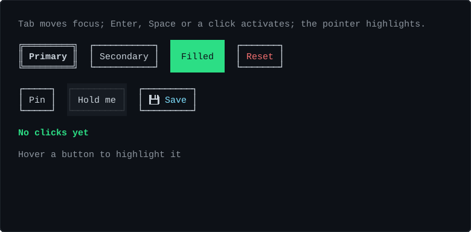

# Button QML type

A focusable, bordered action button that emits `clicked()` on Enter, Space or a mouse click. [More...](#detailed-description)

| | |
| :--- | :--- |
| **Import Statement** | `import QmlTui.Controls` |
| **Since** | QmlTui 0.4 |
| **Inherits** | [AbstractButton](abstractbutton.md) |

## Properties

| Property | Type | Default | Description |
| :--- | :--- | :--- | :--- |
| `color` | `color` | `QmlTui.defaultColor` | Holds the fill color of the default `background` rectangle. |
| `borderColor` | `color` | `QmlTui.defaultColor` | Holds the border color of the default `background` rectangle. |

All other properties (`text`, `textColor`, `down`, `pressed`, `hovered`,
`highlighted`, `background`, `contentItem`, and `checkable`), signals, and methods
are inherited from [AbstractButton](abstractbutton.md).

## Detailed Description

Button is an [AbstractButton](abstractbutton.md) with a bordered
[Rectangle](rectangle.md) as `background` and a centred [Text](text.md) label
as `contentItem`, with paddings of 2 cells horizontally and 1 row vertically
so the implicit size is the label width plus 4 by 3 rows (or 1 row when a
custom `background` uses `Border.None`). Enter or Space while
focused, or a mouse press and release inside it, emits `clicked()`; a press
also gives the button focus and holds `pressed`. Nothing happens while
`enabled` is false. Tab and Shift+Tab move focus between focusable items.

State shows in the border and the label, and each state has its own look.
The border style is `Border.Single`, or `Border.Double` while the button has active
focus, and it is dropped on a button shorter than 3 rows, where the label is
centred on the single row and shows focus by boldness alone. While `down`,
that is while a mouse button is held on it, the label is drawn in reverse
video, so a click flashes and the double border that remains afterwards is
focus, which a click also gives the button. The label is bold while the control has active focus, is `hovered`, or is `highlighted`.
Hover is decoration only: keyboard focus reaches every state, and terminals or
recordings without motion reporting never show it. `textColor`, `color`, and
`borderColor` default to `QmlTui.defaultColor` (`"default"`), the terminal's
own colours.

For quick color overrides, set `textColor`, `color`, and `borderColor` directly
on the Button. For structural restyling (such as removing the border on a
3-row button or replacing the label layout), assign `background`, `contentItem`,
or both:

```qml
Button {
    id: filled
    text: "Filled"
    background: Rectangle { color: "#65e6a0"; border.style: Border.None }
    contentItem: Text {
        text: filled.text
        color: "#0b0f14"
        bold: filled.activeFocus
        horizontalAlignment: Qt.AlignHCenter
        verticalAlignment: Qt.AlignVCenter
    }
}
```

For a toggle use [CheckBox](checkbox.md), for one
choice out of several [RadioButton](radiobutton.md) with a
[ButtonGroup](buttongroup.md).

### Example

<<< ../../examples/gallery/examples/Button.qml{qml}

### Gallery Example



See [`examples/gallery/examples/Button.qml`](../../examples/gallery/examples/Button.qml) (`./build/examples/gallery/qmltui_gallery --example Button`).
