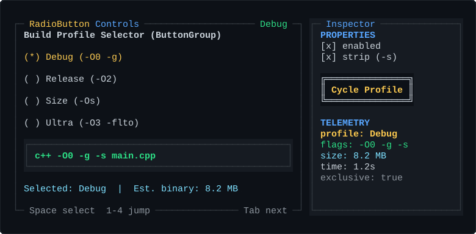

# ButtonGroup QML type

A non-visual object that links [RadioButton](radiobutton.md) items so that checking one unchecks the others. [More...](#detailed-description)

| | |
| :--- | :--- |
| **Import Statement** | `import QmlTui.Controls` |
| **Since** | QmlTui 0.4 |
| **Inherits** | `QtObject` |

## Properties

| Property | Type | Default | Description |
| :--- | :--- | :--- | :--- |
| `buttons` | `list<QtObject>` |  | Holds the items that belong to the group; each item exposing a `buttonGroup` property has it set to this group when the list changes. |

## Detailed Description

ButtonGroup is a plain `QtObject`, not an item: it has no geometry, is not
drawn and cannot be anchored or placed in a layout. Declare it anywhere in
the object tree and assign the member items to `buttons`, typically as a list
of ids. Whenever `buttons` changes, the group walks the list and assigns
itself to the `buttonGroup` property of every member that has one, so the
members do not need to set `buttonGroup` themselves. Members without a
`buttonGroup` property, such as [Button](button.md) or
[CheckBox](checkbox.md), are accepted but left untouched.

The exclusivity logic lives in [RadioButton](radiobutton.md), not in the
group: when a RadioButton becomes checked it iterates over
`buttonGroup.buttons` and sets `checked` to false on every other member that
has a `checked` property. ButtonGroup itself has no `checkedButton`
property, no signals and no methods. Note that removing an item from
`buttons` does not reset its `buttonGroup` back to `null`.

### Example

```qml
import QtQml
import QmlTui
import QmlTui.Controls

Terminal {
    ButtonGroup {
        buttons: [debugBuild, releaseBuild]
    }

    Column {
        anchors.centerIn: parent
        spacing: 1

        RadioButton {
            id: debugBuild
            text: "Debug"
            checked: true
            focus: true
        }

        RadioButton {
            id: releaseBuild
            text: "Release"
            onToggled: checked => { if (checked) Qt.quit() }
        }
    }
}
```

### Gallery Example



See [`examples/gallery/examples/RadioButton.qml`](../../examples/gallery/examples/RadioButton.qml) (`./build/examples/gallery/qmltui_gallery --example RadioButton`, or open in the [WebAssembly Playground](../playground.md?example=RadioButton.qml)).
