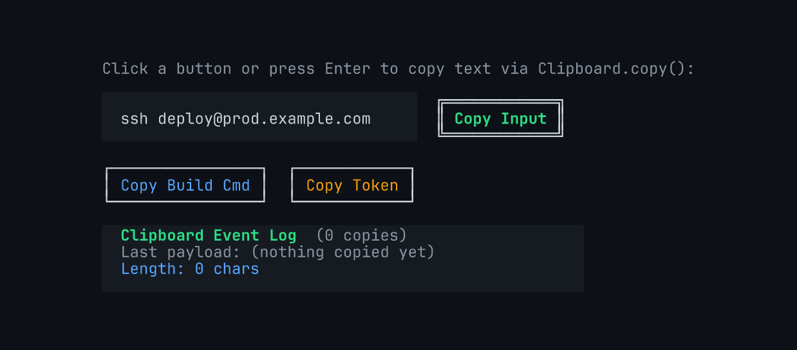

# Clipboard QML type

Terminal clipboard singleton with copying and Promise-based text reads. [More...](#detailed-description)

| | |
| :--- | :--- |
| **Import Statement** | `import QmlTui` |
| **Since** | QmlTui 0.3 |
| **Inherits** | `QObject` |
| **Instantiation** | Singleton, use by name |

Clipboard is a singleton for text clipboard operations through the application's
terminal. It uses OSC 52 and requires neither Qt GUI nor local clipboard helper
programs. The singleton belongs to its QML engine.

## Properties

| Property | Type | Default | Description |
| --- | --- | --- | --- |
| `terminal` | `Terminal` | Automatic | Effective terminal connection. Automatically selects the sole initialized Terminal in this QML engine. With no terminals or multiple terminals it is `null`. Assign a Terminal from the same engine to override; assign `null` to restore automatic selection. Invalid assignments warn and preserve the previous selection. |
| `readTimeout` | `int` | `2000` | Read deadline in milliseconds. Must be positive; invalid assignments warn and preserve the previous value. Changes apply to subsequent queries. |

Destroying an explicitly selected terminal restores automatic selection.

## Signals

| Signal | Description |
| --- | --- |
| `copyRequested(string text)` | Emitted once for each copy request from the selected terminal, including repeated copies of identical text. |

## Methods

| Method | Description |
| --- | --- |
| `void copy(string text)` | Requests a clipboard write through the selected terminal. |
| `Promise<string> requestText()` | Requests clipboard text asynchronously. |

## Detailed Description

### `void copy(string text)`

Calls the selected Terminal's `copyToClipboard(text)`. Its `clipboardMode` and
`clipboardCopyRequested` signal retain their existing behavior: the signal is
emitted even when OSC 52 output is disabled. Without an unambiguous terminal,
copy warns and does nothing. A write request does not confirm that the terminal
updated its clipboard; no success acknowledgment is available.

### `Promise<string> requestText()`

Requests clipboard text from the selected terminal. Resolves with a string,
including `""` for an empty clipboard, or rejects with a JavaScript `Error` with
a stable `code` property. Promise handlers run asynchronously. The method does
not block input or rendering and does not insert the text into a control.

```js
Clipboard.requestText().then(text => {
    editor.paste(text);
}).catch(error => {
    console.warn(error.code, error.message);
});
```

| Error code | Meaning |
| --- | --- |
| `NoTerminal` | No terminal is available. |
| `AmbiguousTerminal` | Multiple terminals exist; assign `Clipboard.terminal`. |
| `Disabled` | The selected terminal's clipboard mode is disabled. |
| `Unavailable` | The session is stopped, input/output is noninteractive, output is suppressed, or the query could not be written. |
| `Timeout` | No matching response arrived before the deadline. |
| `InvalidResponse` | A clipboard reply was malformed, invalid Base64/UTF-8, or exceeded the 1 MiB decoded-text limit. |
| `Cancelled` | Terminal selection changed, the terminal stopped or was destroyed, or clipboard integration/output was disabled while waiting. |

Concurrent calls share the current query and its original deadline. After it
settles, another call starts a fresh query. Unsolicited responses are ignored.
OSC 52 has no request identifiers: a delayed response arriving during a later
query cannot reliably be distinguished from that later query's response.

Terminals may deny or not support clipboard reads. Silence is reported as a
timeout, without assuming a particular reason. There is no startup clipboard
probe, local cached-text fallback, or clipboard monitoring.

Ordinary terminal-initiated paste remains independent: its text arrives through
focused input handling, including `KeyEvent.paste`. It does not require
`requestText()` and is never mistaken for an OSC 52 reply. No global
application-wide Ctrl+V shortcut is installed automatically (focused
[TextInput](textinput.md) and [TextArea](textarea.md) items handle Ctrl+V
internally by requesting clipboard text via OSC 52 and pasting the reply).

### Copy feedback

`copyRequested(text)` forwards the selected Terminal's `clipboardCopyRequested`
signal. It covers `Clipboard.copy()`, direct terminal copy calls, and copying or
cutting selections in text controls. Copies from unselected terminals are not
forwarded, and no signal is emitted when the singleton has no effective terminal.
Changing or destroying the selected terminal updates the connection automatically.

The signal reports a request, not confirmed system clipboard success. It fires
even with OSC 52 output disabled, allowing application-provided clipboard handlers
and feedback to continue working. The application owns the notification UI,
as demonstrated in the gallery example below.

### Example

<<< ../../examples/gallery/examples/Clipboard.qml{qml}

### Gallery Example



See [`examples/gallery/examples/Clipboard.qml`](../../examples/gallery/examples/Clipboard.qml) (`./build/examples/gallery/qmltui_gallery --example Clipboard`).
