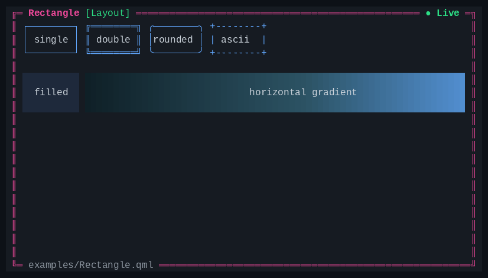

# color Value type

Terminal color value type supporting ANSI palette indices, RGB hex, and named colors. [More...](#detailed-description)

| | |
| :--- | :--- |
| **Import Statement** | `import QmlTui` |
| **Since** | QmlTui 0.4 |
| **Inherits** | none |
| **Instantiation** | Value type, not instantiable |

## Properties

| Property | Type | Default | Description |
| :--- | :--- | :--- | :--- |
| `r` | `real` |  | Read-only. Holds the red channel component normalized between `0.0` and `1.0`. |
| `g` | `real` |  | Read-only. Holds the green channel component normalized between `0.0` and `1.0`. |
| `b` | `real` |  | Read-only. Holds the blue channel component normalized between `0.0` and `1.0`. |
| `a` | `real` |  | Read-only. Holds the alpha opacity component normalized between `0.0` and `1.0`. |
| `valid` | `bool` |  | Read-only. Holds whether the color value represents a valid parsed color. |

## Detailed Description

`color` is the foundational color value type in QmlTui. In QML, string literals
automatically convert to `color`, supporting:

- CSS/SVG named colors (`"red"`, `"blue"`, `"cyan"`, `"orange"`, `"steelblue"`, ...) and hexadecimal formats (`"#RGB"`, `"#RRGGBB"`, `"#AARRGGBB"`), which resolve to literal 24-bit RGB (`"red"` is identical to `"#ff0000"`).
- Terminal ANSI palette colors (`"ansi:red"`, `"ansi:brightred"`, `"ansi:0"` through `"ansi:15"`, or `QmlTui.ansi(0..15)`), which emit SGR 30–37 / 90–97 palette indices so the terminal's user-configured color scheme applies.
- `"default"` (or `QmlTui.defaultColor`): The host terminal's default foreground (SGR 39) or background (SGR 49). A default-constructed `property color` also has this value.
- `"transparent"` (or `QmlTui.transparent`): No ink is painted, allowing underlying content to show through.

Construct color values dynamically using [QmlTui.color()](qmltui.md), [QmlTui.rgba()](qmltui.md), or [QmlTui.ansi()](qmltui.md).

### Example

```qml
import QtQml
import QmlTui

Terminal {
    Keys.onPressed: event => {
        if (event.key === Qt.Key_Q || event.key === Qt.Key_Escape) {
            Qt.quit()
            event.accepted = true
        }
    }

    Rectangle {
        anchors.centerIn: parent
        width: 25
        height: 5
        color: "#2563eb"
        border.style: Border.Single
        border.color: "white"

        Text {
            anchors.centerIn: parent
            text: "Blue Background"
            color: "white"
        }
    }
}
```

### Gallery Example



See [`examples/gallery/examples/Rectangle.qml`](../../examples/gallery/examples/Rectangle.qml) (`./build/examples/gallery/qmltui_gallery --example Rectangle`, or open in the [WebAssembly Playground](../playground.md?example=Rectangle.qml)).
