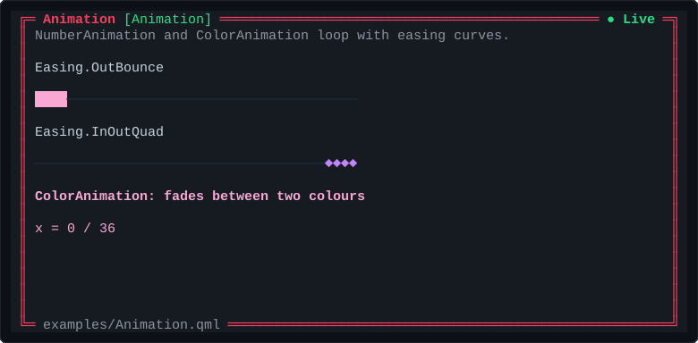

# ColorAnimation QML type

Animates color properties over time by smoothly interpolating color channels. [More...](#detailed-description)

| | |
| :--- | :--- |
| **Import Statement** | `import QmlTui` |
| **Since** | QmlTui 0.4 |
| **Inherits** | [PropertyAnimation](propertyanimation.md) |

## Detailed Description

ColorAnimation is a specialized [PropertyAnimation](propertyanimation.md) that
smoothly transitions between color values by interpolating their RGBA channels.
It is commonly used on properties like `color`, `textColor`, and `borderColor`.

Like all PropertyAnimations, it supports `duration`, `from`, `to`, and `easing`.

### Example

```qml
import QtQml
import QmlTui

Terminal {
    Keys.onPressed: event => {
        if (event.key === Qt.Key_Q || event.key === Qt.Key_Escape) {
            Qt.quit()
            event.accepted = true
        }
    }

    Rectangle {
        id: box
        anchors.centerIn: parent
        width: 20
        height: 5
        border.style: Border.Double

        ColorAnimation {
            target: box
            property: "color"
            from: "blue"
            to: "red"
            duration: 500
            running: true
        }

        Text {
            anchors.centerIn: parent
            text: "ColorAnimation"
        }
    }
}
```

### Interactive Demo & Recording



- **Live Playground**: [▶ Open `Animation.qml` in the WebAssembly Playground](../playground.md?example=Animation.qml)
- **Standalone CLI**: `./build/examples/gallery/qmltui_gallery --example Animation`
- **Gallery Source**: [`examples/gallery/examples/Animation.qml`](../../examples/gallery/examples/Animation.qml)
