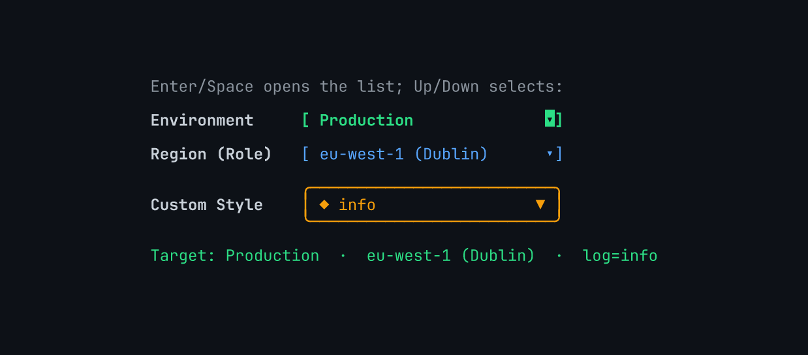

# ComboBox QML type

Dropdown selection control with an inline summary row and a Popup option list. [More...](#detailed-description)

| | |
| :--- | :--- |
| **Import Statement** | `import QmlTui.Controls` |
| **Since** | QmlTui 0.4 |
| **Inherits** | [Rectangle](rectangle.md) |

## Properties

| Property | Type | Default | Description |
| :--- | :--- | :--- | :--- |
| `model` | `var` | `[]` | Holds the list of selectable items (`QAbstractItemModel`, `ListModel`, array of strings/objects, or integer count). |
| `textRole` | `string` | `""` | Holds the role or object property name used to format entries in `model`. |
| `currentIndex` | `int` | `count > 0 ? 0 : -1` | Holds the index of the currently selected item (`0` when `count > 0`, `-1` when `model` is empty). |
| `currentText` | `string` | | Read-only. Holds the display text of the item at `currentIndex`. |
| `displayText` | `string` | `currentText` | Holds the text displayed in the summary row when closed; defaults to `currentText` and may be overridden. |
| `count` | `int` | `0` | Read-only. Holds the number of items in `model`. |
| `maxVisibleItems` | `int` | `6` | Holds the maximum number of rows visible at once inside the dropdown popup. |
| `opened` | `bool` | `false` | Read-only. Holds whether the dropdown popup is currently open. |
| `popup` | `Popup` | | Read-only. Holds the internal [Popup](popup.md) instance. |
| `background` | `Item` | `null` | Holds an optional custom background item filling the control at `z: -1`. |
| `contentItem` | `Item` | `Text` | Holds the item displaying `displayText` inside the summary row. Replace to restyle. |
| `indicator` | `Item` | `Text` | Holds the trailing indicator item (defaults to `▾` / `▴`). Replace to restyle. |
| `delegate` | `Component` | `Rectangle` | Holds the delegate component instantiated for each row in the dropdown `ListView`. |
| `textColor` | `color` | `QmlTui.defaultColor` | Holds the text colour of the summary row and option items. |
| `popupColor` | `color` | `QmlTui.defaultColor` | Holds the background colour of the dropdown popup. |
| `popupBorderColor` | `color` | `border.color` | Holds the border colour of the dropdown popup. |
| `selectionColor` | `color` | `QmlTui.invalidColor` | Holds the background colour of the highlighted popup row. When both `selectionColor` and `selectedTextColor` are unset (`QmlTui.invalidColor`), reverse video is used; setting any valid color (including `"default"`) replaces reverse video. |
| `selectedTextColor` | `color` | `QmlTui.invalidColor` | Holds the text colour of the highlighted popup row (unset by default so reverse video applies). |

## Signals

| Signal | Description |
| :--- | :--- |
| `activated(int index)` | Emitted when the user selects the item at `index` via keyboard or mouse. |

## Methods

| Method | Description |
| :--- | :--- |
| `string itemText(var entry)` | Formats a raw model entry or object into its display string using `textRole` or standard label keys (`text`, `display`, `label`, `name`, `title`). |
| `string textAt(int index)` | Returns the formatted display string for `index`, or `""` when out of bounds. |
| `int find(string text)` | Returns the index of the first item matching `text`, or `-1` if not found. |
| `void selectIndex(int index)` | Sets `currentIndex` to `index` (if within bounds) and emits `activated(index)`. |
| `void open()` | Opens the dropdown popup below the control. |
| `void close()` | Closes the dropdown popup. |

## Detailed Description

ComboBox is a one-row [Rectangle](rectangle.md) that displays `[ currentText ▾ ]`
when closed and opens a [Popup](popup.md) containing a scrollable [ListView](listview.md)
when activated with Enter, Space, Alt+Down, or a mouse click. While the popup is
closed and the ComboBox has active focus, Up/Left and Down/Right step
`currentIndex` directly and emit `activated(index)`. While the popup is open,
Up/Down navigate the popup list, Enter/Space or clicking an option commits the
selection and closes the popup, and Escape or clicking outside dismisses the
popup without changing `currentIndex`.

### Example

<<< ../../examples/gallery/examples/ComboBox.qml{qml}

### Gallery Example

See [`examples/gallery/examples/ComboBox.qml`](../../examples/gallery/examples/ComboBox.qml) (`./build/examples/gallery/qmltui_gallery --example ComboBox`).
