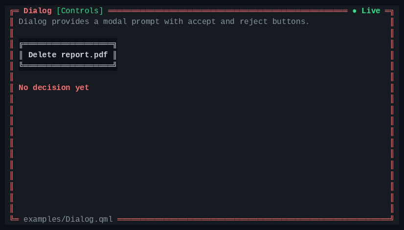

# Dialog QML type

A modal, centred message box with a title, a message and accept and reject buttons. [More...](#detailed-description)

| | |
| :--- | :--- |
| **Import Statement** | `import QmlTui.Controls` |
| **Since** | QmlTui 0.4 |
| **Inherits** | [Popup](popup.md) |

## Properties

| Property | Type | Default | Description |
| :--- | :--- | :--- | :--- |
| `background` | `Rectangle` |  | Read-only. Holds the background rectangle composed behind the dialog content. Customize `background.color`, `background.border` and `background.gradient`. |
| `textColor` | `color` | `"default"` | Holds the terminal colour of the message text, where `"default"` is the terminal's own foreground colour. |
| `titleColor` | `color` |  | Holds the terminal colour of the bold title line; it follows `textColor` unless set explicitly. |
| `title` | `string` | `""` | Holds the bold heading drawn on the first content row of the dialog. |
| `message` | `string` | `""` | Holds the body text drawn below the title; wraps at word boundaries to fit the dialog width. |
| `acceptText` | `string` | `"OK"` | Holds the label of the accept button, which calls `accept()` when activated. |
| `rejectText` | `string` | `"Cancel"` | Holds the label of the reject button, which calls `reject()` when activated. |
| `showRejectButton` | `bool` | `true` | Holds whether the reject button is shown; set it to false for a single-button notice. |

## Detailed Description

Dialog is a preconfigured [Popup](popup.md): its inherited properties default to
`visible: false`, `modal: true`, `dimBackground: true`, and
`closePolicy: Popup.CloseOnEscape`. It is anchored to the centre of its parent and
composes an opaque [Rectangle](rectangle.md) accessible via `background` with a
`Border.Double` border and default terminal colors. Because `closePolicy` is
`Popup.CloseOnEscape` only, Escape calls `reject()` while clicking outside the
dialog does nothing. Callers customize the visual surface through
`background.color`, `background.border`, and `background.gradient`.
Open it with `open()` and react to `accepted()`, `rejected()` or
`finished(bool)`, all of which are inherited from Popup and are followed by
`close()`.

The content is a [Column](column.md) at cell (2, 1) with one blank row between
the title, the message and a [Row](row.md) of two [Button](button.md)s. The
`initialFocusItem` is the accept button, so on `open()` focus moves there and
Enter or Space activates it; Tab and Shift+Tab cycle focus between the two
buttons only, because the popup is modal. Enter or Return that reaches the
dialog itself without being consumed by a child triggers the accept button.
Closing restores focus to the item that was focused before `open()`.

The implicit width is clamped between 32 cells and `parent.width - 4` (or 60 cells
when unparented), and `message` wraps (`Text.WordWrap`) to fit `width - 4`, growing
`implicitHeight` automatically (`contentColumn.implicitHeight + 2`; 9 rows for a
one-line title and message). Use [Popup](popup.md) directly
when you need custom content or a non-modal overlay.

### Example

<<< ../../examples/gallery/examples/Dialog.qml{qml}

### Gallery Example

See [`examples/gallery/examples/Dialog.qml`](../../examples/gallery/examples/Dialog.qml) (`./build/examples/gallery/qmltui_gallery --example Dialog`).
