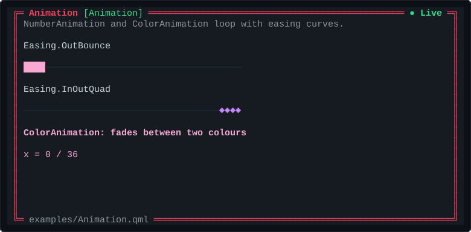

# Easing QML type

Defines easing curve types for animations. [More...](#detailed-description)

| | |
| :--- | :--- |
| **Import Statement** | `import QmlTui` |
| **Since** | QmlTui 0.4 |
| **Inherits** | none |
| **Instantiation** | Not directly instantiable |

## Enumeration Easing.Type

| Value | Description |
| :--- | :--- |
| `Easing.Linear` | Linear progression at uniform speed with no acceleration or deceleration. |
| `Easing.InQuad` | Acceleration from zero velocity following a quadratic curve. |
| `Easing.OutQuad` | Deceleration to zero velocity following a quadratic curve. |
| `Easing.InOutQuad` | Acceleration followed by deceleration using a quadratic curve. |
| `Easing.InCubic` | Acceleration from zero velocity following a cubic curve. |
| `Easing.OutCubic` | Deceleration to zero velocity following a cubic curve. |
| `Easing.InOutCubic` | Acceleration followed by deceleration using a cubic curve. |
| `Easing.OutBounce` | Bouncing effect that decelerates, overshoots, and rebounds to rest at the target. |

## Detailed Description

Easing provides curve types used by [PropertyAnimation](propertyanimation.md)
to control the rate of change of an animated value over time.

By assigning `easing: Easing.OutQuad` or `Easing.InOutCubic`, animations feel
more natural and responsive than standard linear transitions.

### Example

<<< ../../examples/gallery/examples/Animation.qml{qml}

### Gallery Example

See [`examples/gallery/examples/Animation.qml`](../../examples/gallery/examples/Animation.qml) (`./build/examples/gallery/qmltui_gallery --example Animation`).
