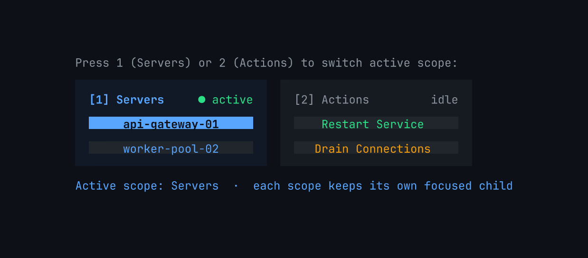

# FocusScope QML type

Explicitly creates a focus scope for encapsulating keyboard focus within reusable components. [More...](#detailed-description)

| | |
| :--- | :--- |
| **Import Statement** | `import QmlTui` |
| **Since** | QmlTui 0.4 |
| **Inherits** | [Item](item.md) |

## Detailed Description

A `FocusScope` acts as a focus proxy and boundary for a subtree of items. In a standard QML scene, only one item has focus at a time; if a component sets `focus: true`, it immediately takes focus from any other item in the window.

Within a `FocusScope`, child items can set `focus: true` without taking active focus from the rest of the application. The `FocusScope` remembers which of its child items should receive focus when the scope itself gains active focus.

When a `FocusScope` receives active focus, focus is automatically forwarded to the child item that has `focus: true` within the scope. Furthermore, while that child item has active focus, `activeFocus` is also `true` on the enclosing `FocusScope`.

### Example

<<< ../../examples/gallery/examples/FocusScope.qml{qml}

### Gallery Example

See [`examples/gallery/examples/FocusScope.qml`](../../examples/gallery/examples/FocusScope.qml) (`./build/examples/gallery/qmltui_gallery --example FocusScope`).
