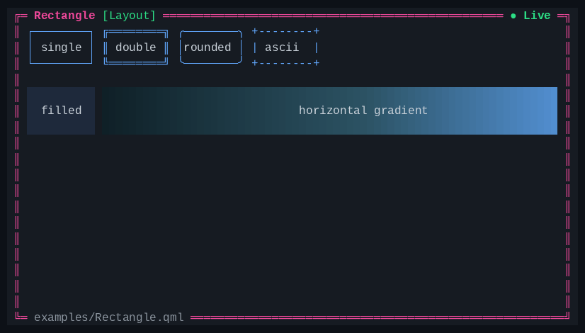

# GradientStop QML type

Defines a color stop at a normalized position within a Gradient. [More...](#detailed-description)

| | |
| :--- | :--- |
| **Import Statement** | `import QmlTui` |
| **Since** | QmlTui 0.4 |
| **Inherits** | none |

## Properties

| Property | Type | Default | Description |
| :--- | :--- | :--- | :--- |
| `position` | `real` | `0.0` | Holds the normalized position of the stop along the gradient axis, from `0.0` to `1.0`. |
| `color` | `color` | `"white"` | Holds the color of the gradient at this stop. |

## Signals

| Signal | Description |
| :--- | :--- |
| `updated()` | Emitted when either `position` or `color` is modified. |

## Detailed Description

GradientStop specifies the color at a particular location along the axis of a
[Gradient](gradient.md).

Multiple stops are defined within a Gradient to create smooth multi-stop color
ramps. `position` ranges from `0.0` (start of the gradient axis) to `1.0` (end of the axis).

### Example

```qml
import QtQml
import QmlTui

Terminal {
    Keys.onPressed: event => {
        if (event.key === Qt.Key_Q || event.key === Qt.Key_Escape) {
            Qt.quit()
            event.accepted = true
        }
    }

    Rectangle {
        anchors.centerIn: parent
        width: 30
        height: 6
        border.style: Border.Single

        gradient: Gradient {
            orientation: Gradient.Horizontal
            GradientStop { position: 0.0; color: "magenta" }
            GradientStop { position: 0.5; color: "yellow" }
            GradientStop { position: 1.0; color: "cyan" }
        }

        Text {
            anchors.centerIn: parent
            text: "Gradient Stops"
        }
    }
}
```

### Gallery Example



See [`examples/gallery/examples/Rectangle.qml`](../../examples/gallery/examples/Rectangle.qml) (`./build/examples/gallery/qmltui_gallery --example Rectangle`, or open in the [WebAssembly Playground](../playground.md?example=Rectangle.qml)).
