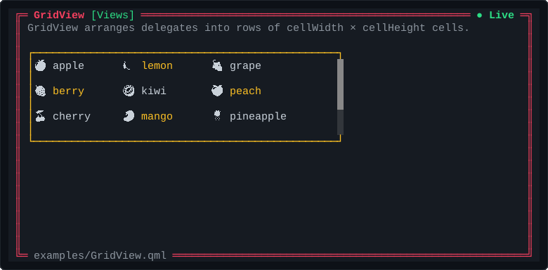

# GridView QML type

Displays a virtualized, scrollable two-dimensional grid of model delegates. [More...](#detailed-description)

| | |
| :--- | :--- |
| **Import Statement** | `import QmlTui` |
| **Since** | QmlTui 0.4 |
| **Inherits** | [ScrollView](scrollview.md) |

## Properties

| Property | Type | Default | Description |
| :--- | :--- | :--- | :--- |
| `model` | `var` |  | Holds the data model providing items for the grid. |
| `delegate` | `Component` |  | Holds the component template instantiated for visible grid cells. This is the default property. |
| `cellWidth` | `int` | `0` | Holds the width of each grid cell in character columns. |
| `cellHeight` | `int` | `0` | Holds the height of each grid cell in rows. |
| `rootIndex` | `QModelIndex` |  | Holds the parent index whose direct children the view displays when using a hierarchical model. |
| `reuseItems` | `bool` | `true` | Whether delegates that scroll out of view are recycled and rebound to incoming cells. |

## Detailed Description

GridView arranges data items into a two-dimensional grid of uniform cells,
scrolling vertically when the number of items exceeds the viewport height.

Each cell has a fixed size defined by `cellWidth` and `cellHeight`. Only the cells
visible in the current viewport (plus overscan rows) are instantiated, making GridView
efficient for thousands of items. As with [ListView](listview.md), setting `reuseItems: true`
enables pooling and recycling of delegate items.

### Example

<<< ../../examples/gallery/examples/GridView.qml{qml}

### Gallery Example

See [`examples/gallery/examples/GridView.qml`](../../examples/gallery/examples/GridView.qml) (`./build/examples/gallery/qmltui_gallery --example GridView`).
