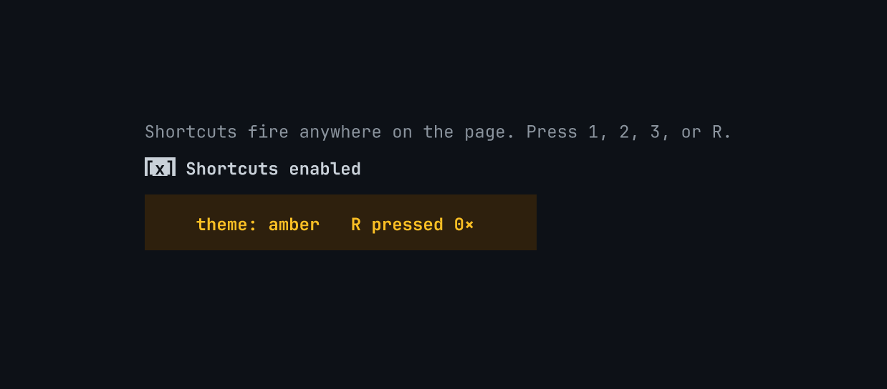

# KeyEvent QML type

Carries keyboard event details delivered to Keys handlers. [More...](#detailed-description)

| | |
| :--- | :--- |
| **Import Statement** | `import QmlTui` |
| **Since** | QmlTui 0.4 |
| **Inherits** | none |
| **Instantiation** | Not directly instantiable |

## Properties

| Property | Type | Default | Description |
| :--- | :--- | :--- | :--- |
| `key` | `int` |  | Read-only. Holds the Qt key code (such as `Qt.Key_Return`, `Qt.Key_Escape`, or `Qt.Key_A`). |
| `text` | `string` |  | Read-only. Holds the Unicode text string generated by the key press, or empty for non-text keys. |
| `modifiers` | `int` |  | Read-only. Holds keyboard modifier flags (such as `Qt.ShiftModifier`, `Qt.ControlModifier`, `Qt.AltModifier`). |
| `paste` | `bool` |  | Read-only. Whether the key event originates from a bracketed paste operation in the terminal. |
| `accepted` | `bool` | `false` | Whether the key event was consumed. Setting to `true` prevents the event from propagating further. |

## Detailed Description

KeyEvent objects are passed as arguments to signal handlers of the [Keys](keys.md)
attached type, such as `Keys.onPressed` or `Keys.onReturnPressed`.

The `key` property holds the Qt key enumeration value, while `modifiers` indicates
any active modifier keys (such as Shift or Control). If the key press generates
printable text, `text` contains the corresponding characters.

When `paste` is `true`, the text was supplied as part of a terminal bracketed paste
sequence rather than discrete keystrokes. Setting `accepted` to `true` marks the
event as handled, preventing it from propagating up the visual hierarchy.

### Example

<<< ../../examples/gallery/examples/Keys.qml{qml}

### Gallery Example

See [`examples/gallery/examples/Keys.qml`](../../examples/gallery/examples/Keys.qml) (`./build/examples/gallery/qmltui_gallery --example Keys`, or open in the [WebAssembly Playground](../playground.md?example=Keys.qml)).
