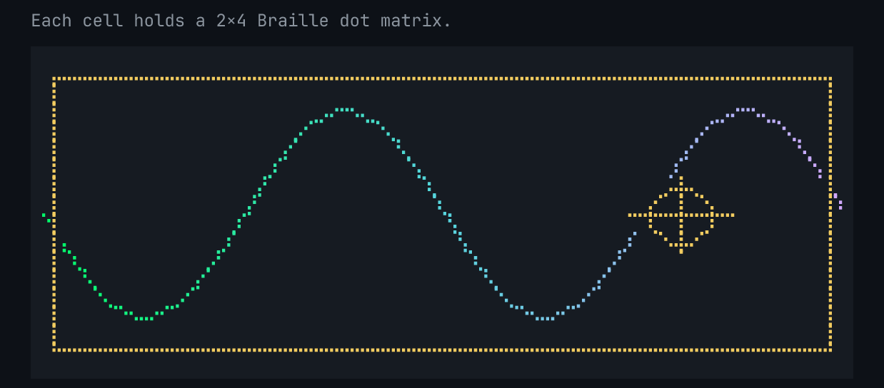

# Line QML type

Draws a straight line segment between two points on a Canvas. [More...](#detailed-description)

| | |
| :--- | :--- |
| **Import Statement** | `import QmlTui` |
| **Since** | QmlTui 0.4 |
| **Inherits** | [CanvasShape](canvasshape.md) |

## Properties

| Property | Type | Default | Description |
| :--- | :--- | :--- | :--- |
| `x1` | `int` | `0` | Holds the horizontal start coordinate in canvas pixels. |
| `y1` | `int` | `0` | Holds the vertical start coordinate in canvas pixels. |
| `x2` | `int` | `0` | Holds the horizontal end coordinate in canvas pixels. |
| `y2` | `int` | `0` | Holds the vertical end coordinate in canvas pixels. |

## Detailed Description

Line draws a 1-pixel straight line segment connecting (`x1`, `y1`) and (`x2`, `y2`)
on its parent [Canvas](canvas.md) using Bresenham's line algorithm. Coordinates
are specified in sub-cell canvas pixels.

The line is painted with the shape's `color` (or the canvas's default `color`
if none is specified).

### Example

<<< ../../examples/gallery/examples/Canvas.qml{qml}

### Gallery Example

See [`examples/gallery/examples/Canvas.qml`](../../examples/gallery/examples/Canvas.qml) (`./build/examples/gallery/qmltui_gallery --example Canvas`, or open in the [WebAssembly Playground](../playground.md?example=Canvas.qml)).
