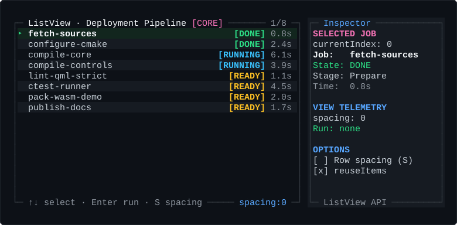

# ListView QML type

Displays a scrollable sequence of model delegates. [More...](#detailed-description)

| | |
| :--- | :--- |
| **Import Statement** | `import QmlTui` |
| **Since** | QmlTui 0.4 |
| **Inherits** | [ScrollView](scrollview.md) |

## Properties

| Property | Type | Default | Description |
| :--- | :--- | :--- | :--- |
| `model` | `var` |  | Holds the data model providing list items: integer count, string/object array, `ListModel`, or `QAbstractItemModel`. |
| `delegate` | `Component` |  | Holds the component template instantiated for visible items. This is the default property. |
| `orientation` | `Qt::Orientation` | `Qt.Vertical` | Holds the layout orientation of items: `Qt.Vertical` or `Qt.Horizontal`. |
| `spacing` | `int` | `0` | Holds the spacing in character cells between adjacent items. |
| `count` | `int` | `0` | Read-only. Holds the number of items in `model`. |
| `currentIndex` | `int` | `-1` | Holds the index of the currently selected or focused item, or `-1`. |
| `reuseItems` | `bool` | `true` | Whether delegates that scroll out of view are recycled and rebound to items scrolling into view. |
| `rootIndex` | `QModelIndex` |  | Holds the parent index whose direct children the view displays when using a hierarchical model. |

## Attached Properties

| Property | Type | Description |
| :--- | :--- | :--- |
| `ListView.view` | `ListView` | Read-only. Holds the parent ListView containing this delegate instance. |
| `ListView.isCurrentItem` | `bool` | Read-only. True if this delegate instance represents the currently selected item (`currentIndex`). |

## Attached Signals

| Signal | Description |
| :--- | :--- |
| `ListView.pooled()` | Emitted on a delegate instance when it scrolls out of view and is placed into the reuse pool (`reuseItems: true`). |
| `ListView.reused()` | Emitted on a pooled delegate instance when it is rebound and reused for a newly visible item. |

## Signals

| Signal | Description |
| :--- | :--- |
| `itemActivated(int index)` | Emitted when an item is activated with Enter or a mouse click. |
| `modelDataChanged()` | Emitted when the underlying model resets or inserts, removes, moves, or modifies rows. |

## Methods

| Method | Description |
| :--- | :--- |
| `var itemData(int index, string role = "")` | Returns the row value or a named role value at `index` from `model` without requiring the row delegate to be materialized. |

## Detailed Description

ListView provides a virtualized, scrollable list of items instantiated from a `delegate`
based on a `model`. Only delegates visible in the current viewport (plus a small overscan)
are instantiated. When `reuseItems` is `true`, delegate items are recycled as the user scrolls,
providing smooth scrolling over large models.

Keyboard navigation (Up/Down arrow keys, PageUp/PageDown, Home, End) moves `currentIndex`
and automatically scrolls the view to keep the active item visible. Mouse clicks update
`currentIndex` and emit `itemActivated()`.

Delegates access the `ListView.isCurrentItem` attached property to adjust styling
when selected.

### Example

<<< ../../examples/gallery/examples/ListView.qml{qml}

### Gallery Example

See [`examples/gallery/examples/ListView.qml`](../../examples/gallery/examples/ListView.qml) (`./build/examples/gallery/qmltui_gallery --example ListView`, or open in the [WebAssembly Playground](../playground.md?example=ListView.qml)).
