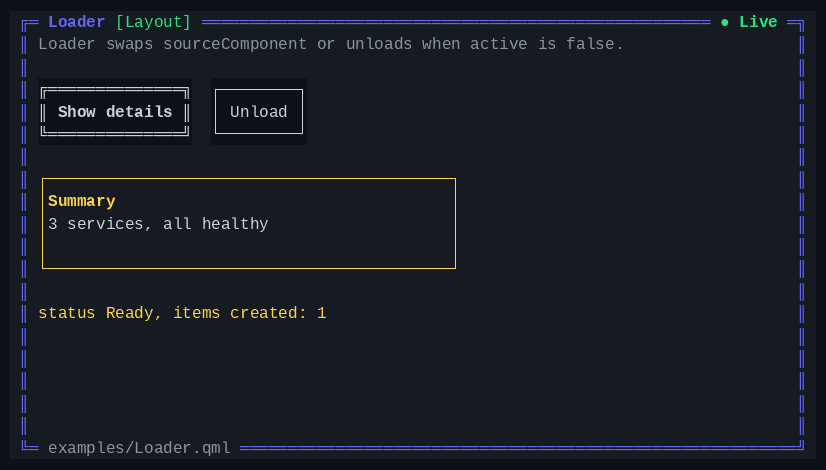

# Loader QML type

Loads and instantiates components or QML documents dynamically on demand. [More...](#detailed-description)

| | |
| :--- | :--- |
| **Import Statement** | `import QmlTui` |
| **Since** | QmlTui 0.4 |
| **Inherits** | [Item](item.md) |

## Properties

| Property | Type | Default | Description |
| :--- | :--- | :--- | :--- |
| `active` | `bool` | `true` | Holds whether the component should be instantiated. Setting to `false` destroys the loaded item. |
| `source` | `url` |  | Holds the URL of a QML document to load. Setting it clears `sourceComponent`. |
| `sourceComponent` | `Component` |  | Holds an inline component to instantiate. Setting it clears `source`. |
| `item` | `Item` |  | Read-only. Holds the instantiated visual item, or `null` if nothing is loaded. |
| `status` | `Status` |  | Read-only. Holds the current loading status: `Loader.Null`, `Loader.Ready`, `Loader.Loading`, or `Loader.Error`. |
| `progress` | `real` |  | Read-only. Holds the loading progress from `0.0` to `1.0`. |
| `asynchronous` | `bool` | `false` | Whether the QML component should be compiled and instantiated asynchronously in a background thread. |
| `errorString` | `string` |  | Read-only. Holds the description of any error encountered during compilation or instantiation. |

## Signals

| Signal | Description |
| :--- | :--- |
| `loaded()` | Emitted when the item has completed loading and instantiation. |

## Enumeration Loader.Status

| Value | Description |
| :--- | :--- |
| `Loader.Null` | No source or sourceComponent is specified, or the Loader is inactive. |
| `Loader.Ready` | The component has been successfully loaded and instantiated. |
| `Loader.Loading` | The component is actively being loaded or compiled. |
| `Loader.Error` | An error occurred while loading or compiling the component. |

## Detailed Description

Loader is used to dynamically load and unload QML items on demand. It is
useful for deferring the creation of complex views, tabs, dialogs, or
controllers until they are actually needed, reducing initial startup time
and memory footprint.

When the loaded object is a visual `qmltui::Item`, it becomes a visual child
of the Loader: the Loader adopts the item's implicit size, and setting an
explicit `width` or `height` on the Loader propagates down to the item.
When `active` is set to `false`, the instantiated item is immediately destroyed.

Access the loaded instance via `item` only after `status` is `Loader.Ready`
or inside the `onLoaded` signal handler.

### Example

```qml
import QtQml
import QmlTui

Terminal {
    Keys.onPressed: event => {
        if (event.key === Qt.Key_Q || event.key === Qt.Key_Escape) {
            Qt.quit()
            event.accepted = true
        }
    }

    Loader {
        anchors.centerIn: parent
        active: true
        sourceComponent: Rectangle {
            width: 24
            height: 5
            border.style: Border.Single
            Text {
                anchors.centerIn: parent
                text: "Loaded Content"
            }
        }
    }
}
```

### Interactive Demo & Recording



- **Live Playground**: [▶ Open `Loader.qml` in the WebAssembly Playground](../playground.md?example=Loader.qml)
- **Standalone CLI**: `./build/examples/gallery/qmltui_gallery --example Loader`
- **Gallery Source**: [`examples/gallery/examples/Loader.qml`](../../examples/gallery/examples/Loader.qml)
