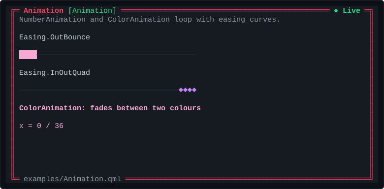

# NumberAnimation QML type

Animates numeric properties over time. [More...](#detailed-description)

| | |
| :--- | :--- |
| **Import Statement** | `import QmlTui` |
| **Since** | QmlTui 0.4 |
| **Inherits** | [PropertyAnimation](propertyanimation.md) |

## Detailed Description

NumberAnimation is a specialized [PropertyAnimation](propertyanimation.md) optimized
for interpolating numeric properties such as `x`, `y`, `width`, and `height`.

It inherits all properties and methods from PropertyAnimation, including `duration`,
`from`, `to`, `easing`, and `loops`.

### Example

<<< ../../examples/gallery/examples/Animation.qml{qml}

### Gallery Example

See [`examples/gallery/examples/Animation.qml`](../../examples/gallery/examples/Animation.qml) (`./build/examples/gallery/qmltui_gallery --example Animation`, or open in the [WebAssembly Playground](../playground.md?example=Animation.qml)).
