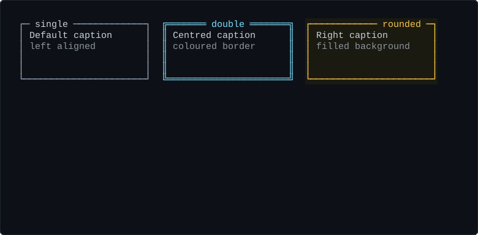

# Panel QML type

A bordered rectangle with optional title, trailing title, footer, and trailing footer items placed on its borders. [More...](#detailed-description)

| | |
| :--- | :--- |
| **Import Statement** | `import QmlTui.Controls` |
| **Since** | QmlTui 0.4 |
| **Inherits** | [Rectangle](rectangle.md) |

## Properties

| Property | Type | Default | Description |
| :--- | :--- | :--- | :--- |
| `footer` | `Item` | `null` | Holds the visual item placed on the left of the bottom border, padded by one space cell on each side. |
| `footerTrailing` | `Item` | `null` | Holds the right-aligned visual item placed on the bottom border, padded by one space cell on each side. |
| `title` | `Item` | `null` | Holds the visual item placed over the top border, padded by one space cell on each side. |
| `titleAlignment` | `int` | `Qt.AlignLeft` | Holds where the `title` item sits on the top border: `Qt.AlignLeft`, `Qt.AlignHCenter` or `Qt.AlignRight`; any other value is treated as left. |
| `titleTrailing` | `Item` | `null` | Holds the right-aligned visual item placed on the top border, padded by one space cell on each side. |

## Detailed Description

Panel is a [Rectangle](rectangle.md) whose `border.style` defaults to
`Border.Single` and `border.color` to `"default"`, with four [Item](item.md)
slots placed on the top and bottom borders so that rich or interactive items
replace parts of the border lines.

Top border slots include:
- `title`: the primary header item (such as a [Text](text.md) or [Row](row.md)
  combining a caption and badge), positioned by `titleAlignment`
  (`Qt.AlignLeft`, `Qt.AlignHCenter`, or `Qt.AlignRight`).
- `titleTrailing`: right-aligned item ending 2 cells before the right edge.
  When `titleAlignment` is centered, `title` is clamped so it does not collide
  with `titleTrailing`.

Bottom border slots include:
- `footer`: left-aligned item on the bottom border.
- `footerTrailing`: right-aligned item on the bottom border.

Each occupied slot with a positive width is automatically backed by a space mask
spanning one cell on each side (`implicitWidth + 2`) so the item stands clear of
the line characters and internal layout gaps (for example `Row { spacing: 1 }`)
do not show border glyphs through. Because slots accept any [Item](item.md), they
can host [MouseArea](mousearea.md) handlers, [ToolTip](tooltip.md) attachments,
or composite rows.

Panel adds no content layout of its own: children are positioned as in any
Rectangle. Because a visible Rectangle border automatically adds one cell of
padding on each side, both un-anchored children and children with
`anchors.fill: parent` stay inside the border automatically (adding
`anchors.margins: 1` adds an extra cell of inner breathing room). Panel has no
implicit size, so set `width` and `height` or anchor it. Change `border.style` to
`Border.Single`, `Border.Double`, `Border.Rounded`, `Border.Ascii`, or
`Border.None` like any Rectangle; types without a `border` group, such as
[TabBar](tabbar.md) or [TableView](tableview.md), are typically wrapped in a
Panel to get a titled frame.

### Example

<<< ../../examples/gallery/examples/Panel.qml{qml}

### Gallery Example

See [`examples/gallery/examples/Panel.qml`](../../examples/gallery/examples/Panel.qml) (`./build/examples/gallery/qmltui_gallery --example Panel`).
