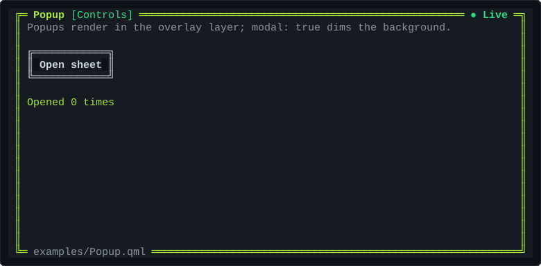

# Popup QML type

An unpainted item drawn above all ordinary items that can trap input, dim the background and restore focus when closed. [More...](#detailed-description)

| | |
| :--- | :--- |
| **Import Statement** | `import QmlTui` |
| **Since** | QmlTui 0.4 |
| **Inherits** | [Item](item.md) |

## Properties

| Property | Type | Default | Description |
| :--- | :--- | :--- | :--- |
| `modal` | `bool` | `false` | Holds whether the popup blocks keyboard and mouse input to everything outside it while open. |
| `dimBackground` | `bool` | `true` | Holds whether the whole frame beneath the popup is dimmed while it is open; it has an effect only when `modal` is also true. |
| `closePolicy` | `int` | `Popup.CloseOnEscape \| Popup.CloseOnOutsideClick` | Holds a combination of `Popup.ClosePolicy` (`Popup.ClosePolicies`) flags selecting which user actions call `reject()` automatically. |
| `initialFocusItem` | `Item` | `null` | Holds the item that receives focus on `open()`; when unset, hidden, disabled or not focusable, the first focusable descendant is used instead. |
| `owner` | `Item` | `null` | Holds the item this popup logically belongs to, used instead of the visual parent to find `parentPopup`. |
| `parentPopup` | `Popup` |  | Read-only. Holds the nearest popup among the ancestors of `owner`, or of the visual parent when no owner is set. Notifies via `ownerChanged()`. |

## Signals

| Signal | Description |
| :--- | :--- |
| `opened()` | Emitted when the popup becomes visible while attached to a [Terminal](terminal.md). |
| `closed()` | Emitted when the popup becomes hidden while attached to a [Terminal](terminal.md). |
| `accepted()` | Emitted by `accept()` before `finished(true)` and `close()`. |
| `rejected()` | Emitted by `reject()`, including automatic closes from Escape or an outside click, before `finished(false)` and `close()`. |
| `finished(bool accepted)` | Emitted after `accepted()` or `rejected()` with the outcome, before the popup closes. |
| `ownerChanged()` | Emitted when `owner` or the resolved `parentPopup` changes. |

## Methods

| Method | Description |
| :--- | :--- |
| `void open()` | Shows the popup or raises it if already visible; when there is something to focus (`initialFocusItem`, a focusable descendant) or the popup is modal, remembers the focused item and moves focus. |
| `void close()` | Hides the popup; when `open()` took focus and focus is still inside the popup (or cleared), returns it to the item focused before `open()` if that is still visible, enabled and focusable, otherwise clears focus. A popup that never took focus, or whose focus moved elsewhere, leaves focus alone; so does closing a popup that is not open. |
| `void accept()` | Emits `accepted()` and `finished(true)`, then calls `close()`. |
| `void reject()` | Emits `rejected()` and `finished(false)`, then calls `close()`. |

## Enumeration Popup.ClosePolicy (`Popup.ClosePolicies`)

| Value | Description |
| :--- | :--- |
| `Popup.NoAutoClose` | The popup closes only through `close()`, `accept()`, `reject()` or `visible`. |
| `Popup.CloseOnEscape` | Escape calls `reject()` on the topmost visible popup with this flag. |
| `Popup.CloseOnOutsideClick` | A mouse press and release both outside the popup call `reject()`. |

## Detailed Description

Popup is an [Item](item.md) that starts hidden (`visible: false`), has no default background
fill, and is painted by the [Terminal](terminal.md) after all ordinary
items regardless of where it sits in the item tree. Because Popup itself
is unpainted, callers compose a [Rectangle](rectangle.md) child inside it
when an opaque surface or decorative border is needed, or leave it transparent
for floating HUD elements or non-rectangular compositions.

Visible popups are ordered by `z` and then by opening order, so calling `open()`
on an already visible popup raises it. When a modal popup is open, it and every
popup whose `parentPopup` chain leads to it are drawn above all other popups.
Closing or destroying a popup also closes every visible popup that descends
from it via `owner` or parenting.

While a modal popup is open the background is dimmed if `dimBackground` is
true, mouse events outside it are swallowed, and Tab and Shift+Tab cycle
focus only among the popup's focusable descendants. The rectangular bounds of
the popup define the outside-click boundary: clicks within the popup bounds
land on the popup (even where unpainted and transparent) and do not trigger
`CloseOnOutsideClick`, while clicks outside dismiss it.

Escape is offered first to the topmost popup in the modal group; if that popup
has `Popup.CloseOnEscape` it is rejected, otherwise the key is dispatched to the
focus chain inside the popup. Without a modal popup, Escape rejects the
topmost visible popup that has `CloseOnEscape`, and `CloseOnOutsideClick`
rejects a popup when a press and the following release both land outside its
bounds. A non-modal popup neither dims nor blocks input.

`open()` moves focus into the popup only when there is something to focus —
`initialFocusItem`, a focusable descendant, or `null` for a modal popup with
neither — and records the item focused just before opening. `close()` restores
that item if the popup took focus and focus is still inside the popup or was
cleared while it was open; a popup that never took focus (a tooltip), or whose
focus the user has since moved elsewhere, leaves focus untouched. The recorded
item is restored only if it is still visible, enabled and focusable, otherwise
nothing is focused. Calling `close()` on a popup that is not
open does nothing, so it never takes focus from another item. Setting `visible` directly registers or
unregisters the popup and emits `opened()` or `closed()`, but does not move
focus. Popup has no implicit size; give it `width` and `height` or anchors.
[Dialog](dialog.md) is a Popup with a title, message and buttons that composes
an opaque [Rectangle](rectangle.md) background, and [ToolTip](tooltip.md)
creates a non-modal Popup internally.

### Example

<<< ../../examples/gallery/examples/Popup.qml{qml}

### Gallery Example

See [`examples/gallery/examples/Popup.qml`](../../examples/gallery/examples/Popup.qml) (`./build/examples/gallery/qmltui_gallery --example Popup`).
