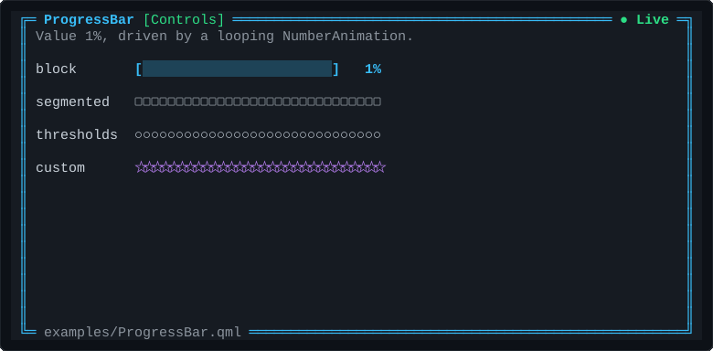

# ProgressBar QML type

A one-row horizontal bar that fills from left to right as a value moves from `from` to `to`. [More...](#detailed-description)

| | |
| :--- | :--- |
| **Import Statement** | `import QmlTui.Controls` |
| **Since** | QmlTui 0.4 |
| **Inherits** | [Item](item.md) |

## Properties

| Property | Type | Default | Description |
| :--- | :--- | :--- | :--- |
| `value` | `real` | `0.0` | Holds the current value; it is clamped into the `from`..`to` range when the bar is drawn. |
| `from` | `real` | `0.0` | Holds the value at which the bar is empty. |
| `to` | `real` | `1.0` | Holds the value at which the bar is full; when `to` is not greater than `from` the bar stays empty. |
| `showBrackets` | `bool` | `false` | Whether the bar is enclosed in `[` and `]`, taking two cells from the bar width. |
| `showPercentage` | `bool` | `false` | Whether a five-cell suffix such as ` 42%` is drawn after the bar, taking five cells from the bar width. |
| `barWidth` | `int` |  | Read-only. Holds the number of cells left for the bar itself: the item width minus 2 for brackets and 5 for the percentage, never negative. |
| `percentageText` | `string` |  | Read-only. Holds the percentage suffix, a space and a right-aligned integer padded to three cells followed by `%`, or the empty string when `showPercentage` is false. |
| `style` | `string` | `"block"` | Holds the glyph preset: `"block"` draws `█`/`░`, `"segmented"` draws `▉`/`░`, `"line"` draws `━`/`─`, `"pill"` draws `▮`/`▯`, `"dot"` draws `●`/`○`, `"hash"` draws `#`/`-`; an unknown value draws like `"block"`. |
| `color` | `color` | `"default"` | Holds the colour of the filled bar (when no gradient or thresholds are set), brackets and percentage, and the fallback colour of the empty portion when `trackColor` is unset. |
| `trackColor` | `color` | `QmlTui.invalidColor` | Holds an explicit colour for the empty portion of the bar; when unset (`QmlTui.invalidColor`), empty cells use `color` (dimmed when no gradient, thresholds, or explicit `color` is active). |
| `fillCharacter` | `string` | `""` | Holds a glyph drawn for each filled cell; when non-empty it overrides `style`. |
| `emptyCharacter` | `string` | `""` | Holds a glyph drawn for each empty cell; when non-empty it overrides `style`. |
| `gradient` | `Gradient` | `null` | Holds a [Gradient](gradient.md) whose stops colour the filled cells by their position along the bar, `0.0` at the left edge and `1.0` at the right. |
| `thresholds` | `var` |  | Holds an array of `{ value, color }` objects, in ascending order of `value`, that colour the filled cells in `from`..`to` units; ignored while `gradient` has stops. |
| `hasGradient` | `bool` |  | Read-only. True when `gradient` has at least one stop or `thresholds` is non-empty, which switches the bar to per-segment colouring. |
| `effectiveFillChar` | `string` |  | Read-only. Holds the glyph actually used for filled cells after applying `fillCharacter` and `style`. |
| `effectiveEmptyChar` | `string` |  | Read-only. Holds the glyph actually used for empty cells after applying `emptyCharacter` and `style`. |
| `position` | `real` |  | Read-only. Holds `value` normalised into `0.0`..`1.0` within `from`..`to`, or `0.0` when `to` is not greater than `from`. |
| `segments` | `var` |  | Read-only. Holds the list of `{ text, color }` runs drawn in gradient mode, one per colour change from left to right plus one for the empty portion; empty otherwise. |

## Methods

| Method | Description |
| :--- | :--- |
| `var getColorAt(var pos)` | Returns the colour for a normalised position `0.0`..`1.0` along the bar: `gradient.colorAt(pos)` (linearly interpolated RGB across stops) when `gradient` has stops, else the colour of the first threshold whose `value` (in `from`..`to` units) is at or beyond `pos` (or the last threshold's colour past the final threshold), else `color`. |

## Detailed Description

The bar is a single row of glyphs, `implicitHeight` 1 and `implicitWidth` 15;
set `width` to choose its length. Of that width, `barWidth` cells are the bar
proper: `Math.round(position * barWidth)` cells are drawn with
`effectiveFillChar` and the rest with `effectiveEmptyChar`. `showBrackets`
wraps the bar in `[` and `]` and `showPercentage` appends `percentageText`, so
`" 100%"` at full width; both are taken out of `barWidth` rather than added to
the item. When the width leaves no cells for the bar, only the decorations are
drawn. Filled cells, brackets and percentage are drawn bold; empty cells are
drawn unbolded in `trackColor` when set, or in `color` when `trackColor`
defaults to `QmlTui.invalidColor` (dimmed automatically when no
gradient/thresholds are active or when `color` is unset).

With neither a gradient nor thresholds, filled cells use `color`. When
`hasGradient` is true, filled runs are built from `segments`: for each filled
cell `i` the colour is `getColorAt(i / (barWidth - 1))`, adjacent cells with the
same colour are merged into one run, the empty portion uses `trackColor` (or
`color`), and brackets and percentage use `color`. When `gradient` has stops,
each cell's colour is linearly interpolated across RGB stops via
`Gradient.colorAt()`. When `thresholds` is used instead, colouring is stepped: a
cell takes the colour of the first threshold whose `value` (in `from`..`to`
units) is at or beyond the cell's position, or the last threshold's colour past
the final threshold, so thresholds should be listed in ascending `value` order.
A `gradient` with stops takes precedence over `thresholds`.

### Example

<<< ../../examples/gallery/examples/ProgressBar.qml{qml}

### Gallery Example

See [`examples/gallery/examples/ProgressBar.qml`](../../examples/gallery/examples/ProgressBar.qml) (`./build/examples/gallery/qmltui_gallery --example ProgressBar`).
