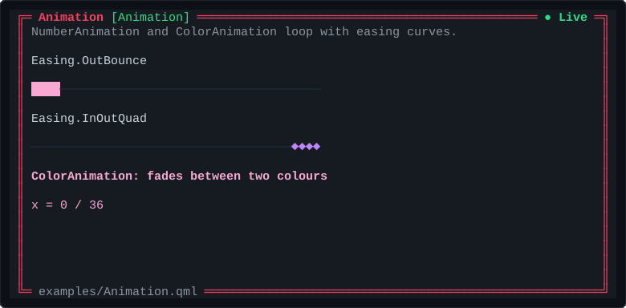

# PropertyAnimation QML type

Animates changes to a target property over time with configurable easing. [More...](#detailed-description)

| | |
| :--- | :--- |
| **Import Statement** | `import QmlTui` |
| **Since** | QmlTui 0.4 |
| **Inherits** | [Animation](animation.md) |

## Properties

| Property | Type | Default | Description |
| :--- | :--- | :--- | :--- |
| `target` | `QtObject` | `null` | Holds the target object whose property is being animated. |
| `property` | `string` | `""` | Holds the name of the property to animate on `target`. |
| `duration` | `int` | `250` | Holds the duration of the animation in milliseconds. |
| `from` | `var` |  | Holds the starting value for the animated property. If unset, uses the current property value. |
| `to` | `var` |  | Holds the target end value for the animated property. |
| `easing` | `Easing::Type` | `Easing.Linear` | Holds the easing curve type applied to the animation progress. |

## Detailed Description

PropertyAnimation interpolates property values of an object between `from` and `to`
over a given `duration` in milliseconds. The interpolation rate curve is controlled
by `easing` (see [Easing](easing.md)).

PropertyAnimation can be used standalone and triggered explicitly via `start()` (or
`running: true`), placed inside a [Behavior](behavior.md) (`Behavior on <property>`), or
configured within a [Transition](transition.md).

For animating numeric coordinates or dimensions, prefer [NumberAnimation](numberanimation.md);
for color properties, prefer [ColorAnimation](coloranimation.md).

### Example

<<< ../../examples/gallery/examples/Animation.qml{qml}

### Gallery Example

See [`examples/gallery/examples/Animation.qml`](../../examples/gallery/examples/Animation.qml) (`./build/examples/gallery/qmltui_gallery --example Animation`, or open in the [WebAssembly Playground](../playground.md?example=Animation.qml)).
