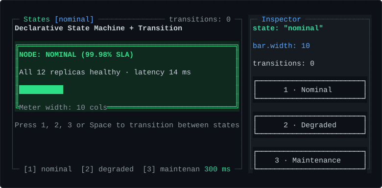

# PropertyChanges QML type

Describes property modifications applied in a State. [More...](#detailed-description)

| | |
| :--- | :--- |
| **Import Statement** | `import QmlTui` |
| **Since** | QmlTui 0.4 |
| **Inherits** | none |

## Properties

| Property | Type | Default | Description |
| :--- | :--- | :--- | :--- |
| `target` | `QtObject` | `null` | Holds the target object whose properties are altered in this state. |
| `properties` | `var` | `{}` | Holds a dictionary of property names and target values applied in this state. |
| `restoreEntryValues` | `bool` | `true` | Whether modified properties should revert to their entry values upon exiting this state. |
| `explicit` | `bool` | `false` | When true, expressions are evaluated once upon state entry instead of staying reactive while the state is active. Supported for map-based `properties` in all builds, and for direct property bindings when `QMLTUI_ENABLE_PRIVATE_QT=ON`. |

## Detailed Description

PropertyChanges is used inside a [State](state.md) to define how property values of
target items change when that state becomes active.

### Syntax Forms

PropertyChanges supports two syntaxes:

1. **Direct assignment syntax** (available with `QMLTUI_ENABLE_PRIVATE_QT=ON`):
   Expressions can be assigned directly to properties on a specified `target`, or
   using ID-qualified grouped property paths:

```qml
PropertyChanges {
    target: label
    text: root.status
}

PropertyChanges {
    label.text: root.status
}
```

2. **Map-based syntax** (supported in all builds; wrap dynamic JavaScript object literals in parentheses so QML parses them as expressions rather than blocks):

```qml
PropertyChanges {
    target: label
    properties: ({ "text": root.status })
}
```

Mixing direct property assignments and `properties: ({ ... })` in a single
`PropertyChanges` object is rejected at compile time.

### Binding Lifecycle and Restoration

When entering a state:
- With `QMLTUI_ENABLE_PRIVATE_QT=ON`, any preexisting QML binding on the target property is suspended (not destroyed) and restored when the state exits (`restoreEntryValues: true`). With `QMLTUI_ENABLE_PRIVATE_QT=OFF`, entry values are captured as snapshots and restored via `setProperty()`, replacing any preexisting binding on that property.
- If `explicit` is `false` (default), expressions remain live and reactive to dependency changes while the state is active. If `explicit` is `true`, values are evaluated once on state entry (supported for `properties: ({ ... })` maps in all builds, and for direct bindings when `QMLTUI_ENABLE_PRIVATE_QT=ON`).
- When exiting the state, if `restoreEntryValues` is `true` (default), original values or bindings are restored and re-evaluated. If `restoreEntryValues` is `false`, the values applied by the state are retained.

### Example

<<< ../../examples/gallery/examples/States.qml{qml}

### Gallery Example



See [`examples/gallery/examples/States.qml`](../../examples/gallery/examples/States.qml) (`./build/examples/gallery/qmltui_gallery --example States`).
