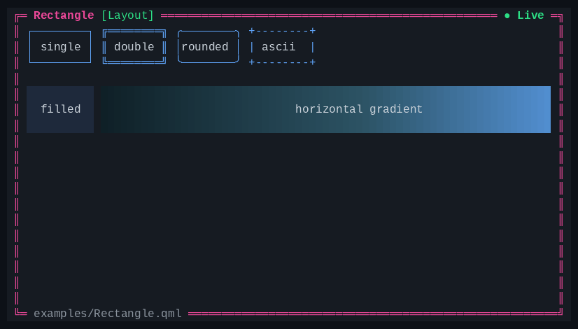

# Rectangle QML type

Renders a filled rectangular area on the character grid with optional borders and gradients. [More...](#detailed-description)

| | |
| :--- | :--- |
| **Import Statement** | `import QmlTui` |
| **Since** | QmlTui 0.4 |
| **Inherits** | [Item](item.md) |

## Properties

| Property | Type | Default | Description |
| :--- | :--- | :--- | :--- |
| `color` | `rgba` | `"transparent"` | Holds the background fill color of the rectangle. |
| `border` | `Border` |  | Read-only. Holds the border configuration ([Border](border.md)), including style, color, and individual edge visibility. |
| `gradient` | `Gradient` | `null` | Holds an optional [Gradient](gradient.md) applied across the rectangle background. |

## Detailed Description

Rectangle is the fundamental visual container in QmlTui, filling a rectangular
region of character cells with an optional background `color`, an optional
[Gradient](gradient.md), and a configurable [Border](border.md).

When `border.style` is anything other than `Border.None`, the perimeter cells are drawn
with box-drawing glyphs (`single`, `double`, `rounded`, `bold`, etc.). The presence
of a border automatically introduces 1 character cell of internal padding along each
bordered edge, ensuring child items anchored within `anchors.fill: parent` or
`anchors.centerIn: parent` do not overlap the border perimeter.

Background color defaults to `"transparent"`, which lets content beneath show through.
Set `color: "default"` to paint using the terminal's native background color, or specify
any hex or named color.

### Example

```qml
import QtQml
import QmlTui

Terminal {
    Keys.onPressed: event => {
        if (event.key === Qt.Key_Q || event.key === Qt.Key_Escape) {
            Qt.quit()
            event.accepted = true
        }
    }

    Rectangle {
        anchors.centerIn: parent
        width: 30
        height: 7
        color: "#1e293b"
        border.style: Border.Double
        border.color: "cyan"

        Text {
            anchors.centerIn: parent
            text: "Rectangle with border"
        }
    }
}
```

### Interactive Demo & Recording



- **Live Playground**: [▶ Open `Rectangle.qml` in the WebAssembly Playground](../playground.md?example=Rectangle.qml)
- **Standalone CLI**: `./build/examples/gallery/qmltui_gallery --example Rectangle`
- **Gallery Source**: [`examples/gallery/examples/Rectangle.qml`](../../examples/gallery/examples/Rectangle.qml)
