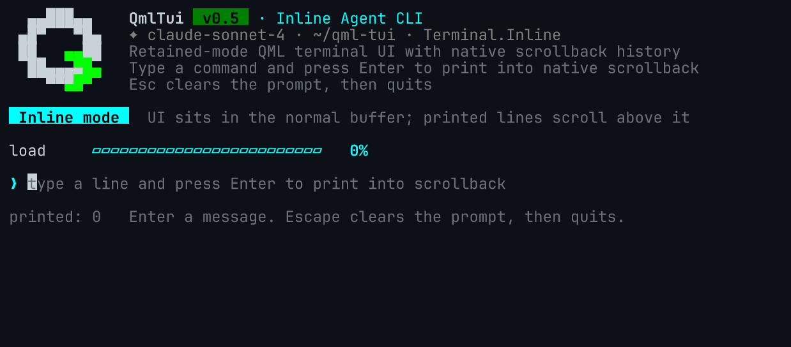

# Scrollback QML type

Manages committing rendered output lines into the terminal's native scrollback buffer. [More...](#detailed-description)

| | |
| :--- | :--- |
| **Import Statement** | `import QmlTui` |
| **Since** | QmlTui 0.4 |
| **Inherits** | none |

## Properties

| Property | Type | Default | Description |
| :--- | :--- | :--- | :--- |
| `model` | `var` |  | Holds the data model driving scrollback entries. |
| `delegate` | `Component` |  | Holds the visual component template instantiated for each model row. This is the default property. |
| `spacing` | `int` | `0` | Holds the number of blank separator rows inserted between successive entries. |
| `separator` | `Component` |  | Holds an optional component rendered as a horizontal separator line between entries. |
| `reuseItems` | `bool` | `true` | Whether delegate instances are pooled and reused across sequential entries. |

## Signals

| Signal | Description |
| :--- | :--- |
| `outputRejected(string reason)` | Emitted when an output batch exceeds queue capacity or is refused. |

## Methods

| Method | Description |
| :--- | :--- |
| `void append(var data)` | Renders the delegate using the provided data object and commits it to scrollback. |
| `void append(Item item)` | Renders and commits a snapshot of the given Item into scrollback. |
| `bool print(string text)` | Appends plain text directly into the terminal scrollback buffer. Returns `true` on success. |
| `void clear()` | Resets the internal delegate cache and consumed position. |

## Detailed Description

Scrollback is a non-visual element used in `Terminal.Inline` mode to emit
rendered content directly into the terminal emulator's native scrollback buffer.
This enables CLI tools and interactive REPLs to log previous outputs that
remain accessible in the user's terminal history above the active inline interactive UI.

Accepted scrollback belongs to the terminal session with a 1 MiB UTF-8 queue.
In full-screen mode, scrollback output is queued until inline mode resumes.

### Example

```qml
import QtQml
import QmlTui

Terminal {
    id: root
    mode: Terminal.Inline

    Keys.onPressed: event => {
        if (event.key === Qt.Key_Q || event.key === Qt.Key_Escape) {
            Qt.quit()
            event.accepted = true
        }
    }

    Scrollback {
        id: history
        delegate: Text {
            required property string modelData
            text: "> " + modelData
        }
    }

    Text {
        text: "Interactive Prompt (Press Q to quit)"
    }
}
```

### Interactive Demo & Recording



- **Live Playground**: [▶ Open `InlineMode.qml` in the WebAssembly Playground](../playground.md?example=InlineMode.qml)
- **Standalone CLI**: `./build/examples/gallery/qmltui_gallery --example InlineMode`
- **Gallery Source**: [`examples/gallery/examples/InlineMode.qml`](../../examples/gallery/examples/InlineMode.qml)
