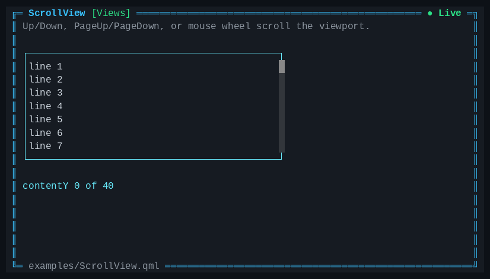

# ScrollView QML type

Container providing vertical scrolling and scrollbar display for overflowing content. [More...](#detailed-description)

| | |
| :--- | :--- |
| **Import Statement** | `import QmlTui` |
| **Since** | QmlTui 0.4 |
| **Inherits** | [Item](item.md) |

## Properties

| Property | Type | Default | Description |
| :--- | :--- | :--- | :--- |
| `contentWidth` | `int` | `0` | Holds the explicit total width in columns of the scrollable content; when `0` or negative, the bounding right edge of visible child items is used. |
| `contentHeight` | `int` | `0` | Holds the explicit total height in rows of the scrollable content; when `0` or negative, the bounding bottom edge of visible child items is used. |
| `contentX` | `int` | `0` | Holds the horizontal scroll offset in columns, clamped to the overflowing content width. |
| `contentY` | `int` | `0` | Holds the vertical scroll offset in rows, clamped to the overflowing content height. |
| `scrollBarVisible` | `bool` | `true` | Whether the vertical scrollbar track and thumb are drawn. |

## Detailed Description

ScrollView provides a clipped viewport with a vertical scrollbar for content
that exceeds the visible bounds. Its inherited [Item](item.md) properties default to
`focusPolicy: Qt.StrongFocus` and `clip: true`. Built-in keyboard navigation
(`Up`, `Down`, `PageUp`, `PageDown`, `Home`, `End`), mouse wheel scrolling, and
the overlay scrollbar remain vertical, while `contentX` (paired with
`contentWidth`) and `ScrollView::ensureChildVisible()` also support horizontal
panning within the clipped viewport.

When `scrollBarVisible` is `true`, an overlay scrollbar is rendered along the
right edge of the viewport. Child items are clipped to the viewport boundaries.
ListView and GridView inherit from ScrollView, reusing its scrolling and scrollbar
machinery.

### Example

<<< ../../examples/gallery/examples/ScrollView.qml{qml}

### Gallery Example

See [`examples/gallery/examples/ScrollView.qml`](../../examples/gallery/examples/ScrollView.qml) (`./build/examples/gallery/qmltui_gallery --example ScrollView`).
