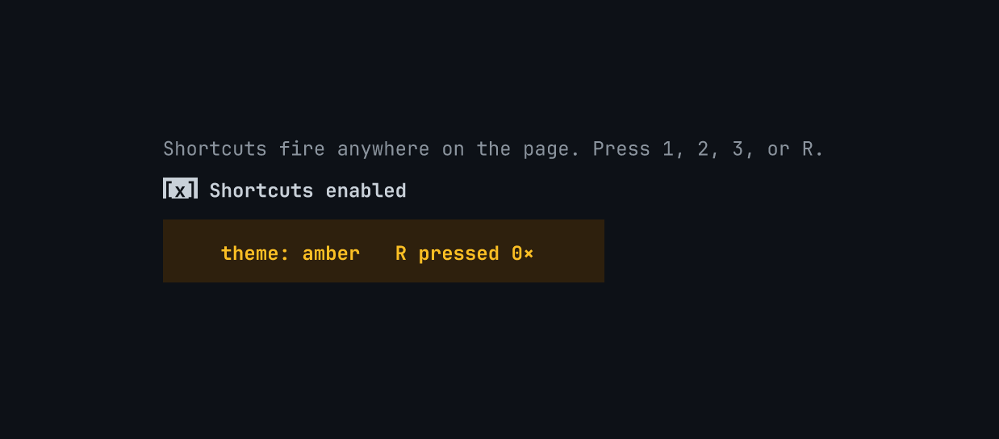

# Shortcut QML type

Defines application-wide keyboard shortcuts that trigger actions. [More...](#detailed-description)

| | |
| :--- | :--- |
| **Import Statement** | `import QmlTui` |
| **Since** | QmlTui 0.4 |
| **Inherits** | none |

## Properties

| Property | Type | Default | Description |
| :--- | :--- | :--- | :--- |
| `sequence` | `var` | `0` | Holds a portable key-chord string (such as `"Ctrl+S"`, `"Ctrl+Shift+P"`, `"Alt+Return"`, `"F5"`) or an integer Qt key/modifier bitmask (`Qt.ControlModifier \| Qt.Key_S`). |
| `enabled` | `bool` | `true` | Holds whether the shortcut is currently active and listens for key presses. |

## Signals

| Signal | Description |
| :--- | :--- |
| `activated()` | Emitted when the shortcut key combination is pressed. |

## Detailed Description

Shortcut provides a convenient way to register global keyboard shortcuts that
trigger actions regardless of which item currently possesses keyboard focus.

The `sequence` property accepts either a key-chord string (for example `"Ctrl+Q"`,
`"Ctrl+Shift+S"`, `"Alt+Return"`, `"Escape"`, `"Backtab"`, or `"F1"` through `"F12"`)
or a Qt key bitmask (`Qt.Key_F1`, `Qt.Key_Escape`, or `Qt.ControlModifier | Qt.Key_S`).
Only single-stroke chords are supported; multi-chord sequences (such as `"Ctrl+X, Ctrl+S"`),
`"Meta"`, or malformed strings emit a QML warning and leave the shortcut inactive.
When the matching key is pressed and `enabled` is `true`, `activated()` is emitted
and the key event is consumed before reaching focused items.

### Example

<<< ../../examples/gallery/examples/Shortcut.qml{qml}

### Gallery Example

See [`examples/gallery/examples/Shortcut.qml`](../../examples/gallery/examples/Shortcut.qml) (`./build/examples/gallery/qmltui_gallery --example Shortcut`).
