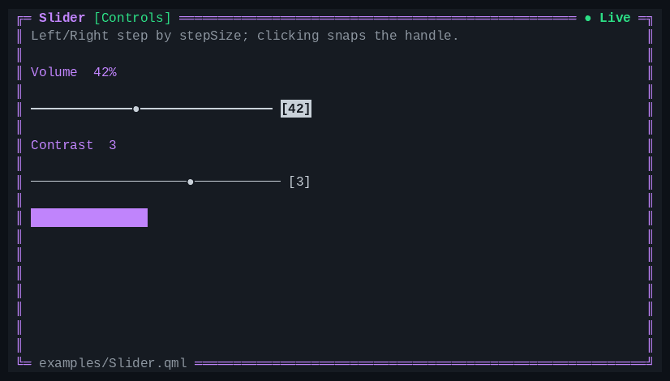

# Slider QML type

A one-row horizontal slider that selects a numeric value with arrow keys (`Left`/`Right`), `Home`/`End`, mouse click or drag, or the mouse wheel. [More...](#detailed-description)

| | |
| :--- | :--- |
| **Import Statement** | `import QmlTui.Controls` |
| **Since** | QmlTui 0.4 |
| **Inherits** | [Rectangle](rectangle.md) |

## Properties

| Property | Type | Default | Description |
| :--- | :--- | :--- | :--- |
| `value` | `real` | `0.0` | Holds the current value; user interaction keeps it between `from` and `to`, but a value assigned from code is not clamped. |
| `from` | `real` | `0.0` | Holds the value at the left end of the track. |
| `to` | `real` | `100.0` | Holds the value at the right end of the track. |
| `stepSize` | `real` | `1.0` | Holds the amount added to or subtracted from `value` by the Right and Left keys, and the grid a mouse click snaps to. |
| `textColor` | `color` | `"default"` | Holds the terminal colour of the track, handle and value readout, where `"default"` is the terminal's own foreground colour. |
| `showValue` | `bool` | `true` | Holds whether the rounded value is drawn as `[N]` at the right edge, taking cells away from the track. |
| `trackWidth` | `int` |  | Read-only. Holds the number of cells available to the track: `width` minus the readout width and one separating cell when `showValue` is true, never negative. |

## Detailed Description

Slider is a [Rectangle](rectangle.md) one row high whose track is a string of
`─` cells with a single `●` handle, drawn from the item's left edge. The
handle cell is `round((value - from) / (to - from) * (trackWidth - 1))`, so
the leftmost cell is `from` and the rightmost is `to`. When `showValue` is
true a [Text](text.md) readout `[N]`, with `N` the value rounded to the
nearest integer, is anchored to the right edge and the track is shortened by
its width plus one cell. The implicit size is 25 by 1 cells; set `width` to
choose the resolution, because `trackWidth` derives from `width`, and a
`width` too small for the readout produces an empty track.

While the slider has active focus, Left subtracts `stepSize`, Right adds
it, and Home and End jump to `from` and `to`, clamping to `from` and `to`, and all four keys are accepted. A mouse click or drag
gives the slider focus and moves `value` along the track: `x` is mapped
over the track onto the range, snapped to the nearest multiple of `stepSize`
from `from`, and clamped to `from` and `to`, so clicking or dragging onto the readout beyond
the track selects `to`. Scrolling the mouse wheel also steps `value` by `stepSize`. A disabled slider
ignores keys, clicks, drags, and wheel events alike, and its `focusPolicy` is `Qt.StrongFocus` only while `enabled`.
Focus is visible in the drawing: the track is a heavy line (`━`) with a bold
handle while the slider has active focus and a light line (`─`) otherwise,
and the readout is drawn bold in reverse video while focused, so even a
slider too narrow to show a track reveals where focus is.

### Example

<<< ../../examples/gallery/examples/Slider.qml{qml}

### Gallery Example

See [`examples/gallery/examples/Slider.qml`](../../examples/gallery/examples/Slider.qml) (`./build/examples/gallery/qmltui_gallery --example Slider`).
