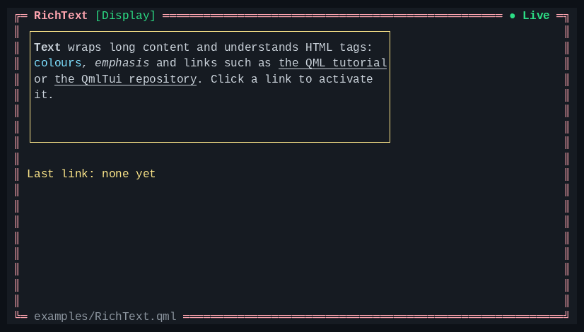

# span Value type

A literal text run with optional style overrides. [More...](#detailed-description)

| | |
| :--- | :--- |
| **Import Statement** | `import QmlTui` |
| **Since** | QmlTui 0.4 |
| **Inherits** | none |
| **Instantiation** | Object literal or `QmlTui.span()` |

## Properties

| Property | Type | Default | Description |
| :--- | :--- | :--- | :--- |
| `text` | `string` |  | Holds the plain text content of this span. |
| `color` | `rgba` |  | Holds the foreground text color override for this span. |
| `backgroundColor` | `rgba` |  | Holds the background cell color override for this span. |
| `bold` | `bool` |  | Whether this span applies bold text formatting. |
| `dim` | `bool` |  | Whether this span applies dim / faint text formatting. |
| `italic` | `bool` |  | Whether this span applies italic text formatting. |
| `underline` | `bool` |  | Whether this span applies underline text formatting. |
| `reversed` | `bool` |  | Whether this span swaps foreground and background colors. |

## Detailed Description

Use spans through [Text.spans](text.md). Create them with JavaScript object
literals or the [QmlTui.span()](qmltui.md) factory. Both accept color strings and
QmlTui `rgba` values. Attribute omission is distinct from explicit `false`.

In C++, `hasBold()` (and the corresponding methods for other attributes)
reports whether an override exists. A boolean getter alone does not report
presence. `resetBold()`, `resetDim()`, `resetItalic()`, `resetUnderline()`, and
`resetReversed()` restore inheritance; color reset methods restore unset colors.
The QML properties support reset by assigning `undefined`.

Equality includes override presence, so an unset attribute differs from an
explicitly disabled attribute. Copies are ordinary values with no QObject
identity. See Text for multiline, grapheme-boundary, and gradient semantics.

### Example

```qml
import QtQml
import QmlTui

Terminal {
    Keys.onPressed: event => {
        if (event.key === Qt.Key_Q || event.key === Qt.Key_Escape) {
            Qt.quit()
            event.accepted = true
        }
    }

    Text {
        anchors.centerIn: parent
        spans: [
            QmlTui.span("Normal ", {}),
            QmlTui.span("Bold ", { "bold": true, "color": "cyan" }),
            QmlTui.span("Underlined", { "underline": true, "color": "yellow" })
        ]
    }
}
```

### Gallery Example



See [`examples/gallery/examples/RichText.qml`](../../examples/gallery/examples/RichText.qml) (`./build/examples/gallery/qmltui_gallery --example RichText`, or open in the [WebAssembly Playground](../playground.md?example=RichText.qml)).
