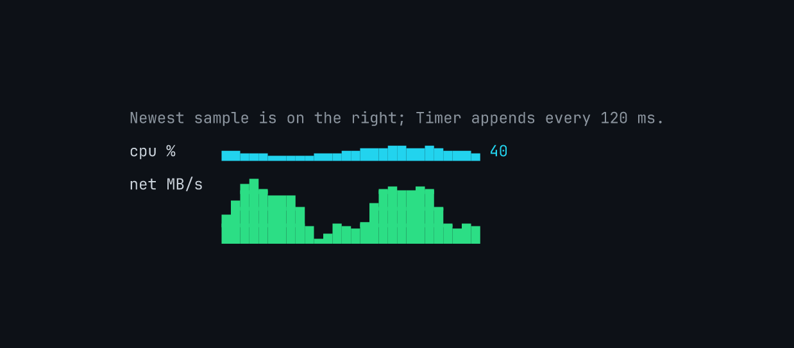

# Sparkline QML type

A compact chart that draws a series of numbers as one block glyph per column, scaled to the item's height. [More...](#detailed-description)

| | |
| :--- | :--- |
| **Import Statement** | `import QmlTui.Controls` |
| **Since** | QmlTui 0.4 |
| **Inherits** | [Item](item.md) |

## Properties

| Property | Type | Default | Description |
| :--- | :--- | :--- | :--- |
| `values` | `var` |  | Holds the series as a JavaScript array or list of numbers; the newest value is last and is drawn in the rightmost column. |
| `from` | `real` | `0.0` | Holds the value drawn at the bottom of the chart when a fixed range is set with `to`. |
| `to` | `real` | `0.0` | Holds the value drawn at the top of the chart; `0.0` means auto-scale to the minimum and maximum of `values`. |
| `filled` | `bool` | `false` | Whether the cells below each column's top glyph are drawn as solid `█` blocks in multi-row charts instead of being left blank. |
| `color` | `color` | `"default"` | Holds the foreground colour of the glyphs, where `"default"` is the terminal's own foreground. |
| `backgroundColor` | `color` | `"transparent"` | Holds the background colour written to every cell of the chart. |

## Detailed Description

Sparkline paints directly into the terminal grid, with an `implicitWidth` of
20 cells and an `implicitHeight` of 1 row. Each column is one value. When the
series has at least `width` entries the last `width` values are shown, so a
growing history scrolls left. When it has fewer, the values are right-aligned
and the unused columns on the left are left blank. Nothing is painted
while `values` is empty.

The range is `from`..`to` when `to` is non-zero. When `to` is `0.0` the range
is the minimum and maximum of the series, widened to one unit above the
minimum when all values are equal; `from` is ignored in that case. Every value
is clamped into the range and mapped onto `height * 8` sub-cell levels, using
the eight Unicode lower-block glyphs `▁▂▃▄▅▆▇█` (U+2581 to U+2588). A one-row
chart draws that glyph directly, so the minimum value is `▁` rather than a
blank cell. A taller chart places the glyph in the row the level falls in
(rows count from the bottom), leaves the rows above blank, and draws the rows
below either blank, giving a line, or as `█` when `filled` is true, giving an
area. `color` and `backgroundColor` are written to every cell of the item,
including blank ones.

Sparkline has no border; wrap it in a [Rectangle](rectangle.md) or
[Panel](panel.md) inset by one cell when one is needed.

### Example

<<< ../../examples/gallery/examples/Sparkline.qml{qml}

### Gallery Example

See [`examples/gallery/examples/Sparkline.qml`](../../examples/gallery/examples/Sparkline.qml) (`./build/examples/gallery/qmltui_gallery --example Sparkline`, or open in the [WebAssembly Playground](../playground.md?example=Sparkline.qml)).
