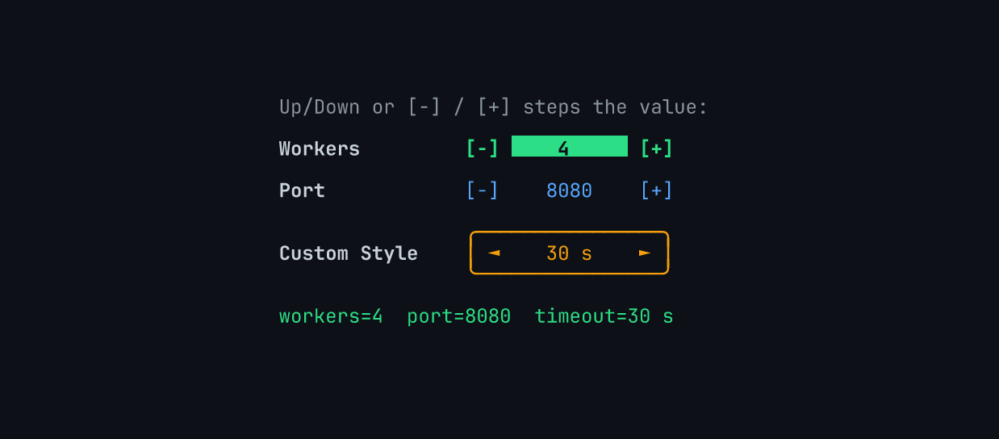

# SpinBox QML type

Interactive integer stepper over `[from, to]` in increments of `stepSize`. [More...](#detailed-description)

| | |
| :--- | :--- |
| **Import Statement** | `import QmlTui.Controls` |
| **Since** | QmlTui 0.4 |
| **Inherits** | [Rectangle](rectangle.md) |

## Properties

| Property | Type | Default | Description |
| :--- | :--- | :--- | :--- |
| `value` | `int` | `0` | Holds the current integer value. |
| `from` | `int` | `0` | Holds the minimum value of the range. |
| `to` | `int` | `99` | Holds the maximum value of the range. |
| `stepSize` | `int` | `1` | Holds the increment added or subtracted by `increase()` and `decrease()`. |
| `wrap` | `bool` | `false` | Holds whether stepping past `to` wraps to `from` and stepping below `from` wraps to `to`. |
| `prefix` | `string` | `""` | Holds an optional string prepended to `value` in `displayText`. |
| `suffix` | `string` | `""` | Holds an optional string appended to `value` in `displayText`. |
| `displayText` | `string` | | Read-only. Holds `prefix + String(value) + suffix`. |
| `background` | `Item` | `null` | Holds an optional custom background item filling the control at `z: -1`. |
| `downIndicator` | `Item` | `Text` | Holds the leading decrement indicator item (defaults to `[-]`). Replace to restyle. |
| `contentItem` | `Item` | `Text` | Holds the centred value display item. Replace to restyle. |
| `upIndicator` | `Item` | `Text` | Holds the trailing increment indicator item (defaults to `[+]`). Replace to restyle. |
| `textColor` | `color` | `"default"` | Holds the text colour of the buttons and value readout. |

## Signals

| Signal | Description |
| :--- | :--- |
| `valueModified()` | Emitted when `value` changes due to user interaction (keyboard, mouse click, or wheel). |

## Methods

| Method | Description |
| :--- | :--- |
| `void increase()` | Increments `value` by `stepSize` (clamped to `to`, or wrapped to `from` when `wrap` is true). |
| `void decrease()` | Decrements `value` by `stepSize` (clamped to `from`, or wrapped to `to` when `wrap` is true). |

## Detailed Description

SpinBox is a one-row [Rectangle](rectangle.md) displaying `[-]  displayText  [+]`.
When focused, the centre value readout is drawn bold in reverse video, and
Up/Right/`+`/`=` call `increase()`, Down/Left/`-` call `decrease()`, PageUp/PageDown
step by `10 * stepSize`, and Home/End jump to `from`/`to`. Clicking the left
half of the control calls `decrease()`, clicking the right half calls
`increase()`, and scrolling the mouse wheel steps the value.

### Example

<<< ../../examples/gallery/examples/SpinBox.qml{qml}

### Gallery Example

See [`examples/gallery/examples/SpinBox.qml`](../../examples/gallery/examples/SpinBox.qml) (`./build/examples/gallery/qmltui_gallery --example SpinBox`).
